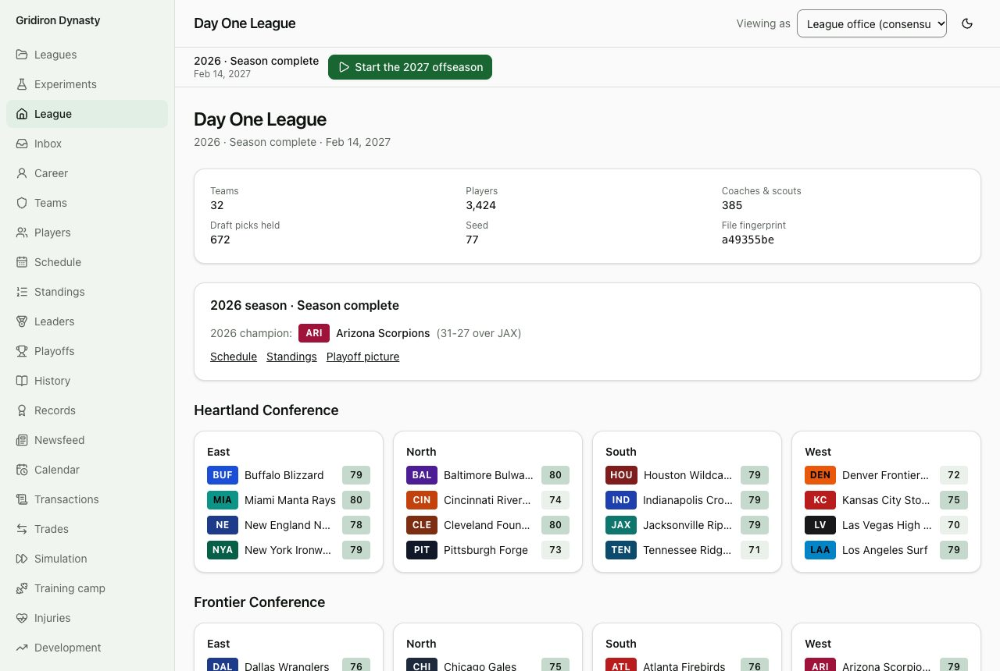
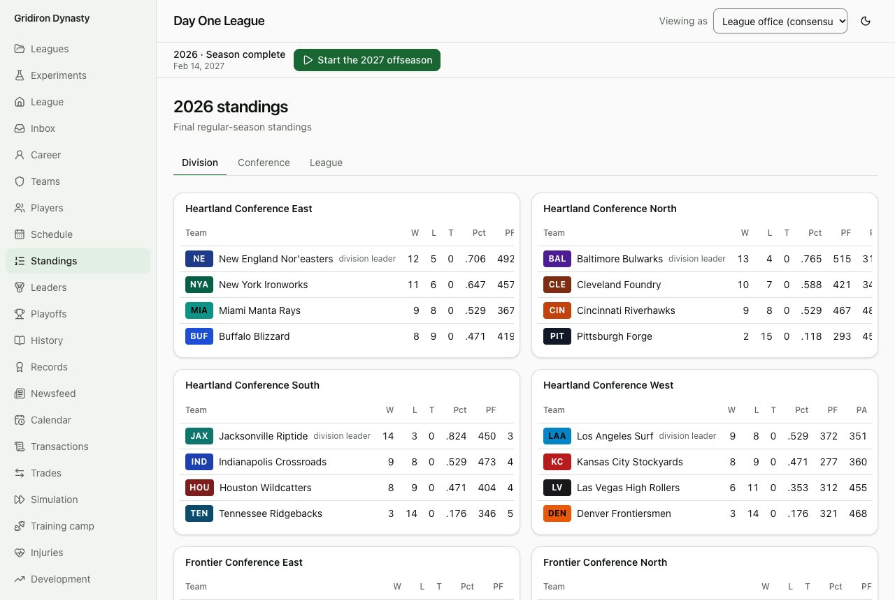
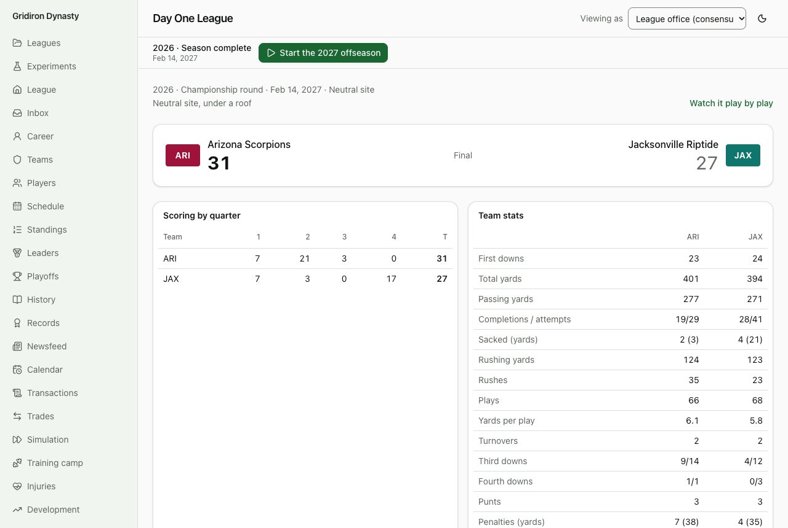
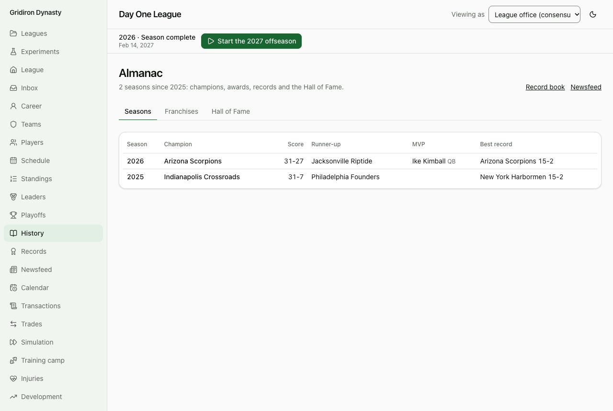
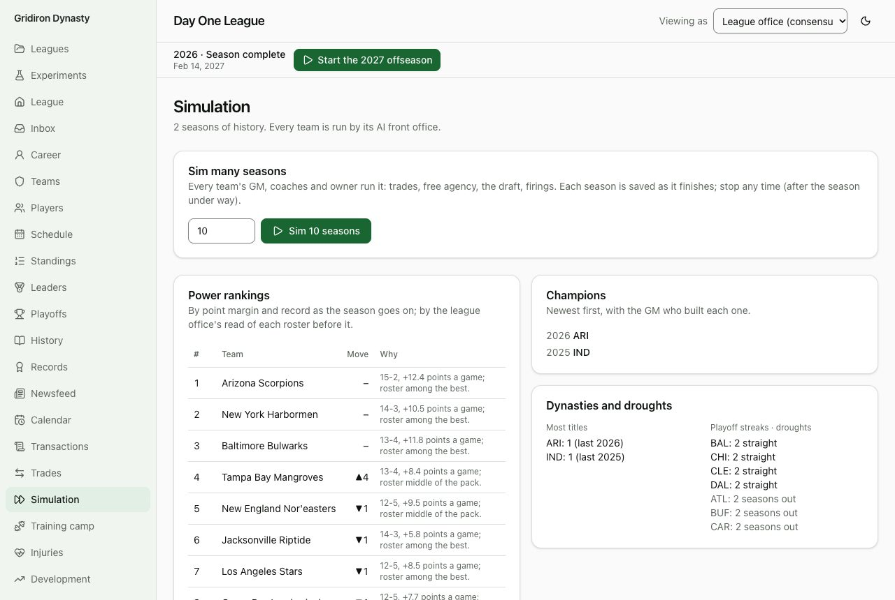
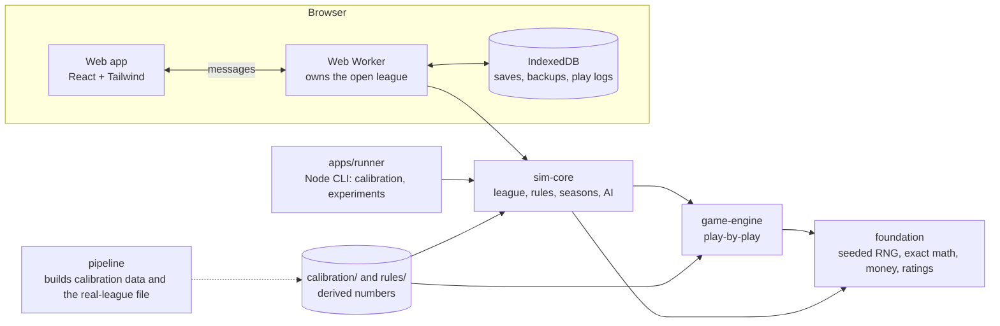

# Gridiron Dynasty: GM Simulator

A pro football league simulator and general-manager game that runs in your browser. Every game is played snap by snap by a play-by-play engine calibrated against real pro football statistics. Take over one franchise and build it through the salary cap, free agency, trades and the draft, or hand all 32 teams to computer front offices and watch decades of league history unfold.

It was built to mirror the real league down to the fine print (the cap, the contracts, the calendar, the roster rules, the tie-breakers) and to be fully fictional on the surface: every team, player and coach name is invented.



## Two ways to play

- **GM Mode.** Pick a team and run it. You don't call plays: you hire the coaches whose philosophies decide how your team plays, then build the roster through contracts, the cap, free agency, trades and the draft. An owner is watching your results and your spending, and can fire you. A staff handles whatever you delegate.
- **Simulation Mode.** All 32 teams are run by AI front offices, coaches and owners. Fast-forward a week, a season or a century, and watch dynasties, droughts, firings, trades and Hall of Fame classes happen.

Both modes start from a **fictional league** generated from a seed. The author also built a _real league_ start (the real 2026 offseason, every name made fictional); that file depends on data that can't be published, so it is not part of this repository (see [What is and isn't published](#what-is-and-isnt-published)).

## What's in it

- **A snap-by-snap game engine.** Formations, matchups, play calls, fatigue, injuries, weather, special teams, challenges and clock management. Season totals land inside the real ranges (the calibration scorecard checks them). Every snap carries a win probability and an expected-points figure, and fourth-down decisions compare them.
- **The real rulebook as data.** Cap, tags, tenders, void years, restructures, the top-51 rule, June 1 releases, practice squads, injured reserve, waivers, the draft order, tie-breakers, compensatory picks. Every rule lives in [`rules/2026.json`](rules/2026.json) with a source note, and every cap rule has a unit test with a worked example.
- **People with reasons.** Coaches with philosophies and a carousel, scouts and noisy draft boards, agents and moods, general managers with habits and owners with patience. Every AI decision records why it happened, and the screen shows it.
- **Truth and perception.** You never see a player's true ratings: every screen reads through what your staff believes, with an error that shrinks as you scout.
- **A league that keeps its history.** Awards, All-Star Game selections, records for the league and for each club, a Hall of Fame, retired numbers, coaching trees and a newsfeed.
- **Experiments.** A parallel headless runner replays thousands of leagues to answer questions, with confidence intervals (see [Findings](#findings)).
- **Deterministic.** The same seed, data and decisions give the same league history, in any browser. Simulation code uses only exact arithmetic and named random streams.

|                                                                      |                                                                           |
| -------------------------------------------------------------------- | ------------------------------------------------------------------------- |
|       |  |
|  |  |

## How to play

The easiest way is the hosted build, if the author has turned it on (see the repository's About section for the link). To run it on your own computer you need [Node.js](https://nodejs.org) 22 or newer:

```bash
npm install
npm run dev
```

Open the address it prints. Choose **New league**, pick _Fictional league_, then _GM Mode_ or _Simulation Mode_. Leagues are saved in your browser (IndexedDB); you can export a league to a file and import it again, and the app keeps a backup the first time each season is saved. Nothing is sent anywhere: there is no server.

Good first steps: in Simulation Mode, press **Sim to the 2026 season opener** and then **Sim full season**, and open the Standings, History and Simulation pages. In GM Mode, the Inbox tells you what needs a decision and when it is due, and the Glossary explains the cap terms.

## Run the checks

```bash
npm test               # about 600 tests, including a worked example for every cap rule
npm run typecheck
npm run build          # a production build of the web app
npm run sim -- --calibrate        # the scorecard: simulated league and player stats vs. real ranges
npm run sim -- --seasons 100 --seed 7      # simulate 100 seasons headless, validating every schedule
npm run sim -- --experiment experiments/coach-vs-quarterback.json   # rerun a published experiment
```

[`CLAUDE.md`](CLAUDE.md) lists every command and explains how each part of the code works.

## How it is built



- `packages/foundation`, `packages/game-engine` and `packages/sim-core` use no browser or Node APIs, so the same code runs in the page's worker, in a test and in the command-line runner.
- A league is plain JSON validated by one schema, saved byte-for-byte the same way every time, so a fingerprint on screen tells you whether two copies are identical.
- The page talks to the simulation only through typed worker messages ([`apps/web/src/sim/protocol.ts`](apps/web/src/sim/protocol.ts)).
- Pages load when first visited (the first download is about 300 KB), and a 50-season save is about 34 MB raw (see [Performance](docs/performance.md)).

## Findings

Questions answered by running the league many times. Each finding names its experiment file and seeds, so you can rerun it, and each says what the model assumes.

| Question                                                                                   | Answer                                                                            |
| ------------------------------------------------------------------------------------------ | --------------------------------------------------------------------------------- |
| [How random is a single-elimination playoff?](docs/findings/01-playoff-randomness.md)      | The strongest team wins the title 30% of the time (a coin flip would give it 9%). |
| [A great head coach vs. a great quarterback](docs/findings/02-coach-vs-quarterback.md)     | The best quarterback is worth about three times the best coaching staff.          |
| [Aggressive vs. conservative fourth-down coaches](docs/findings/03-fourth-down-coaches.md) | Going for it more is worth about a fifth of a win a season.                       |
| [Cap-aggressive vs. conservative GMs](docs/findings/04-cap-aggressive-gms.md)              | A short early edge and a slightly worse twenty years; no harder collapse.         |
| [Draft and develop vs. free-agency spending](docs/findings/05-draft-vs-free-agency.md)     | The draft won over twenty years, with about 44% more titles.                      |

These are results of this simulation, not claims about the real league.

## What is and isn't published

The code is MIT licensed ([`LICENSE`](LICENSE)). The repository holds the code, the rules file and `calibration/`, which contains only numbers derived from public data, never the data itself. Credits and licenses for every source and dependency are in [`NOTICE.md`](NOTICE.md), [`docs/data-sources.md`](docs/data-sources.md) and the app's About page.

Not published: the real-league starting file, and the inputs it is built from (a ratings file, contract data, archived pages). `npm run pipeline -- league` builds it from those inputs if you supply them; [`docs/rebuild-guide.md`](docs/rebuild-guide.md) explains how. Without them, everything else works: fictional leagues, both modes, the experiments and the scorecard.

Gridiron Dynasty is not affiliated with or endorsed by the NFL, the NFLPA, EA Sports or any team or player. No real team, player or coach names, logos or league trademarks are used; real cities are. A test in CI hashes the real names and nicknames and fails if one appears anywhere in the repository. This is a good-faith effort, not legal advice.

## How it was built

The project was planned, specified and directed by its author, who does not write code. The code was written with [Claude Code](https://claude.com/claude-code) (Anthropic's coding agent), one roadmap phase at a time: the agent proposed a plan, the author approved or changed it, and each phase ended with checks that can be verified by using the game or reading its scorecards. The plan and the log of what happened are in [`docs/`](docs/):

- [Overview](docs/overview.md) and [Roadmap](docs/roadmap.md): the goals and the phases, each with "Done when" checks.
- [Devlog](docs/devlog/README.md): one entry per phase, with what was built, what surprised us and what broke.
- [Portfolio page](docs/portfolio.md): the project on one page.
- [Performance](docs/performance.md) and [Changelog](CHANGELOG.md).
