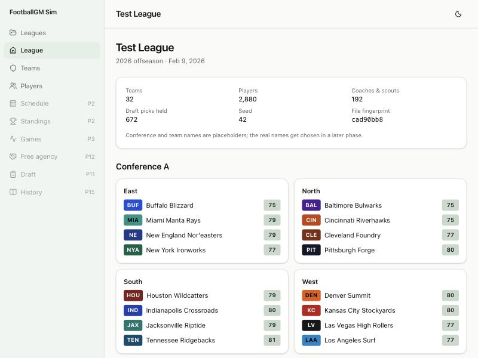

# Devlog 1: A league to browse

_Phase 1, October 2026_

Press **New league** and a whole fictional league appears: 32 teams, 2,880 players on 90-man offseason rosters, 192 coaches and scouts, and 672 draft picks. It builds and saves in about 0.2 seconds, survives a browser reload, and exports to a 430 KB file that imports back exactly.

## What was built

- **Rules as data.** `rules/2026.json` holds the league structure (two conferences of four divisions, real alignment), roster limits (90 / 53 / 48 actives / practice squad 16+1), and draft settings, each with a note on where the numbers came from. A broken rules file is rejected with a list of what's wrong.
- **The data model.** Teams, players, coaches, contract stubs, draft picks, transactions (each with a reason), pending decisions, and the random-number state, all plain data. The same definitions check every imported file.
- **Players.** 16 positions and 28 attributes on our own 0–100 scale. Each position's overall is a weighted mix of the attributes that matter for it, shifted so an average starter reads 75 at every position. Size, speed, and age follow position profiles (tackles average 315 lb, corners 193 lb and much faster). Each team has starters, backups, and camp bodies, and some teams are stronger than others.
- **Position flexibility.** About a third of players know a second position (guards who can play center, corners who can play safety); their overall there is reduced by how unfamiliar they are.
- **Hidden traits and personality** (potential, work ethic, injury proneness, ego, loyalty, what they value in a team…) are generated and saved, never shown. Later phases use them.
- **Truth vs. perception.** Every screen gets ratings through "what your staff believes". Today that is the exact truth (100% confident); scouting will make it fuzzy in Phase 11 without touching any screen. A guardrail test fails if the web app ever reads true ratings directly.
- **One engine, two modes.** Each team is run by the AI or by a person. Decisions go through one router: the AI answers on the spot with a reason; a person's decisions wait in a queue. Only a test decision exists so far.
- **Saving.** The league lives in the browser's database. Same seed gives a byte-identical league file, in Node and in the browser alike (seed 42 produced the same fingerprint in both).
- **Screens.** Leagues (create, open, export, import, delete), league home with the divisions, a team ranking, team pages (roster, staff, draft picks), a searchable list of every player, and player and coach pages.
- **Runner.** `npm run sim -- --new-league --seed 42` prints the spread of overalls and ages by position and the strongest and weakest teams.

## What surprised us / what broke

- The new schema check caught a real bug on its first run: heights like 64.5 inches slipped through because the generator rounded before limiting instead of after.
- Clicking the overall column first sorted worst-first, because overall was already a hidden second sort. The roster now starts grouped by position with the best players first, and a click on any column starts from the top.
- Team chips used each team's second color for text, which was unreadable on several teams; text is now black or white, whichever contrasts better.
- Three attribute cards side by side squeezed the rating bars to 6 pixels on a laptop-width window.

## Not done yet

- Names can still match a real person by coincidence; the real-name blocklist arrives with the Phase 6 data pipeline.
- Team names, conference names, and colleges are placeholders.

---

[← 0: Foundations](0000-foundations.md) · [Index](README.md) · [2: The league plays seasons →](0002-seasons.md)
