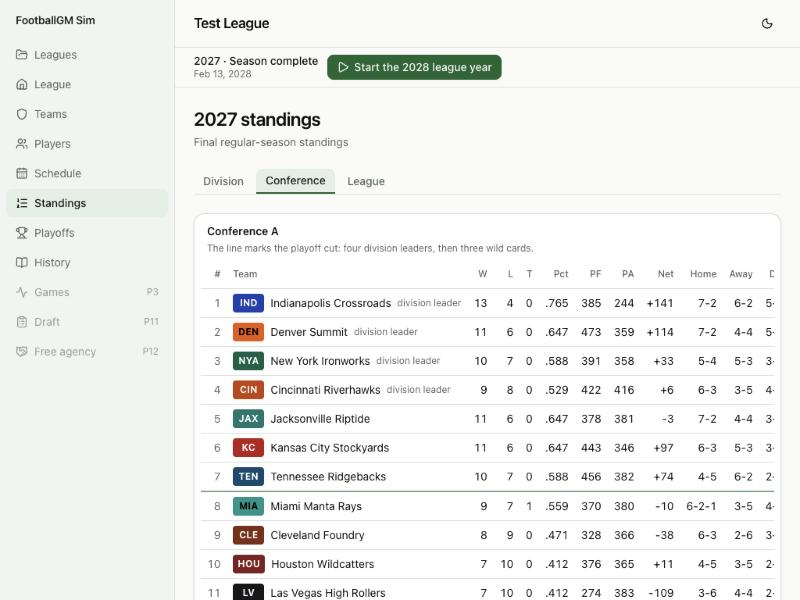

# Devlog 2: The league plays seasons

_Phase 2, October 2026_

Time moves now. A league plays real-format seasons: a 17-game schedule built from the NFL's formula, weekly results, standings with every official tiebreaker, the 14-team playoff, and a draft order. Then it rolls into the next league year and does it again. A hundred seasons take about 8 seconds.

## What was built

- **The calendar.** Offseason → preseason → Weeks 1–18 → wild card → divisional → conference → championship → next league year, on real dates. The 2025 season worked out this way ends on Feb 8, 2026, matching the real championship, and the 2026 season's championship lands on Feb 14, 2027, again matching the real date.
- **The schedule formula.** Division games home and away, a full same-conference division (3-year cycle), a full other-conference division (4-year cycle), two same-place games, and the 17th game against a same-place team from the other conference. The 2026 pairings match the real 2026 opponent lists. Weeks are laid out by a seeded search: one game a week, one bye in Weeks 5–14, at most six byes a week, all-division Week 18. It takes about 15 ms.
- **A validator** checks every one of those rules; 100 straight seasons pass.
- **Placeholder scores** until the play-by-play engine: touchdowns and field goals drawn around about 22 points a team, tilted by starter strength and home field. Over 100 seasons, about 22 points per team, home teams win 55%, and there's a tie most seasons, close to the real league.
- **Standings and every tiebreaker**, step by step from the official procedure: head-to-head, division, common games (minimum four for wild cards), conference, strength of victory and schedule, points rankings, net points, net touchdowns, coin toss; "only one club advances"; restart at step 1; best club per division for wild cards; head-to-head sweeps. The standings page lists how each tie was broken.
- **Playoffs** with seven seeds per conference, a bye for the top seed, reseeding, and a neutral-site championship. **Draft order** follows the official rules, including tied clubs rotating each round; teams' picks show their numbers.
- **History**: every champion, the runner-up, the score, and the best record.
- **Sim buttons**: start the season, sim a week, to the trade deadline, to the end of the regular season, the playoffs, a full season, the next league year. The league saves after every step.

## What surprised us / what broke

- The NFL publishes no worked tiebreaker examples, so the tests are hand-built: one small made-up season per step, designed so only that step can decide it.
- Coin tosses had to stop using the random-number stream. Otherwise just *looking* at the standings mid-season would consume random numbers and change the rest of the season. A coin toss is now a fixed hash of the league seed, season, and teams.
- The week search was first too slow (up to 2 seconds) and too random; cutting its random moves from 2% to 0.2% made it about 15 times faster.
- A new league now plays a 2025 season first, so the first real season has standings to build its schedule from.

## Not done yet

- Playoffs and drafts produce pick numbers, but no draft happens yet (Phase 11); unused picks expire each new league year.
- Rosters don't change between seasons except for experience; development and aging come in Phase 9.
- Rotation years other than 2026 are derived from the cycles; Phase 16 re-checks them against the real schedules.
- Leagues saved in Phase 1 can't be opened; create a new league.
