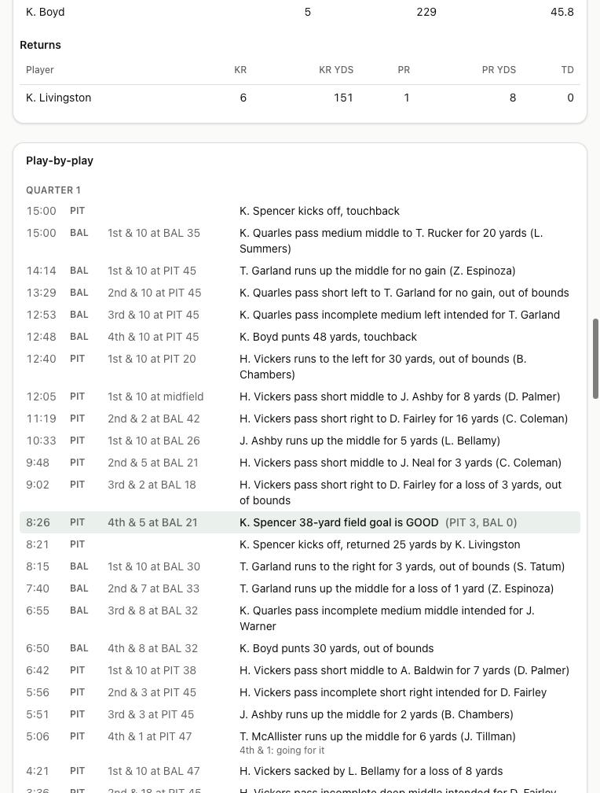

# Devlog 3: Real football

_Phase 3, October 2026_

Games are played snap by snap now. Every game has a kickoff, drives, downs and distance, a running and stopping clock, punts, field goals, two-point tries, timeouts, the two-minute warning, and overtime under the current rules (both teams get the ball). You can read every play, and every game has a box score. A full season of 272 games simulates in about a quarter of a second.

## What was built

- **Calibration data first.** A pipeline step downloads four seasons of real NFL play-by-play (nflverse, 2022–2025, CC-BY-4.0) and measures the league: points, plays, yards per play, completion %, sacks, interceptions, punts, kicking by distance, 3rd- and 4th-down rates, drives, home wins, ties, and how much teams differ. It also extracts the _shapes_ the engine draws from: how far runs go, completion and interception rates by throw depth, air yards and yards after catch, sack and scramble yardage, punt and kickoff results, field goal odds by distance, and how often teams pass by down and distance or go for it on 4th down.
- **The engine.** Each team's lineup becomes unit strengths (pass protection, pass rush, coverage, run blocking...). A play's outcome is drawn from the real shape, nudged by the matchup of units. Play calling uses real NFL tendencies, adjusted for the score and the clock: hurry-up when trailing late, kneel-downs, spikes, end-of-half field goals, the 2-point chart. Every play credits the players involved.
- **Rules from the rules file:** 15-minute quarters, timeouts, the two-minute warning, out-of-bounds clock rules, kickoff touchbacks to the 35, and overtime (10 minutes and can tie in the regular season; 15-minute periods until a winner in the playoffs).
- **Stats.** Box scores on every game; player season and career stats; team season totals and leaders.
- **Screens.** A game page (scoring by quarter, team stats, every player's line, the full play-by-play with the reasons behind 4th-down and 2-point calls); "Box score" links from the schedule; stats tables on player pages; a Stats tab on team pages.
- **Scorecard.** `npm run sim -- --calibrate` sims eight seasons in four leagues and compares 26 stats with the real ranges: all 26 land inside. A test in CI holds the core stats there.
- **A new `foundation` package** holds the shared basics (random numbers, math, ratings), so the engine and the league code don't depend on each other.

## What surprised us / what broke

- **The 200-yard play.** Early seasons had about fifteen times too many kick-return touchdowns. Nudging a random draw by "adding a bit and capping it" piled draws onto the extreme end of the distribution, which with a tail meant absurdly long plays. Nudging on the log-odds scale fixed it, and scoring dropped from about 27 points a team to 24 in one step.
- **Penalties matter even when absent.** Real drives are kept alive by about one penalty first down a game, so without penalties our drives ended a little too often. A slightly slower clock stands in until penalties arrive in Phase 4.
- **Different leagues, different eras.** A generated league's talent mix shifts its stats a little, like a real season does, so the scorecard averages four leagues.
- An old save opened fine in the tests but not in the browser: the upgrade added stats but forgot the new game rules. The test now mimics a real old save.
- Real gamebooks credit the defender who pushes a runner out of bounds; ours do too.

## Not done yet

- No individual matchups, formations, coverages, penalties, injuries, or depth chart: Phase 4. No weather or detailed special teams: Phase 5.
- Lineups are simply the best players by overall at each position.
- Playoff stats aren't added to season totals yet (they stay in the box scores).

---

[← 2: The league plays seasons](0002-seasons.md) · [Index](README.md) · [4a: Matchups →](0004a-matchup-engine.md)
