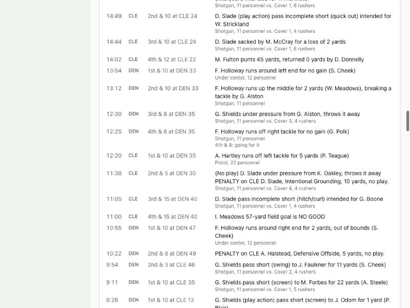

# Devlog 4a: Matchups

_Phase 4a, October 2026_

Games now come down to football concepts and individual players instead of unit against unit. Every snap has a personnel group and formation, a defensive package, a box count, a coverage shell and a number of pass rushers, all at real NFL rates for the situation. A pass rusher beats (or loses to) the man blocking him, a receiver gets open (or doesn't) against the man covering him, the quarterback reads the field, and the ball is caught, dropped, broken up or picked off. Penalties are in, with accept/decline decisions. The play-by-play shows all of it.

## What was built

- **More real data.** Two new pipeline outputs. `calibration/matchups.json` comes from nflverse play-by-play plus _participation_ data (CC-BY-4.0): personnel and formations by situation, defensive packages, men in the box, coverage shells, number of rushers, pressure and its results, time to throw, routes, run gaps, every penalty type with yards and first downs, and an expected-points table. `calibration/charting.json` comes from FTN charting (CC-BY-SA-4.0): play-action, screens, RPOs and QB sneaks. It's kept in its own file so the share-alike license applies only there.
- **Who's on the field.** Lineups now dress a fullback, five receivers, three tight ends, three linebackers, four corners and three safeties, so every package can be fielded.
- **Runs.** The gap comes from real distributions. The blockers at that gap face the defenders there, the box count matters, and then it's the runner's elusiveness against the tackler, with broken tackles. Short-yardage QB sneaks.
- **Passes.** Pressure comes from each rusher against his blocker. Blitzes bring more pressure and leave coverage thinner, so they cause more sacks and also give up more big plays, as in the real data. Under pressure the QB may take a sack, scramble or throw it away. Otherwise he reads his receivers by how open each one is; better decision-makers find the open man more often. Accuracy, hands and coverage decide completions, drops, breakups and interceptions; yards after catch pit the receiver against the tackler. Play-action, screens and RPOs happen at real rates.
- **Penalties.** 21 types from the rules file: pre-snap, holding both ways, pass interference (a spot foul), illegal contact, roughing the passer, unnecessary roughness, face masks, intentional grounding (loss of down), and illegal blocks and holding on returns. Rates are real; less aware, less composed players commit more. The offended team takes the penalty or the play by expected points. Half-the-distance and automatic first downs apply. Personal fouls after a play are added on. The slower clock that stood in for penalties in Phase 3 is gone.
- **Play-by-play.** Each snap shows its formation and coverage ("Shotgun, 11 personnel vs. Cover 3, 5 rushers"), plus who pressured the QB, play-action/RPO, drops, breakups, broken tackles and penalties, with "no play" when one wipes out the snap. Box scores add penalties and yards.
- **Scorecard v2.** Seven new lines (penalties, penalty yards, pressure, blitz, 11-personnel and shotgun shares, man coverage). Injuries are listed as coming in 4b.
- **Tests.** An elite quarterback raises a weak team's scoring (+4.1 points a game, completion rate +9 points). A defense that blitzes two snaps in three gets 9% more sacks and gives up 11% more 20-yard completions. Better coverage cuts completion rate by about 4 points. The defense never declines an offensive foul on a play that made a first down, and the offense never declines a foul that would erase its own turnover. Accepted fouls move the ball exactly the penalty yards. Saves upgrade automatically to format 4.

## Scorecard

`npm run sim -- --calibrate --seed N` sims 8 seasons in 4 leagues per seed set. All 33 lines are inside the real 2022–2025 range on three independent sets:

| Stat                      | Real  | Real range  | Seed 42  | Seed 1000 | Seed 2000 |
| ------------------------- | ----- | ----------- | -------- | --------- | --------- |
| pointsPerTeamGame         | 22.39 | 21.01–23.77 | 23.25    | 23.04     | 22.95     |
| offensivePlaysPerTeamGame | 62.61 | 59.78–65.04 | 60.37    | 60.46     | 60.52     |
| yardsPerPlay              | 5.34  | 5.09–5.56   | 5.39     | 5.32      | 5.31      |
| passRate                  | 0.605 | 0.586–0.626 | 0.612    | 0.615     | 0.613     |
| completionPct             | 0.645 | 0.626–0.667 | 0.641    | 0.630     | 0.629     |
| yardsPerAttempt           | 7.04  | 6.84–7.29   | 7.09     | 7.00      | 6.97      |
| sackRate                  | 0.069 | 0.064–0.074 | 0.066    | 0.070     | 0.071     |
| interceptionRate          | 0.022 | 0.021–0.024 | 0.022    | 0.023     | 0.023     |
| fumblesLostPerTeamGame    | 0.511 | 0.420–0.593 | 0.449    | 0.455     | 0.459     |
| turnoversPerTeamGame      | 1.254 | 1.081–1.421 | 1.141    | 1.177     | 1.204     |
| yardsPerCarry             | 4.35  | 4.03–4.61   | 4.37     | 4.36      | 4.39      |
| puntsPerTeamGame          | 3.88  | 3.32–4.39   | 3.85     | 3.93      | 3.98      |
| fieldGoalPct              | 0.851 | 0.819–0.881 | 0.857    | 0.852     | 0.844     |
| extraPointPct             | 0.953 | 0.924–0.981 | 0.959    | 0.954     | 0.950     |
| thirdDownPct              | 0.393 | 0.377–0.407 | 0.400    | 0.394     | 0.392     |
| drivesPerTeamGame         | 10.97 | 10.30–11.61 | 11.30    | 11.40     | 11.47     |
| pointsPerDrive            | 2.04  | 1.84–2.26   | 2.06     | 2.02      | 2.00      |
| fourthDownGoRate          | 0.204 | 0.173–0.248 | 0.212    | 0.209     | 0.208     |
| twoPointTriesPerTeamGame  | 0.231 | 0.205–0.260 | 0.237    | 0.247     | 0.245     |
| homeWinPct                | 0.545 | 0.516–0.574 | 0.544    | 0.549     | 0.554     |
| tiesPerSeason             | 0.750 | 0.000–4.00  | 1.125    | 1.75      | 1.75      |
| teamPointsPerGameSpread   | 4.10  | 3.40–4.75   | 4.19     | 4.33      | 4.17      |
| fieldGoalPct 18-29        | 0.978 | 0.948–1.000 | 0.986    | 0.978     | 0.975     |
| fieldGoalPct 30-39        | 0.934 | 0.895–0.970 | 0.939    | 0.938     | 0.929     |
| fieldGoalPct 40-49        | 0.803 | 0.732–0.878 | 0.802    | 0.805     | 0.789     |
| fieldGoalPct 50-59        | 0.706 | 0.670–0.745 | 0.703    | 0.704     | 0.700     |
| penaltiesPerTeamGame      | 6.02  | 5.20–6.82   | 5.85     | 5.96      | 5.91      |
| penaltyYardsPerTeamGame   | 49.06 | 43.07–55.06 | 46.67    | 47.22     | 47.13     |
| injuriesPerTeamGame       | 1.66  | 1.468–1.87  | Phase 4b | Phase 4b  | Phase 4b  |
| pressureRate              | 0.300 | 0.282–0.321 | 0.310    | 0.309     | 0.304     |
| blitzRate                 | 0.263 | 0.241–0.280 | 0.264    | 0.262     | 0.265     |
| personnel11Share          | 0.619 | 0.555–0.674 | 0.625    | 0.626     | 0.626     |
| shotgunShare              | 0.639 | 0.576–0.725 | 0.637    | 0.640     | 0.637     |
| manCoverageShare          | 0.402 | 0.254–0.541 | 0.419    | 0.416     | 0.418     |

Penalties by type (accepted per team-game, one simulated season vs. real) are close for the big ones: false start 1.31 vs 1.16, offensive holding 1.06 vs 1.15, defensive pass interference 0.50 vs 0.50, defensive holding 0.32 vs 0.34, roughing the passer 0.19 vs 0.17. Two are low: unnecessary roughness (0.20 vs 0.31, since we only throw it on scrimmage plays for now) and illegal contact (0.09 vs 0.14).

## What surprised us / what broke

- **Drives were too short, and the cause was screens.** Sim drives averaged about 5 plays against 5.6 in real games. Teams converted each distance on 3rd down at real rates but faced 3rd-and-1 only half as often. The culprit: for short passes, the sim drew the catch spot and the run after the catch separately, so a screen caught behind the line often went nowhere (12% of completions lost yards vs. 5% in real games). The pipeline now measures yards after catch separately for catches behind the line, and drives came out right.
- **Penalties count on 3rd down.** The real data counts a defensive penalty that gives a first down as a converted 3rd down. Counting ours the same way raised the 3rd-down rate about two points.
- **Smart quarterbacks hold the sack rate down.** One set of test leagues happened to have starting QBs about 4 points more aware on average than the others, and its sack rate was a point lower. We centered the tuning on all 12 leagues instead of chasing one set.
- **Kicking doesn't follow one smooth curve.** Modern kickers make long kicks more often than the curve fitted in Phase 3 predicted, and 40-something-yard kicks less often. The engine now uses the real make rate at each distance.
- **Blitzes first came out backwards.** In the first version, blitz-heavy defenses gave up _fewer_ big plays, because the extra pressure outweighed the thinner coverage. Real 5-man rushes give up 20-yard completions about 19% more often than 4-man rushes; the sim now gives up about 13% more.
- The new fullback wasn't counted in box scores at first, which a box-score test caught (team rushing yards didn't match the players').

## Not done yet

- Phase 4b: depth chart, fatigue and rotations, in-game injuries, expanded and advanced stats (EPA), league leaders, player-level calibration, and release v0.1.
- Time to throw, play-action and drop rates are drawn straight from the real data, so they aren't scorecard lines (they'd match by construction).
- Special-teams penalties are limited to return holding and illegal blocks; no special-teams personal fouls yet.

---

[← 3: Real football](0003-game-engine.md) · [Index](README.md) · [4b: The people around it →](0004b-people.md)
