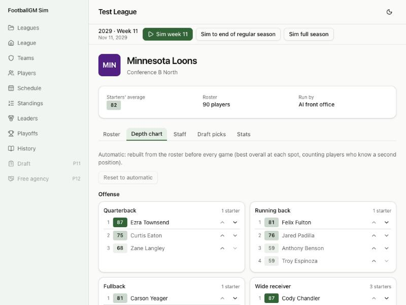

# Devlog 4b: The people around it

_Phase 4b, October 2026_

Games now have a cast. Every team has a depth chart, players tire and rotate, and players get hurt in games and miss time afterwards. There are new stats (snaps, air yards, yards after catch, pressures, passes defensed, missed tackles, drops), an advanced layer (expected points added and success rate), and a League Leaders page. The scorecard now checks players as well as teams: real leaderboard values at fixed ranks, the spread of passer ratings, and how playing time splits down the depth chart.

## What was built

- **More real data.** A new pipeline step, `npm run pipeline -- people`, reads three seasons of nflverse participation (who was on the field each snap) and four of play-by-play (CC-BY-4.0). It measures:
  - how snaps split by depth at each position (the top running back plays 65%, the second 29%);
  - in-game injuries per snap by position, and what happened next: 59% of injured players return to the same game; of those who don't, 30% miss no games and 26% miss nine or more;
  - real leaderboards (the passing leader averages 4,875 yards, the 10th-best passer 3,819);
  - EPA and success rate.

  Injuries were matched to players by team and jersey number. Names are only used in memory, never written out.

- **Depth charts.** Each team has one, built automatically: the best overall at each of 19 spots, counting players who know a second position. Nobody starts twice on one side of the ball. On the team page, **Depth chart** lets you move players up and down; the first change makes the chart custom, and **Reset to automatic** goes back. A custom chart keeps your order, drops players who left and adds new arrivals at the bottom.
- **Fatigue and rotation.** Before every snap the engine picks who's on the field. Each snap drains a player's energy (less for high-stamina players), and the sideline restores it. A tired player gives way to the next man and comes back once rested. The drain rates are tuned so snap shares match real ones. Running backs split about 65/32, defensive linemen rotate, and linemen and safeties almost never come off.
- **In-game injuries.** Each snap can hurt someone, at the real per-snap rate for his position, tilted by his hidden injury-proneness and durability. Some players come back later in the game; the rest are done for the day and miss a number of games drawn from the real distribution. The depth chart covers for them, and they show an "Out N games" tag on rosters, the depth chart and their player page. Everyone heals at the new league year (the full injury model is Phase 9).
- **Stats.** Snap counts, dropbacks, air yards, yards after catch, drops, pressures, passes defensed and missed tackles for every player. Game pages add EPA per play, success rate and dropbacks under pressure; team pages add offense and defense EPA, success rate and pressure rates.
- **EPA.** Every run and dropback gets expected points added from the real expected-points table, with nflverse's conventions (a touchdown is 7). The pipeline measures the real targets with the same table, so the comparison is fair.
- **League Leaders.** The top ten in 16 categories, including passer rating and EPA per dropback (both need 14 attempts per team game, the NFL's rule), with a season picker.
- **Scorecard.** League stats gained injuries, EPA per play and success rate (36 lines). A new player-level section adds 48 lines: leaderboard values at ranks 1, 5, 10 and 20 in seven categories, the passer-rating spread, and snap shares by depth.
- **Saves upgrade to format 5** (depth charts, injuries, advanced totals). A full season sims in about 1.2 seconds.
- **Tests (195 in all).** Automatic charts put the best player first and never start anyone twice. Custom orders survive saving, handle roster moves and reset. Injured players sit out until their games are up. Running backs share the load like real committees. A player who leaves hurt is never credited afterwards. EPA follows the conventions, and team totals add up.

## Scorecard

`npm run sim -- --calibrate --seed N`, 8 seasons in 4 leagues per seed set. League stats: 35 of 36 inside the real range on all three sets; the new lines:

| Stat                | Real  | Real range   | Seed 42 | Seed 1000 | Seed 2000 |
| ------------------- | ----- | ------------ | ------- | --------- | --------- |
| injuriesPerTeamGame | 1.66  | 1.468–1.87   | 1.54    | 1.55      | 1.53      |
| epaPerPlay          | 0.009 | -0.017–0.024 | 0.020   | 0.011     | 0.004     |
| successRate         | 0.448 | 0.441–0.451  | 0.435 ✗ | 0.432 ✗   | 0.431 ✗   |

Every Phase 4a line stays inside its range on all three sets.

Player level: 32, 36 and 40 of 48 lines inside the real range (seed sets 42, 1000, 2000):

| Stat                      | Real    | Real range      | Seed 42   | Seed 1000 | Seed 2000 |
| ------------------------- | ------- | --------------- | --------- | --------- | --------- |
| passYds #1                | 4874.80 | 4624.00–5250.00 | 4422.50 ✗ | 4431.75 ✗ | 4395.25 ✗ |
| passYds #5                | 4280.50 | 4048.00–4475.00 | 4064.25   | 4125.38   | 4028.13 ✗ |
| passYds #10               | 3818.50 | 3693.00–4016.00 | 3908.38   | 3851.13   | 3867.00   |
| passYds #20               | 2916.30 | 2860.00–3025.00 | 3521.63 ✗ | 3536.63 ✗ | 3520.13 ✗ |
| passTd #1                 | 41.50   | 36.00–46.00     | 37.75     | 35.75 ✗   | 35.38 ✗   |
| passTd #5                 | 30.50   | 29.00–35.00     | 31.13     | 31.38     | 30.50     |
| passTd #10                | 25.00   | 25.00–25.00     | 27.75 ✗   | 27.63 ✗   | 27.25 ✗   |
| passTd #20                | 17.50   | 16.00–20.00     | 22.88 ✗   | 22.63 ✗   | 21.75 ✗   |
| rushYds #1                | 1684.50 | 1459.00–2005.00 | 1542.88   | 1582.63   | 1672.38   |
| rushYds #5                | 1270.00 | 1049.00–1412.00 | 1260.63   | 1274.38   | 1310.38   |
| rushYds #10               | 1098.80 | 1012.00–1140.00 | 1131.63   | 1154.38 ✗ | 1166.50 ✗ |
| rushYds #20               | 913.80  | 897.00–929.00   | 924.25    | 955.13 ✗  | 958.25 ✗  |
| recYds #1                 | 1777.30 | 1708.00–1809.00 | 1603.25 ✗ | 1514.38 ✗ | 1689.63 ✗ |
| recYds #5                 | 1387.30 | 1263.00–1456.00 | 1350.00   | 1290.88   | 1333.50   |
| recYds #10                | 1176.30 | 1109.00–1250.00 | 1178.00   | 1180.50   | 1188.25   |
| recYds #20                | 1031.30 | 1003.00–1066.00 | 1048.00   | 1050.38   | 1041.25   |
| rec #1                    | 129.80  | 127.00–135.00   | 136.13 ✗  | 127.75    | 138.63 ✗  |
| rec #5                    | 110.50  | 107.00–117.00   | 108.25    | 109.50    | 108.88    |
| rec #10                   | 97.50   | 88.00–103.00    | 99.88     | 99.13     | 99.13     |
| rec #20                   | 81.00   | 78.00–83.00     | 89.50 ✗   | 89.00 ✗   | 88.88 ✗   |
| sacks #1                  | 19.50   | 17.50–23.00     | 17.63     | 18.00     | 20.75     |
| sacks #5                  | 14.50   | 12.00–16.50     | 14.00     | 14.63     | 15.50     |
| sacks #10                 | 12.00   | 11.00–12.50     | 12.00     | 12.13     | 13.88 ✗   |
| sacks #20                 | 9.40    | 8.50–10.50      | 10.38     | 10.38     | 11.13 ✗   |
| defInt #1                 | 7.80    | 6.00–9.00       | 7.38      | 7.75      | 7.75      |
| defInt #5                 | 5.30    | 5.00–6.00       | 5.63      | 5.88      | 5.50      |
| defInt #10                | 4.30    | 4.00–5.00       | 4.88      | 4.88      | 5.00      |
| defInt #20                | 3.80    | 3.00–4.00       | 4.00      | 4.00      | 4.13 ✗    |
| passer rating: qualifiers | 33.50   | 32.00–36.00     | 32.50     | 32.25     | 32.25     |
| passer rating: best       | 113.50  | 105.80–120.90   | 116.90    | 114.89    | 115.19    |
| passer rating: median     | 92.70   | 91.10–93.60     | 91.95     | 90.48 ✗   | 90.42 ✗   |
| passer rating: worst      | 70.30   | 62.10–73.80     | 68.57     | 60.74 ✗   | 62.23     |
| snap share RB1            | 0.651   | 0.591–0.711     | 0.651     | 0.655     | 0.651     |
| snap share RB2            | 0.289   | 0.229–0.349     | 0.317     | 0.313     | 0.316     |
| snap share WR1            | 0.874   | 0.814–0.934     | 0.818     | 0.814     | 0.815     |
| snap share WR2            | 0.763   | 0.703–0.823     | 0.768     | 0.766     | 0.766     |
| snap share WR3            | 0.562   | 0.502–0.622     | 0.655 ✗   | 0.658 ✗   | 0.658 ✗   |
| snap share WR4            | 0.245   | 0.185–0.305     | 0.237     | 0.240     | 0.241     |
| snap share TE1            | 0.742   | 0.682–0.802     | 0.744     | 0.748     | 0.739     |
| snap share TE2            | 0.403   | 0.343–0.463     | 0.438     | 0.437     | 0.440     |
| snap share EDGE1          | 0.809   | 0.749–0.869     | 0.818     | 0.814     | 0.810     |
| snap share EDGE2          | 0.697   | 0.637–0.757     | 0.737     | 0.737     | 0.702     |
| snap share DT1            | 0.675   | 0.615–0.735     | 0.701     | 0.701     | 0.703     |
| snap share CB1            | 0.971   | 0.911–1.031     | 0.949     | 0.948     | 0.947     |
| snap share CB2            | 0.882   | 0.822–0.942     | 0.892     | 0.896     | 0.899     |
| snap share CB3            | 0.561   | 0.501–0.621     | 0.549     | 0.560     | 0.582     |
| snap share S1             | 0.980   | 0.920–1.040     | 0.948     | 0.945     | 0.947     |
| snap share S2             | 0.887   | 0.827–0.947     | 0.893     | 0.894     | 0.889     |

**What the player-level misses mean:**

- Running backs, tight ends, cornerbacks, safeties, edge rushers, the top tackle and the top two receivers play the right share of snaps.
- Receiving and rushing leaders land close.
- Passing leaders are bunched: the leader throws for about 4,400 yards instead of 4,875, and the 20th-best passer for 3,500 instead of 2,900. In a real season some teams pass far more than others and many teams change quarterbacks (benchings, long injuries). In the sim every team calls plays from the same playbook and nobody gets benched. Coaching styles arrive in Phase 10 and AI front offices in Phase 13. Generated leagues also have a narrower spread of quarterback talent than the real one (the real league arrives in Phase 6).
- The third receiver plays 66% of snaps vs. 56% in real games. Real teams platoon that spot; the sim rotates only on fatigue.
- Success rate runs about 1.5 points low. Runs on 2nd, 3rd and 4th down succeed less often than real (38% vs. 45% on 2nd down), because a run gains the same way on 2nd-and-2 as on 2nd-and-10. Situational play is Phase 5's job.

## What surprised us / what broke

- **A bug from 4a: the expected-points table was missing most 4th downs.** It was built from runs and passes only, so 4th-and-long states (punts, field goals) were absent. Lookups fell back to the nearest 4th-down entry, often a short-field one worth +2 points, so a failed 3rd down looked like a good play. That skewed EPA, and in 4a it also nudged some penalty accept/decline choices. The table now uses every play with a down, measures distance to go yard by yard up to 10, and falls back to the nearest measured situation.
- **EPA has to be measured the same way on both sides.** nflverse's EPA uses its own model, which knows the clock and timeouts. Comparing against it made the sim look too efficient even though points, yards and drives all matched. Measured with the same table, the real league averages +0.009 EPA per play and the sim lands in range.
- **The top receiver got 41% of his team's targets** (real: 23%). The quarterback's "find the open man" logic made a good receiver much more likely to be chosen. A softer read with equal base weights gives a top target share of 26%, while elite receivers still pile up targets and lead the league.
- **The sim's nickel back was always a corner.** Real nickel defenses use a third safety 26% of the time, and dime defenses 77%. Adding that fixed the third cornerback's snap share (56% vs. 56% real).
- **A season got slower** (0.25 s in Phase 3, about 1.2 s now): building the on-field lineup before every snap and depth charts every week costs time. Caching the lineup and ranking each spot once brought it down from about 1.9 s. The 40-season schedule test needed a longer time limit.

## Not done yet

- Yards after contact (the run game doesn't yet split a run into before and after first contact).
- Situational run game (Phase 5), quarterback benchings and play-calling styles (Phases 10 and 13), the full injury model (Phase 9).
- Release v0.1 (README with screenshots, GitHub Pages and the tag) waits until the repo goes public, as decided.
