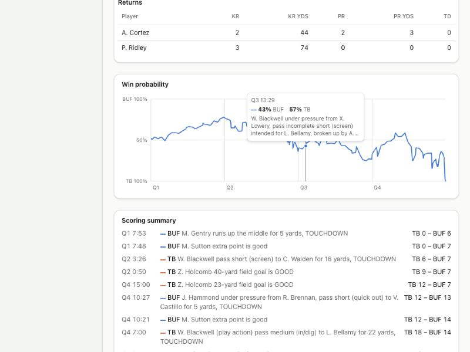

# Devlog 5a: Game management

_Phase 5a, October 2026_

Games now know the stakes. Every snap carries a win probability. Coaches make 4th-down and 2-point calls by weighing what each option does to their chances, then lean as cautious as real coaches do. Clocks are managed from the game state, teams call timeouts to regroup, and close calls get reviewed by the replay booth or challenged by coaches. The game page has a win-probability chart, a drive chart and a scoring summary.

## What was built

- **Real data.** A new pipeline step, `npm run pipeline -- situations`, reads four seasons of nflverse play-by-play (CC-BY-4.0) and writes `calibration/situations.json`:
  - a win-probability model fitted to who actually won;
  - 3rd- and 4th-down conversion rates by distance, overall and inside the 20;
  - where punts leave the other team;
  - run gains by distance to go;
  - situational targets: pass rate in seven down-and-distance groups, 4th-down choices by field zone, 2-point tries, timeouts, points in the last two minutes of each half, challenges and booth reviews with their reversal rates, and home and road false starts.
- **Win probability.** A logistic model of score, time left, field position, down and distance, timeouts, home field and who gets the ball after halftime. Checked against real games, it's as accurate as nflverse's own model (log loss 0.502 vs. 0.503). When it says 85%, teams win 86% of the time; at 25%, 26%.
- **4th downs and 2-point tries.** The analytics baseline compares the win probability of going for it (real conversion rates), punting (real punt results) and kicking (the kicker's make chance). Then comes real coaches' caution: a lean, much stronger against skipping a punt than a field goal and weaker for long field goals. Each team's aggressiveness moves that lean; Phase 10's coaches will set it. Every call that goes for it, or goes against the numbers, says why: "4th & 2: going for it (win chance 50% vs. 48% punting)".
- **Clock management.** Teams deep in their own end run out the clock before halftime. Defenses play prevent against two-minute drills. Teams use timeouts early in halves to beat the play clock or regroup (keeping at least two), plus the strategic late timeouts from Phase 3.
- **Replay.** Close calls on catches, incompletions, spots, fumbles, "down by contact", interceptions and touchdowns. The booth reviews scoring plays, turnovers and anything in the last two minutes; otherwise the team the call hurt may challenge, if it has a challenge and a timeout. Calls are reversed at the real rates (46% of challenges, 73% of booth reviews). A lost challenge costs a timeout, and two wins earn a third challenge.
- **A situational run game.** Run gains now come from real tables by distance to go: short-yardage runs face crowded fronts but usually get their yard; on long yardage, the defense gives up more. This closed most of the success-rate gap left in 4b.
- **Run-pass options.** An RPO is now a kind of quick pass against a crowded box. It used to turn called runs into passes, which double-counted passes in short yardage.
- **Halftime adjustments.** Each offense leans its second-half run/pass mix toward what worked (by EPA), scaled by its coach's adaptability, and defenses tighten slightly against what hurt them. A momentum setting exists but is zero: I found no real effect to calibrate it against.
- **Screens.** The game page shows:
  - a win-probability chart with a crosshair, readable by mouse or arrow keys, showing each snap's chances and the play;
  - a scoring summary;
  - a drive chart: each drive's start, a field bar, plays, yards, time and result.

  The team colors (blue and orange) were checked for color-blind readers on both themes.

- **Scorecard v3.** 58 league lines, including 22 new situational ones. Small-sample situational ranges are widened to two standard errors of a season's sampling noise: their real four-season spread was narrower than the noise in a single season, so even a perfect sim would often miss.
- **Tests (211 in all).** Win probability is sensible (big late leads nearly won, leads matter more late, home field helps). The analytics say go on 4th & 1 near midfield and punt on 4th & 15 deep in your own end. An aggressive coach goes for it more. Kneels come from the team ahead, and late timeouts from the team behind. Reviews are reversed at real rates, and challenges never use more timeouts than a team has.

## Scorecard

Three seed sets (4 leagues, 8 seasons each). League stats: **58, 57 and 57 of 58** inside the real range. The two misses are success rate on seed sets 1000 and 2000 (43.7% and 43.9% vs. a 44.1% minimum; in 4b it was 1.5 points under). New and key lines:

| Stat                                   | Real  | Real range   | Seed 42 | Seed 1000 | Seed 2000 |
| -------------------------------------- | ----- | ------------ | ------- | --------- | --------- |
| timeoutsPerTeamGame                    | 3.84  | 3.67–4.01    | 3.79    | 3.73      | 3.77      |
| endOfHalfPointsPerTeamGame             | 3.57  | 3.33–3.73    | 3.48    | 3.43      | 3.46      |
| twoPointTriesPerTouchdown              | 0.094 | 0.078–0.110  | 0.095   | 0.094     | 0.095     |
| challengesPerGame                      | 0.518 | 0.431–0.605  | 0.553   | 0.545     | 0.529     |
| challengeReversalRate                  | 0.455 | 0.372–0.539  | 0.456   | 0.449     | 0.421     |
| boothReviewsPerGame                    | 0.647 | 0.549–0.744  | 0.676   | 0.688     | 0.679     |
| boothReversalRate                      | 0.728 | 0.661–0.795  | 0.732   | 0.721     | 0.725     |
| falseStartsHomeOffense                 | 1.165 | 1.035–1.296  | 1.131   | 1.127     | 1.125     |
| falseStartsRoadOffense                 | 1.163 | 1.032–1.294  | 1.099   | 1.133     | 1.112     |
| passRate 1st down                      | 0.500 | 0.492–0.512  | 0.501   | 0.500     | 0.500     |
| passRate 2nd & short                   | 0.374 | 0.347–0.397  | 0.371   | 0.375     | 0.377     |
| passRate 2nd & medium                  | 0.524 | 0.505–0.544  | 0.529   | 0.533     | 0.531     |
| passRate 2nd & long                    | 0.719 | 0.706–0.731  | 0.725   | 0.723     | 0.724     |
| passRate 3rd & short                   | 0.503 | 0.476–0.530  | 0.504   | 0.508     | 0.505     |
| passRate 3rd & medium                  | 0.907 | 0.893–0.921  | 0.904   | 0.906     | 0.908     |
| passRate 3rd & long                    | 0.924 | 0.914–0.933  | 0.919   | 0.917     | 0.921     |
| fourthDownGoRate own-deep              | 0.083 | 0.069–0.098  | 0.095   | 0.091     | 0.090     |
| fourthDownGoRate midfield              | 0.250 | 0.213–0.295  | 0.249   | 0.254     | 0.240     |
| fourthDownGoRate plus-territory        | 0.301 | 0.268–0.334  | 0.330   | 0.320     | 0.330     |
| fourthDownFieldGoalRate plus-territory | 0.649 | 0.615–0.683  | 0.649   | 0.657     | 0.645     |
| fourthDownGoRate red-zone              | 0.294 | 0.259–0.348  | 0.333   | 0.318     | 0.321     |
| fourthDownFieldGoalRate red-zone       | 0.706 | 0.652–0.741  | 0.667   | 0.682     | 0.679     |
| fourthDownGoRate                       | 0.204 | 0.173–0.248  | 0.222   | 0.217     | 0.215     |
| twoPointTriesPerTeamGame               | 0.231 | 0.205–0.260  | 0.254   | 0.250     | 0.250     |
| epaPerPlay                             | 0.009 | -0.017–0.024 | 0.024   | 0.009     | 0.009     |
| successRate                            | 0.448 | 0.441–0.451  | 0.443   | 0.437 ✗   | 0.439 ✗   |
| homeWinPct                             | 0.545 | 0.516–0.574  | 0.545   | 0.542     | 0.522     |
| pointsPerTeamGame                      | 22.39 | 21.01–23.77  | 23.14   | 23.10     | 22.87     |

Player level: 37, 36 and 32 of 48, the same picture as 4b (passing leaders too bunched until play-calling styles and benchings arrive).

## What surprised us / what broke

- **No crowd-noise false starts.** I planned to model road false starts from crowd noise, but in 2022–2025 home and road offenses commit false starts at the same rate (1.17 vs. 1.16 a game). Home-field advantage stays a general edge, which keeps the home win rate in range.
- **Pre-snap fouls were over-generated.** Since 4a, every penalty type got a 25% boost to make up for declined penalties, but pre-snap fouls are never declined. False starts ran 20% high until that was fixed.
- **Coaches are cautious in specific ways.** A single "caution" setting made teams go for it too often deep in their own end and too rarely in field-goal range. Real coaches hate giving up a punt more than giving up a field goal, and they trust long field goals less. Modeling those two habits matched every field zone.
- **Inside the 20, conversions are harder.** 4th & 4 converts 42% of the time inside the 20 vs. 52% overall. Without that, coaches went for it in the red zone far too often.
- **League talent swings EPA.** Within a seed set, leagues whose starting quarterbacks average about 81 run +0.05 EPA per play, vs. about +0.02 for leagues around 76. That's natural sampling in a generated league (real seasons swing about as much), but it makes one seed set run hotter than the others.

## Not done yet

- Success rate is still a few tenths of a point low on two seed sets.
- The sim reaches 3rd & 1 about two-thirds as often as real teams.
- Special teams, stadiums and weather, the live ticker and the performance pass are Phase 5b.

---

[← 4b: The people around it](0004b-people.md) · [Index](README.md) · [5b: Special teams and the elements →](0005b-special-teams-weather.md)
