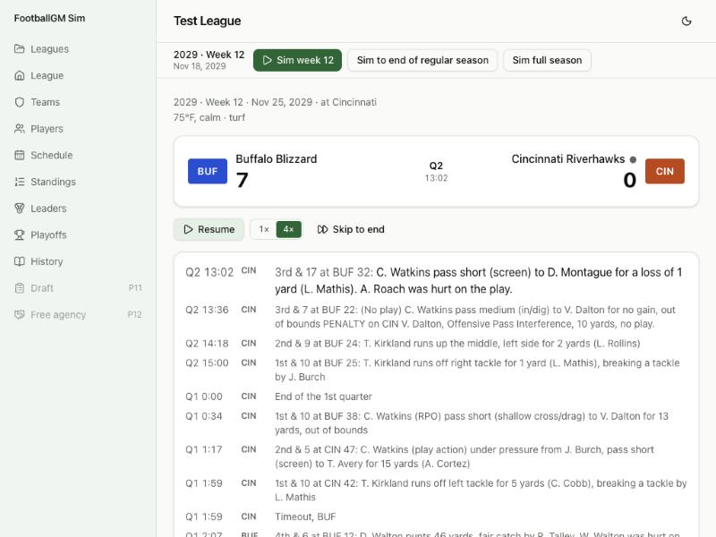

# Devlog 5b: Special teams and the elements

_Phase 5b, October 2026_

Kicking plays now follow the current rules and behave like the real thing. Kickoffs use the dynamic-kickoff rules. Trailing teams try onside kicks late. Punts get pinned near the goal line, and returns get muffed, kicks get blocked, and now and then a punt or field goal is a fake. Every team has a stadium, and every outdoor game has weather drawn from its city's real climate for that week. Wind, cold, rain, snow and Denver's thin air change the game by amounts measured from real games. You can also watch any game play by play, or play one of this week's games right away and watch it live.

## What was built

- **The current kickoff rules, checked first.** From the NFL's dynamic-kickoff explainer, the 2025 touchback change (AP) and the owners' March 2026 vote:
  - kick from the 35 into a landing zone from the goal line to the 20;
  - touchbacks at the 35, or at the 20 if the ball lands in the zone and rolls into the end zone;
  - short kicks and kicks out of bounds at the 40;
  - from 2026, an onside kick may be declared at any time, trailing or not.

  They're in `rules/2026.json` with their sources, and a test checks them. Old saves get the new kickoff rules when they load.

- **Real data.** A new pipeline step, `npm run pipeline -- elements`, reads 2022–2025 nflverse play-by-play (CC-BY-4.0) and writes `calibration/elements.json`. It holds:
  - each team's roof and surface (no stadium names);
  - each city's game-day climate by week: temperature, wind, rain and snow;
  - what weather does to field goals, completions, yards per catch, fumbles and punts;
  - the 2025 kickoff mix and onside-kick rates;
  - muff, block and fake rates;
  - scoring and kicking in domes vs. cold or windy games.
- **Kickoffs.** Each kickoff draws from the real 2025 mix: about 21% touchbacks, 76% returned, a few short or out of bounds. A strong leg gets more touchbacks, and so does Denver's altitude; wind gets fewer. Returns pit the returner's speed against the kicking team's coverage. Returners sometimes fumble.
- **Onside kicks.** A team trailing by two scores or fewer declares one late in the 4th quarter or in overtime: inside the last 2 minutes down one score, 4 minutes down two. The kicking team recovers about 8% of the time, the real rate.
- **Punts and field goals.** Punt distance comes from the punter's leg plus the wind. Near midfield a punter aims short of the end zone and usually pins it inside the 15. Returners muff punts at the real rate, punts and field goals get blocked, and on short yardage a punt or field goal is occasionally a fake. Bad weather also shortens the range a coach trusts his kicker from.
- **Stadiums and weather.** Each team has a stadium: dome, outdoor or retractable roof, grass or turf, and elevation (Denver, 5,279 ft). Each game's weather is drawn from the home city's climate for that week, with the game's own seed. Snow turns to rain above 38°F, and retractable roofs open only on pleasant days, as often as the real ones do. The game page shows a line like "Retractable roof, open · 68°F, wind 6 mph · turf" or "34°F, wind 15 mph, snow · grass".
- **Weather effects, from real games.** Wind, cold and rain or snow lower field-goal and completion odds and shorten catches. Rain and snow add fumbles, wind shortens punts, and altitude helps every kick. The engine's base tables already average over real weather, so each effect is measured from the average real day: a dome game kicks slightly better than average, a windy December game much worse.
- **Play and watch.** Each of this week's unplayed games has a "Play and watch" button (on the schedule and on its game page). It plays that game right away and opens it live. When you sim the rest of the week, that game isn't played again. Games, weather and injuries all have their own seeds, so the result is exactly what simming the whole week would have produced (a test checks the saved league is byte-for-byte identical).
- **Watching live.** Any game with play-by-play has a "Watch it play by play" link. Plays appear one at a time with the score, quarter and clock updating, and scoring plays linger. You get pause, 1× and 4× speeds and "Skip to end". The final score stays hidden until the end; then "Box score and charts" opens the full page.
- **Play-by-play text** now describes onside kicks, short kickoffs, blocked field goals, and muffed punts and kickoffs.
- **Saves are format 6.** Teams gain stadiums, games gain weather, and older saves upgrade automatically (games played before the upgrade have no weather).
- **Tests (232 in all).**
  - Cold, windy games score less and miss more kicks than dome games, with the same teams and seeds.
  - Onside kicks come only from trailing teams in the 4th quarter or overtime, at the real frequency.
  - Touchbacks, gross punting, blocks, muffs and fakes land at real rates, and the touchback spot is read from the rules file.
  - The kickoff rules match the rulebook.
  - Weather is the same every time it's drawn, domes stay dry, and Green Bay gets colder and snowier in December.
  - Play and watch gives the same week as simming it, and only this week's games can be played early.
  - Format-5 saves upgrade.
  - A full season stays fast.

## The weather test

400 games between the same two average teams with the same seeds, once in a dome and once at 22°F with an 18 mph wind:

|                  | Points per team | Field goals made |
| ---------------- | --------------- | ---------------- |
| Dome             | 23.2            | 86.3%            |
| 22°F, 18 mph     | 21.1            | 79.7%            |
| Real: dome       | 23.4            | 86.2%            |
| Real: cold/windy | 21.2            | 83.2%            |

(The real cold-or-windy group includes merely chilly or breezy games, so its kicking drop is smaller than in this raw test.)

## Speed

A full season (272 games and the playoffs) takes **1.5 seconds in the browser**, saving and play-by-play included. Headless it takes 1.4 s. The goal was under 5 s. A new speed guard in the tests catches a big slowdown.

## Scorecard

Three seed sets (4 leagues, 8 seasons each). League stats: **62, 62 and 60 of 63** inside the real range. Every special-teams line is in range on every seed set. The dome and cold-or-windy lines are shown as "info", not pass/fail: real cold-city teams differ from dome teams in quality, so the real gap isn't only weather.

| Stat                            | Real  | Real range   | Seed 42 | Seed 1000 | Seed 2000 |
| ------------------------------- | ----- | ------------ | ------- | --------- | --------- |
| kickoffTouchbackRate            | 0.210 | 0.195–0.226  | 0.206   | 0.206     | 0.205     |
| onsideAttemptsPerTeamGame       | 0.096 | 0.077–0.114  | 0.091   | 0.088     | 0.088     |
| onsideRecoveryRate              | 0.077 | 0.025–0.129  | 0.074   | 0.072     | 0.101     |
| puntGrossAverage                | 47.33 | 47.00–47.56  | 47.46   | 47.22     | 47.25     |
| puntNetAverage                  | 41.67 | 41.41–41.82  | 41.76   | 41.60     | 41.59     |
| puntsPerTeamGame                | 3.88  | 3.32–4.39    | 3.61    | 3.76      | 3.75      |
| fieldGoalPct                    | 0.851 | 0.819–0.881  | 0.851   | 0.854     | 0.851     |
| fieldGoalPct 50-59              | 0.706 | 0.670–0.745  | 0.726   | 0.730     | 0.713     |
| pointsPerTeamGameDome (info)    | 23.41 | 22.98–23.64  | 23.99   | 23.45     | 23.11     |
| pointsPerTeamGameColdOrWindy    | 21.16 | 19.56–22.34  | 21.54   | 22.66     | 21.81     |
| fieldGoalPctDome (info)         | 0.862 | 0.850–0.879  | 0.860   | 0.863     | 0.859     |
| fieldGoalPctColdOrWindy (info)  | 0.832 | 0.793–0.874  | 0.823   | 0.850     | 0.823     |
| pointsPerTeamGame               | 22.39 | 21.01–23.77  | 23.49   | 23.12     | 22.96     |
| homeWinPct                      | 0.545 | 0.516–0.574  | 0.538   | 0.546     | 0.552     |
| epaPerPlay                      | 0.009 | -0.017–0.024 | 0.029 ✗ | 0.009     | 0.008     |
| successRate                     | 0.448 | 0.441–0.451  | 0.444   | 0.437 ✗   | 0.437 ✗   |
| interceptionRate                | 0.022 | 0.021–0.024  | 0.022   | 0.023     | 0.025 ✗   |
| fourthDownGoRate plus-territory | 0.301 | 0.268–0.334  | 0.327   | 0.323     | 0.339 ✗   |

The misses are old acquaintances: seed set 42's quarterback-rich leagues run hot on EPA, and success rate sits a few tenths low (both since 4b/5a). Interceptions and plus-territory go rates are just over their edges on one seed set. Player level: 38, 35 and 32 of 48, the same picture as before.

## What surprised us / what broke

- **The rules changed under us.** In 2025 a team could declare an onside kick only when trailing; the owners dropped that in March 2026. The touchback spot also moved from the 30 to the 35 in 2025, so only 2025 kickoffs are used for the kickoff mix.
- **Win probability was the wrong tool for onside kicks.** First I let win probability decide when to kick onside, but the model never thought it was worth it, so nobody ever tried one. Real coaches follow a simple habit (late, down one or two scores), and that's what the sim does now.
- **Too many punt touchbacks.** Drawing gross distance alone sent too many midfield punts into the end zone, and net punting ran a yard short. Real punters aim short of the goal line from midfield; modeling that fixed it.
- **The engine already played in "average weather".** All its real-data tables mix domes, sunshine and blizzards. Adding weather effects on top double-counted bad weather. Effects are now measured from the average real day, so domes improve slightly and storms hurt.
- **A team knelt away a 6-point lead.** Watching a game live caught it: leading with 38 seconds left, on 4th & 13 at their own 16, a team knelt and handed the ball over for the losing touchdown. The kneel-out math counted the play clock after the last kneel, but after a 4th-down kneel the other team gets the ball. Fixed: the clock now has to run out between kneels, and the two-minute warning counts as a stop.

## Not done yet

- Success rate is still a few tenths low on two seed sets.
- Return touchdowns and return yardage aren't on the scorecard yet; they look right in the box scores but aren't checked against real ranges.
- Real-league stadium names and the Phase 6 naming session come later; for now stadiums are described, not named.

---

[← 5a: Game management](0005a-game-management.md) · [Index](README.md) · [6a: Real rosters →](0006a-real-rosters.md)
