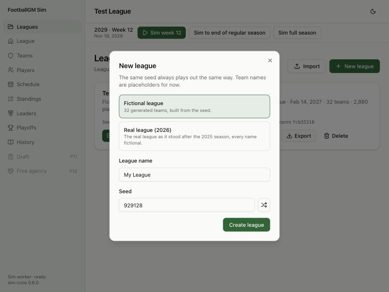

# Devlog 6a: Real rosters

_Phase 6a, October 2026_

The game can now start from the real league as it stood after the 2025 season. Every player on every roster is there, plus the head coaches and coordinators. The real 2025 season is in History, and the 2026 schedule has every team's real opponents. Every name is fictional. New League offers "Real league (2026)" next to the fictional league.

The real league is built on this computer by one command and never committed: it's made from public data plus a private Madden ratings file.

## What was built

- **A new pipeline step, `npm run pipeline -- league`.** It downloads public nflverse data (CC-BY-4.0) once and builds the league file in about 15 seconds. Rebuilding gives a byte-identical file.
- **Who's in the league: 2,669 players.**
  - Each team's roster at the end of its 2025 season, from its final game: active players, reserve lists and practice squads. Teams range from 75 to 90 players.
  - 32 players who played in 2025 but finished it unsigned start as free agents.
  - Bios come from nflverse: birth date, height, weight, draft round and pick, and experience.
- **Positions mapped to ours.** Defensive ends and outside linebackers are the tricky ones. Madden's player type settles whether an outside linebacker is a pass rusher (EDGE) or an off-ball linebacker. Very heavy "ends" (3-4 style) play defensive tackle.
- **Ratings from Madden.** You supplied Madden 26's Week 1 ratings; no end-of-season file turned up.
  - Players are matched by last name and birth date, then by full name, including nicknames ("C.J." as well as the legal first name). 1,830 of Madden's 1,880 players matched; the rest had retired or been cut.
  - Madden's ~50 attributes are combined into our 28. For example, our pass rush leans on a player's better move (power or finesse), and our route running averages short, medium and deep routes.
  - The result is moved onto our scale position by position. Real starters end up with the same average and spread as starters in our generated leagues, which the game engine is calibrated on. Madden's order and the gaps between players are kept.
  - **839 players Madden doesn't carry** (late signings, practice squads, long snappers) get ratings around a target from their 2025 snap share and draft slot.
- **Fictional names.** Each name comes from a hash of the person's id, so it's the same on every rebuild without storing a lookup table. A name matching any real player in nflverse's list (every era) or a real coach is redrawn; that happened 21 times. Colleges map to fictional schools.
- **Coaches.**
  - Head coaches and offensive, defensive and special-teams coordinators come from each team's 2025 season page (facts only): who held each job at season's end, including the two interim head coaches.
  - One job had no real holder: Tampa Bay's head coach ran its defense, so that coordinator is generated, as are the scouts.
  - Coach attributes stay placeholders until Phase 10.
- **The real 2025 season as History.** All 285 real scores, with touchdowns counted from the play-by-play, run through our own standings, tiebreaker, playoff and draft-order code. It all comes out matching reality: every team's win total, the champion, and a draft order led by Las Vegas, the New York team that plays in the AFC, Arizona, Tennessee and the NFC's New York team. The league starts Feb 9, 2026, the day after the real championship game.
- **The 2026 schedule.** Our formula pairs every team with exactly its real 2026 opponents (all 272 games).
- **New League.**
  - The dialog offers "Real league (2026)" when the file has been built on this computer; otherwise the option is greyed out with the command to build it.
  - Each new real league gets its own name and seed, so the same start plays out differently each time.
  - This turned up a bug, now fixed: new games shared data with the starting file, so two games started from it would have moved together.
- **Tests (246 in all; 8 run only on this computer).**
  - **Everywhere (CI):** assembling a league from a played fictional season reproduces its standings, seeds, champion and draft order. Given ratings are kept exactly, generated ones land near their target, and every team gets a full staff. The result is deterministic, and new games get their own seed.
  - **On this computer only** (they skip where the private files are missing):
    - the build loads and saves byte for byte;
    - no player or coach shares a full name with any real player or coach;
    - rosters are legal and cover every position;
    - every 2025 win total and the champion match;
    - all 2026 opponents match;
    - a season plays start to finish;
    - rebuilding gives an identical file;
    - no committed file contains a real 2025 player's or coach's name.

## What surprised us / what broke

- **The first ratings sheet was a year old.** It turned out to be Madden 25 (the 2024 season): its rookies were the 2024 class, and players were on their 2024 teams. Switching to Madden 26's Week 1 file brought in the 2025 rookies and cut the starters with no Madden rating from 66 to 4.
- **Legal names vs. football names.** nflverse uses legal first names, so the automatic match missed players known by a nickname until nicknames were added to it.
- **Spreadsheet dates.** Some birth dates in the Madden export had been turned into the wrong date by the spreadsheet ("7/12/01" stored as July 1, 2012). The reader recognizes the pattern and reads them back correctly.
- **nflverse still listed fired coaches.** Its game data names the original head coach for two teams that fired theirs mid-season. The teams' final-staff lists are right, so coaches come from those.
- **Home and away don't all match yet.** Our schedule formula picks the right 2026 opponents but hosts 88 of the 272 games at the other team's stadium. The NFL decides hosts from how past rotations went, which our formula doesn't model yet.
- **Start-of-season ratings show.** In a test season, real 2025 contenders whose players outperformed their Week 1 ratings (the NFC team in Los Angeles, for one) finished near the bottom. Phase 6b's adjustment for 2025 performance is there to fix exactly this.

## Not done yet (Phase 6b)

- Adjusting ratings by real 2025 performance (Next Gen Stats, advanced stats, snap counts).
- Hidden traits from draft pedigree and injury history, and injury history itself.
- Career stats back to 1999.
- The top-10 sanity sheet for your review.
- The scorecard with real rosters on three seeds.
- Contracts arrive in Phase 7, real traded draft picks with the draft, and team names with the naming session.
