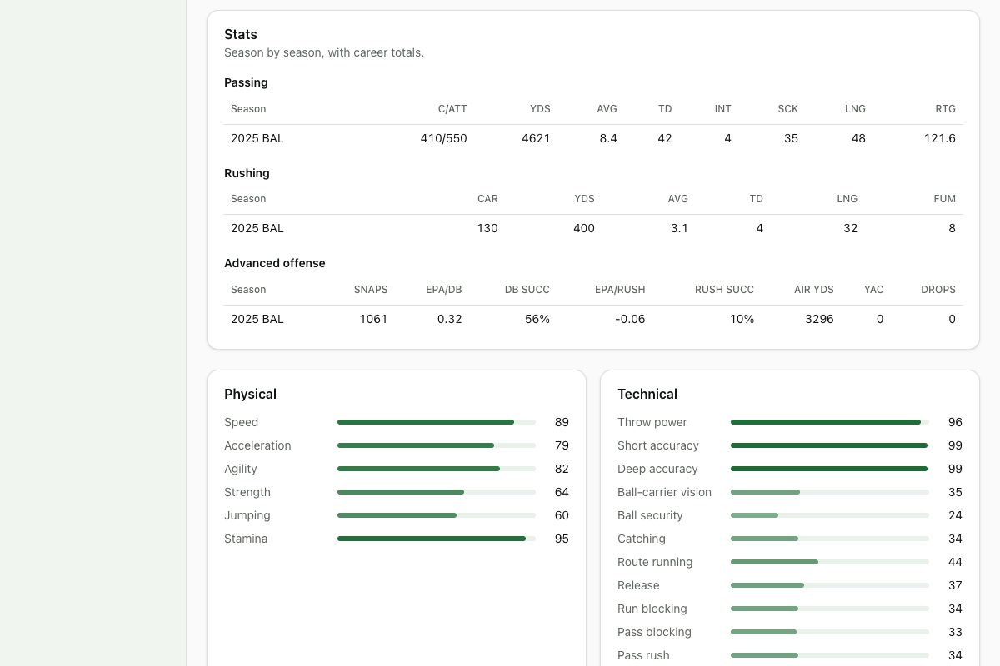

# Devlog 6b: Real ratings

_Phase 6b, October 2026_

The real league now plays like the real league. Ratings start from Madden's start-of-2025 numbers and then move toward how each player actually played in 2025. Each team's regulars also move with how the team actually did. Every player carries his real career stats back to 1999, injury-prone players are injury-prone, and young high draft picks have more room to grow. Simulated seasons on the real rosters match the real NFL as well as our generated leagues do.

## What was built

- **Ratings adjusted by 2025 performance.** For each position, every regular's 2025 production is scored against the others at his position, and his overall moves part of the way toward the rank that production implies:
  - **Quarterbacks:** expected points added per play and completion over expected.
  - **Running backs:** rushing yards over expected (Next Gen Stats), rushing EPA and yards per touch.
  - **Receivers and tight ends:** yards and EPA per target, and target share.
  - **Pass rushers:** pressures per snap and missed tackles (PFR advanced stats).
  - **Linebackers:** tackles per snap, missed tackles and passer rating allowed.
  - **Defensive backs:** yards and passer rating allowed, plus interceptions and passes defended per target.

  Full-time players move further than part-timers. Coverage numbers are the noisiest, so defensive backs move least. Only skills move; one season of production says nothing new about speed or strength. Linemen, kickers and punters keep their Madden-based ratings: there's no individual production we can trust for them.

  Examples (real names stay in the private report): New England's young quarterback rises from 77 to 82 after his breakout year, Seattle's top receiver from 81 to 85, and a few stars who had down years drop 4–5 points.

- **Team results.** On Madden's start-of-season numbers, real teams came out far more evenly matched than our generated leagues (team strength spread 1.3 overall points vs. 3.0), and real 2025 contenders like Seattle and Denver looked middling. Each team's regulars now move with the team's real 2025 point differential, up to about ±4 overall. The ranking of team strength now looks like the real 2025 standings, and the scorecard's team-scoring spread matches the real NFL.
- **Kickers and punters** are lined up with the engine's average kicker. Kickers signed mid-season count as their team's regular, rather than as a camp leg.
- **Hidden traits.**
  - Injury proneness and durability come from 2023–25 injury history (weeks listed out or on injured reserve) and Madden's injury and toughness ratings. They're put on the same scale as generated players', which the injury model is calibrated on.
  - Potential grows faster for high draft picks: first-rounders get 35% more growth room than the generator's default, late-rounders and undrafted players less.
  - Other traits and personalities are generated, as before.
- **Career stats.** 2,321 current players carry their real regular-season stats, season by season, back to 1999 (nflverse player stats). Player pages show real careers; half-sacks stay half-sacks. Longest plays aren't in the season files, so those columns show a dash.
- **The sanity sheet.** Each build writes `pipeline/private/out/sanity.html`, which stays on this computer: the top 10 at every position with real names, ages, 2025 snap share, the start-of-season rating, what 2025 play implies, the final rating and 2025 production. A team table puts each team's strength next to its real 2025 record.
- **Scorecard from the real league.** `npm run sim -- --calibrate --league pipeline/private/out/real-league-2026.json` starts every league from the real file.
- **Tests (259 in all; 10 run only on this computer).**
  - **Everywhere:** position mapping (including edge rushers vs. off-ball linebackers), reading odd spreadsheet exports, matching with nicknames and overrides, and the attribute mix. Also: moving an overall changes skills but not speed, injury history raises injury proneness, trait rescaling, and names never matching a real person.
  - **On this computer:** a season on real rosters keeps every core stat in range; the best players at each position are real 2025 regulars; and 2025 totals in player careers cover over 90% of the real league's yards and sacks (the rest belong to players who retired or went unsigned).

## Scorecard on real rosters

Three seed sets (4 leagues × 2 seasons each, all starting from the real league). League stats: **62, 62 and 62 of 63** inside the real range. That's as good as our generated leagues; the one miss is the same success-rate gap. Player level: 34, 33 and 35 of 48, also the same as generated leagues.

| Stat                            | Real  | Real range   | Seed 42 | Seed 1000 | Seed 2000 |
| ------------------------------- | ----- | ------------ | ------- | --------- | --------- |
| pointsPerTeamGame               | 22.39 | 21.01–23.77  | 23.16   | 22.59     | 23.00     |
| teamPointsPerGameSpread         | 4.10  | 3.40–4.75    | 4.02    | 3.86      | 3.84      |
| homeWinPct                      | 0.545 | 0.516–0.574  | 0.534   | 0.555     | 0.537     |
| injuriesPerTeamGame             | 1.66  | 1.468–1.87   | 1.54    | 1.57      | 1.54      |
| kickoffTouchbackRate            | 0.210 | 0.195–0.226  | 0.197   | 0.199     | 0.200     |
| fieldGoalPct                    | 0.851 | 0.819–0.881  | 0.850   | 0.858     | 0.857     |
| puntNetAverage                  | 41.67 | 41.41–41.82  | 41.62   | 41.79     | 41.71     |
| fourthDownGoRate plus-territory | 0.301 | 0.268–0.334  | 0.317   | 0.319     | 0.312     |
| epaPerPlay                      | 0.009 | -0.017–0.024 | 0.012   | 0.006     | 0.013     |
| successRate                     | 0.448 | 0.441–0.451  | 0.437 ✗ | 0.435 ✗   | 0.437 ✗   |
| interceptionRate                | 0.022 | 0.021–0.024  | 0.024   | 0.023     | 0.023     |

The first run on real rosters scored 57–58 of 63. Three causes, each fixed at the source rather than by tuning the engine:

- teams too evenly matched (fixed by team results);
- injury traits on a lower scale than generated players' (rescaled);
- kickers short of the engine's average kicker (aligned, plus mid-season signings no longer rated as camp legs).

## What surprised us / what broke

- **Madden misfiled an edge rusher.** It lists one star pass rusher as a "run stopper" defensive end, and my first rule only counted "rusher" types as edge players, so he was scored as an off-ball linebacker. Any Madden defensive-end type now counts as an edge player.
- **Half-sacks.** The first career import rounded half-sacks up, inflating 2025 sack totals by 6%. The career test caught it.
- **One season of production is noisy.** The first version moved players halfway to their production rank, which knocked several stars down 6–9 points for one off year. The move is now a third or less, and smallest where the numbers are noisiest.
- **Kickers: the obvious explanation was wrong.** The kickers looked fine on paper. The ones actually kicking in games were signed mid-season and had been rated as camp legs.

## Not done yet

- **Your review of the sanity sheet:** done; you approved it after this entry was written.
- **Success rate** is still a few tenths low, in real and generated leagues alike.
- **Hosts for 88 of the 2026 games** are swapped compared with the real schedule (the opponents all match).
- **Contracts** (Phase 7), **real traded draft picks** (draft phase), and **team names** (naming session) come later.
