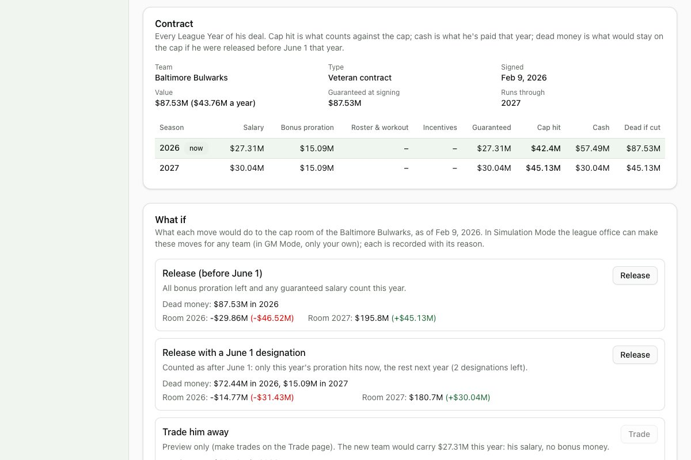

# Devlog 7a: The cap and contract engine

_Phase 7a, October 2026_

Players now have real contracts, and the league has a real salary cap. Every contract runs year by year:

- base salary and guarantees;
- signing bonuses spread over up to five years, void years included;
- roster and workout bonuses, and playing-time incentives.

Every team has a cap sheet with dead money and carried-over room. Releases (before or after June 1, or with a June 1 designation), trades, restructures, extensions, pay cuts and fifth-year options all follow the CBA's accounting to the dollar, and each records a reason. Tags, tender amounts and rookie deals are built in. Fictional leagues start with realistic payrolls and stay under the cap year after year.

## What was built

- **The cap rules as data**, read from the 2020 CBA text and the league's own announcements, each with its source in `rules/2026.json`:
  - **The cap by year:** $301.2M in 2026, $279.2M in 2025, back to 2019. Later years are projected at 7% growth and rounded like the league's figures.
  - **Minimum salaries:** the full Article 26 tables through 2030, by credited seasons, for players on and off the active list. After 2030 they keep rising by the final step.
  - **Contract accounting:** bonuses spread over at most five years, and only the top 51 contracts count in the offseason. Teams get two June 1 designations a year, plus carryover.
  - **The veteran salary benefit:** a one-year minimum deal for a 4+ year veteran counts at the 2-year minimum. It's checked against a reported 2026 deal: $1.3M base plus $187,500 in bonuses counts $1,262,500.
  - **Minimum cash spending:** 90% of the caps over each multi-year period.
  - **Tags:** the 2026 franchise and transition values for all eleven position groups, cross-checked against the amounts NFL.com reported for the four players tagged in 2026. Later years use the CBA's Cap Percentage Average of the five previous years' top salaries, which the league now records every year.
  - **Restricted free agent tenders:** the NFL's official 2026 amounts ($8.107M first round, $5.811M second round, $3.674M original round, $3.547M right of first refusal), then growing with the cap.
  - **Fifth-year options:** the CBA's tiers. Pro Bowls arrive with awards (Phase 15); until then only the playing-time tiers apply.
  - **The rookie wage scale:** a provisional curve by draft slot. Phase 7b replaces it with real 2026 rookie contracts.
- **Contract math**, pure functions:
  - cap hit, cash paid, total value and guarantees;
  - bonus proration, with leftover dollars going to the earliest years;
  - remaining proration and guarantees.
- **The moves**, each with a preview (what happens to the cap before you do it) and an action that records a transaction with its reason:
  - **Release** before June 1: all remaining bonus counts now.
  - **Release** after June 1, or with a June 1 designation: this year's share stays, the rest moves to next year. Guaranteed salary still owed counts either way.
  - **Trade:** the bonus stays with the old team; the new team takes only the salary.
  - **Restructure:** salary above the minimum turns into a bonus spread over the remaining years, optionally with void years added to stretch it to five.
  - **Extension, pay cut**, and exercising or declining a **fifth-year option**.
- **Each new League Year:**
  - the year's top salaries are recorded for future tags;
  - cash paid is logged and checked against minimum spending;
  - incentives are settled the CBA way: unexpected ones earned beyond the team's room are charged to next year, and likely ones missed are credited back;
  - void years accelerate;
  - fifth-year options are decided;
  - expiring players re-sign or walk.
- **Placeholders until free agency (Phase 12) and roster upkeep (Phase 8):**
  - Teams re-sign the expiring players they can afford, best first, while keeping room to fill the roster.
  - A simple free-agent market sends the best free agents to the team with the most room. A full team cuts a weaker cheap player at that position to make space.
  - Thin rosters fill up with one-year minimum deals.
  - Any team over the cap restructures its biggest salaries first, then releases whoever frees the most room for the least football value. Each step records why.
- **Contracts for fictional leagues and old saves.** A player's market value comes from his rank at his position group, anchored to that group's franchise tag:
  - the best are paid about like the tag;
  - an average starter gets around 40% of it;
  - backups sit near the minimum.

  Each team's veteran pay is then settled on its actual cap sheet, so teams start with $0–36M of room (median $22.5M). Some deals carry void years and incentives, and young drafted players have rookie deals by their slot. Saves move to format 7, and older saves get contracts when they load.

- **The real league** gets generated contracts for now; real ones come in 7b.
- **The player page** shows each contract's last year, yearly value and this year's cap hit. The full contract page and team cap sheet come in 7b.
- **Tests (293 in all; 10 run only on this computer).**
  - **A worked example for every rule**, to the dollar: caps and minimums, tenders, proration rounding, cap hits with incentives, the veteran salary benefit, void-year acceleration, releases before and after June 1, the designation limit, guarantees at release, trades, restructures with and without void years, tags and the Cap Percentage Average, rookie deals and fifth-year options, the top-51 rule, carryover, minimum cash spending, and both directions of the incentive adjustment.
  - **Cash equals cap:** 60 random contracts, played out, cut early or restructured, all pay the player exactly what they charge the cap.
  - **20 seasons legal:** every team under the cap at every new League Year, every rostered player under contract, rosters between 75 and 90.

## Scorecard

Contracts don't touch play on the field, but this phase changed three engine settings:

- **Sack rate** (0.80 → 0.76 of the base rate). Fictional leagues now draw different random players, because the old contract stub no longer uses up random numbers, and that pushed one seed set to 0.075 sacks per dropback, just over the real range. The real figure is 0.069, and the old setting ran a little high on every seed set.
- **Yards after the catch** (a small increase). Fewer sacks meant more throws under pressure, which dropped yards per attempt just under its range on real rosters. Our yards per attempt had always sat below the real 7.04.
- **The engine's "average kicker"** (77 → 76). This is what generated starting kickers actually average, now that punters no longer take kicking jobs (see below).

Final scorecard, three seed sets on generated leagues and two on the real rosters: **62 of 63** on every run. The one miss is the long-standing success-rate gap, which moved slightly closer (0.436–0.440 vs. a 0.441 minimum).

## What surprised us / what broke

- **Placeholders have to stand in for the whole market.** Contracts that expire need somewhere to go. The first version re-signed everyone at market value, which left 14 teams over the cap and shrank rosters from 90 to 57 in six years. The second let teams spend all their room re-signing stars, leaving some with 40-man rosters. The working version keeps room for a full roster, prices re-signings so league-wide spending fits the cap, and adds a simple free-agent market.
- **The top-51 rule matters a lot.** Generated payrolls first came out $60M under the cap, because in the offseason only the top 51 contracts count. Budgeting against the actual cap sheet fixed it.
- **A real bug from a worked example.** The restructure preview measured savings in a contract's first year, not the current one. That also made teams pick the wrong contracts to restructure when getting under the cap.
- **Punters were kicking.** When a team's punter had a stronger leg than its kicker, the depth chart made him the kicker and left nobody to punt. Kickers and punters now do their own jobs unless a team has none.

## Not done yet (Phase 7b)

- Real contracts imported for the real league, with existing dead money and a validation report against each team's published 2026 cap space.
- The real rookie scale from 2026 rookie contracts.
- The contract page, team cap sheet and "what if" panel.
- Offer sheets and matching for tags and restricted free agents, and the exclusive franchise tag, come with free agency (Phase 12).
