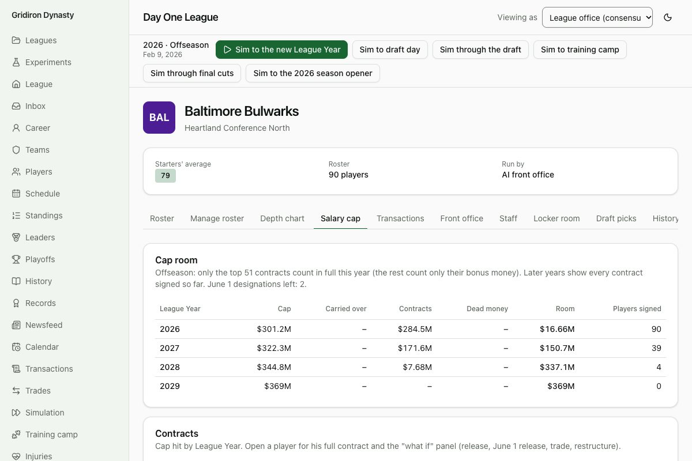
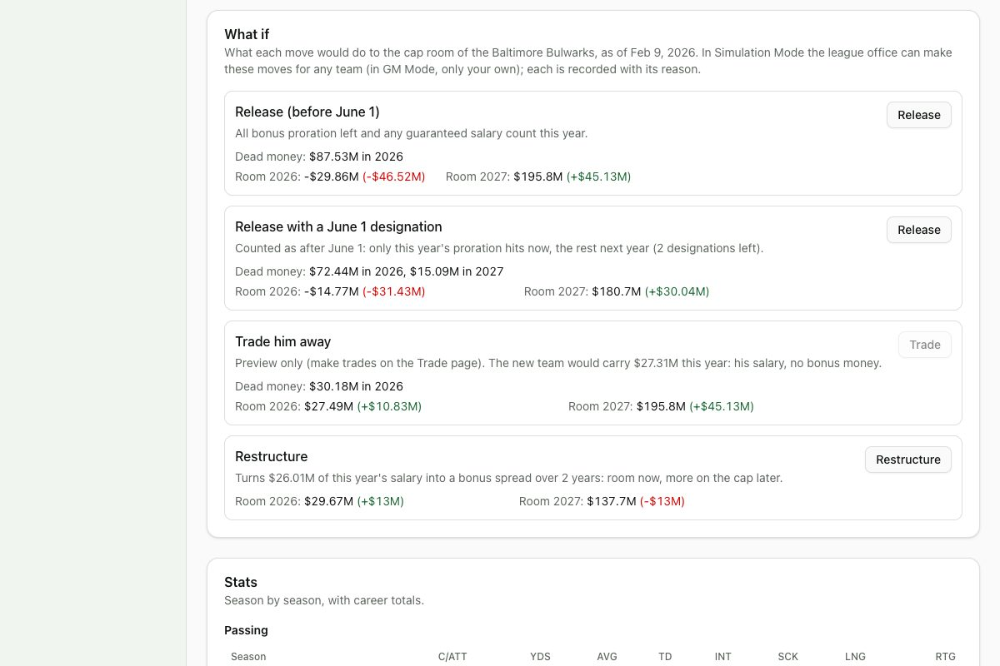

# Devlog 7b: Real contracts and the cap screens

_Phase 7b, October 2026_

The real league now starts with every team's real cap situation as of Feb 9, 2026: every contract year by year, the dead money left by players already gone, void years still on the books, and room carried over from 2025. Of 1,650 imported contracts, 1,629 reproduce their published 2026 cap hit to the dollar, and 25 of 32 teams' cap spending lands within $3M of the published Feb 10 figures. The other seven are explained.

Two new screens show the money. The **Salary cap** tab on a team's page has room for four League Years, every contract's cap hit by year (with the offseason top-51 rule marked) and the dead money list. Each player's page has his **contract** year by year and a **"what if"** panel showing what a release, a June 1 release, a trade or a restructure would do to his team's room this year and next. Until GM Mode, the league office can make the release and restructure moves for any team.

## What was built

- **Real contracts, from each team's public cap page** as archived closest to the league's start (Feb 2–25, 2026; the Internet Archive kept a copy of all 32). The pages list every player's 2026–2029 salary, bonus proration, roster, workout and per-game bonuses, guarantees and cap number. We use the facts only; the pages stay on this computer.
  - Players are matched by name to our end-of-2025 rosters. Nicknames count ("Mike" for a player listed under his legal name "Michael"), and suffixes and punctuation don't.
  - Each year's bonus proration is kept as that year's share, so cap hits and dead money match the page exactly.
  - Two things the page counts but doesn't list come from its own cap numbers. **Per-game roster bonuses** count only as far as they're likely (games active last season); the rest becomes an unlikely incentive. **Veteran-minimum deals** get the salary benefit.
  - Years after 2029, and the year each deal was signed, come from nflverse's contract data.
  - **Pending free agents:** a player on his team's roster but not on its page has a deal that ended with 2025. 51 of them still have void years charging their team; that money becomes dead money tied to the player.
  - **Players already gone:** 11 players were released between Feb 9 and their team's page date; they start as free agents, and their dead money is on the books.
  - **Team dead money** comes from each page's list of players already gone, by season; **carried-over room** from the archived league cap-space table.
- **The validation report** (private, with real names; its numbers go to a file the local tests read):
  - **Contracts:** 1,629 of 1,650 imported contracts' 2026 cap hits, computed by our cap engine, equal the page to the dollar. 6 more are within $10 (the page rounds bonus proration). The other 15 are page rows whose own columns don't add up to their cap number.
  - **Year by year (2026–29):** 3,042 of 3,129 contract-years equal the page (97%).
  - **Team totals:** with the offseason top-51 rule, as the published figures use, 25 of 32 teams are within $3M (10 within $0.1M). The other seven are explained: six have pages archived three or more days from Feb 10 (moves in between), and six have players under contract whom our end-of-season rosters don't include (futures deals signed after the season, up to $6.9M for one team). Most have both.
- **The real rookie wage scale.** All 257 picks of the 2026 draft have their real four-year deals. The rules file's knots now come from them: total value above four rookie minimums as a share of the cap, plus the signing-bonus share. The bonus shares come from the same slots in 2025, because the 2026 deals' year-by-year detail isn't published yet. Interpolating between the 60 knots reproduces every slot within $40,000. `npm run pipeline -- rookies` refits them.
- **The screens:**
  - **Team cap sheet** (Salary cap tab): cap, carryover, contracts, dead money and room for this League Year and the next three; every contract's cap hit by year and its dead money if cut; players outside the top 51 marked; the dead money list with reasons.
  - **Contract page** (on the player page): type, signing date, value, guarantees, void years, fifth-year option and the veteran salary benefit, then a year-by-year table of salary, bonus proration, other bonuses, likely incentives, guarantees, cap hit, cash and dead money if cut.
  - **"What if" panel:** each move's dead money this year and next, and the team's room this year and next, before and after. Previews apply the move to a scratch copy of the league and read the real cap sheet, so they're exact even when a cut pulls the 52nd contract into the top 51. Release, June 1 release and restructure have buttons (with a confirm step); trades are previews until Phase 8. Every move is saved and recorded with its reason.
- **Better placeholders until free agency (Phase 12).** The real league starts with 987 pending free agents, far more than a fictional league's first year, and that exposed weak spots:
  - A free agent now signs with the team that has the most room **among those where he'd start**; past 80 players, a team only adds starters. Before, a few teams with room hoarded starters, and the league's average starting offensive line fell half a point.
  - A tight team **restructures big contracts to keep its own starters**, as real teams do in March, but only while next year's commitments stay under next year's cap.
  - The room a team keeps for filling its roster only covers the top 51 in the offseason (deals outside the top 51 cost no room), priced at the costliest minimum salary a filler can count.
  - Roster filling checks the real effect on room, and makes sure every position has its starters, even on a full roster.
- **Tests (303 in all; 12 run only on this computer):**
  - Contract and cap screens: the preview is exactly what the move then does; a restructure frees room now and raises next year's bill; a cut shows the right dead money before and after June 1, with and without a designation; previews never change the league; the cap sheet adds up for four years.
  - Local, on the real league: it starts cap-legal; the import reproduces the published numbers (contracts, year by year, and team totals with every miss explained); and after a simulated 2026 season, the 2027 League Year opens legal.

## Scorecard

No engine settings changed. Contracts change who plays where in the real league, so the scorecard was rerun (four leagues, two seasons each):

- **Real rosters, with real contracts:** 62 of 63 on seeds 42 and 7. The one miss is the long-standing success-rate gap.
- **Generated leagues:** 62 of 63 on seed 42; 61 of 63 on seed 7, where third-down rate and expected points per play sit just over their ranges. The 7a code gives exactly the same result on that seed, so it's that seed's draw, not this phase.
- **Sack rate on the real rosters** briefly rose to the top of its range (0.075 against a 0.074 maximum in the local two-league check). Cap-tight teams were letting starting linemen walk, and free agents were piling up on the teams with the most room. The placeholder fixes above restored the starters (average starting offensive line back to 76.7, quarterbacks 76.5), and the check passes again.

## What surprised us / what broke

- **The contract data was today's view, not February's.** nflverse's contract data (from OverTheCap) shows each player's history as it stands now, in October. Restructures, extensions and trades from March onward were already baked in, and Houston came out $142M short. Archived copies of each team's cap page from February solved it.
- **The top-51 rule hid in the published figures too.** Even pages archived on Feb 10 totaled $2–3M more than the published cap-space table, because the table counts only the top 51 contracts in the offseason. Comparing the same way took us from 19 to 25 teams within tolerance.
- **Void years outlive the contract.** Cleveland was $55M short until the import counted players whose deals had ended but whose void years still charge the team.
- **A phantom $433M bill.** The minimum cash spending check covers 2024–2026, but a league that begins in 2026 has no record of what teams paid before. Every team was told it owed hundreds of millions (a message only, never charged to the cap). Years before the league began now count as met. This affected fictional leagues too.
- **One page typo.** One player's 2026 salary read about ten times his cap number. When the cap number implies a minimum salary, the import trusts it.

## Not done yet

- **During the season, rosters stay at offseason size**, so most teams would be over the cap once every contract counts. Cutdowns to 53 come with Phase 8, along with trades (now previews only).
- Offer sheets and matching for tags and restricted free agents, and the exclusive franchise tag, come with free agency (Phase 12).
