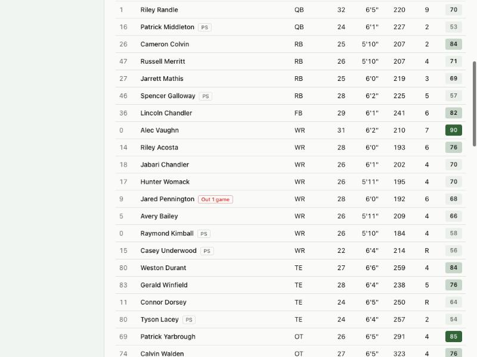
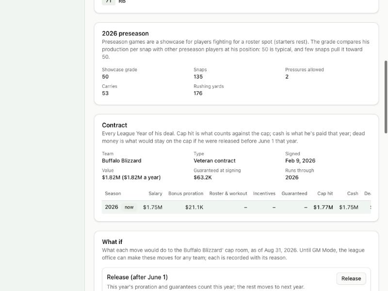

# Devlog 8a: The League Year and the roster rules

_Phase 8a, October 2026_

The league now lives through a real League Year. From the championship it goes to:

- the new League Year in March (contracts expire, free agency);
- the draft in April;
- training camp in July;
- three preseason weeks in August;
- final cuts to 53, with the waiver rush and practice squads;
- the 18-week season and the playoffs;
- the season's end, with practice-squad futures deals and retirements.

Every roster follows the NFL's rules, and every move is checked against them the moment it's made. Ten simulated League Years in a row passed that check after every single move.

## What was built

- **The calendar as data**, checked against the NFL's own 2026 and 2026-27 calendars:
  - tag window Feb 17 to Mar 3;
  - combine;
  - negotiating period Mar 9, and the League Year opens Mar 11;
  - draft Apr 23 (Apr 29 in 2027);
  - fifth-year option deadline May 1;
  - training camp in late July;
  - preseason weekends Aug 15, 22 and 29;
  - final cuts on Sunday Aug 30 (new in 2026: the day after the last preseason game);
  - waiver claims and practice squads Aug 31;
  - trade deadline Nov 10 (the Tuesday after Week 9);
  - Week 18 on Jan 10;
  - the championship on Feb 14, 2027.

  Later years follow the same rules.

- **The sim buttons follow it:** to the new League Year, through the draft, to training camp, each preseason week, through final cuts, to the season opener.
- **Contracts now expire in March, not the day after the championship.** Deals that ended with last season stay on the books until the League Year opens, as in reality.
- **The roster rules**, from the 2020 CBA and the league's roster rules:
  - 90 players in the offseason, 53 from final cuts, 48 dressed on game day (47 with fewer than eight offensive linemen);
  - a practice squad of 16 plus one international player, with at most six veterans of any experience;
  - the CBA's weekly practice-squad pay ($13,750 in 2026 for players with two or fewer seasons, at least $18,350 for veterans), counted on the cap;
  - two game-day elevations per game, three per player per season;
  - each team protects four practice-squad players a week; any other can be signed to another team's 53, keeping what his old team already paid him. The CBA's three-week pay guarantee for a player signed away isn't modeled yet;
  - injured reserve: at least four games out, eight designated returns a season (two of them can be named at final cuts);
  - the PUP list for players still hurt in camp;
  - waivers: players with fewer than four seasons go on waivers until the trade deadline, everyone after it. Claim order is last season's draft order through Week 3, then this season's standings, worst first. A claiming team takes the contract without the bonus money.
- **A legality check after every move:** roster and practice-squad sizes, everyone under contract with his own team, nobody retired on a roster, and every team under the cap. In the offseason only the top 51 count; in the season every contract counts, plus the practice squad and injured players. Moves made together (a team's cuts, a waiver claim and the cut that makes room for it) are checked once they're all done.
- **Weekly pay in the season.** Salary is paid in weekly installments. A player cut in Week 5 leaves his first four paychecks on the cap; a player traded or claimed mid-season splits his salary between the teams; a deal signed in Week 10 pays only the weeks left.
- **Preseason games, a showcase for bubble players.**
  - Three per team, with starters resting, so backups and camp bodies play.
  - Each player gets a **showcase grade**: his production per snap against everyone else at his position. 50 is typical, and few snaps pull it toward 50. Linemen are graded on the pressures they allow, which the engine now records (it only notes who lost the rep; no game plays out differently).
  - A strong grade can win a bubble player a spot at final cuts.
  - Standouts who have room to grow (hidden potential above their current rating) and good work habits get a small boost, at most two points and never past their potential. In the first test league, 61 players improved (about two per team), each with the reason recorded ("Strong preseason: grade 72, top 8% of preseason LBs").
  - The grade and stat line show on the player page. Preseason games can be turned off per league.

  

- **Final cuts:**
  - **Camp lists:** PUP players are activated, or moved to Reserve/PUP if still hurt; injured players go to injured reserve, with two designated to return.
  - **The cut to 53:** every team cuts at once. Teams keep a real-looking roster by position (two quarterbacks, five receivers, three tight ends, eight to nine linemen and so on), then the rest by value: rating, preseason grade, age, and the dead money a cut would cost.
  - **The waiver rush:** best players first, each to the first team in claim order that wants him. A claiming team waives its weakest at the position to make room.
  - **Practice squads:** teams take turns forming them, favoring their own cuts.
  - **Cap:** teams over the in-season cap restructure, then release, with reasons.
- **Each week:**
  - players out four or more games go on injured reserve, and come back when healthy and past the minimum, using a designation;
  - rosters go back to 53 by promoting from the practice squad, signing a free agent, or signing another team's unprotected practice-squad player when he's clearly better;
  - open practice-squad spots are filled;
  - players are elevated for the game when injuries leave a team short.

  These moves are made right after the previous week's games, so every game in a week sees the same rosters, whether it's simmed with the week or played early with "Play and watch".

- **Placeholders until later phases:**
  - **The draft (Phase 11 brings the real one).** A generated class is drafted in order, each pick signed to a rookie deal on the real 2026 scale; teams then fill to 90 with undrafted free agents.
  - **Retirement (Phase 9 brings the real model).** At the start of each offseason, players past their position's age limit retire. So do free agents who haven't played for two seasons, or for one season at 30 or older. A retiring player's leftover bonus money speeds up onto his team's cap.
- **The runner:** `npm run sim -- --seasons N` now plays full League Years with the legality check after every move. It prints each season's draft picks, cuts, waiver claims, injured-reserve placements and retirements.
- **Tests (324 in all; 12 run only on this computer):**
  - **10 League Years legal after every move:** every team at 53 after cuts, each new schedule valid, every move with a reason.
  - **Worked examples:**
    - the 2026 dates;
    - every draft pick on the rookie scale;
    - claim order before and after Week 3;
    - vested veterans before and after the deadline;
    - practice-squad pay, the veteran limit, and protection from being signed away;
    - the elevation limit;
    - injured reserve's four-game minimum and its designations;
    - a release and a trade after Week 4;
    - 48 dressed on game day.

## Scorecard

A full League Year (offseason events, 272 games and the playoffs) takes about 7 seconds headless.

**One engine setting changed: the completion nudge, 0.05 to 0.09.**

- **What we saw:** with real 53-man rosters, completion rate and yards per attempt fell (0.642 → 0.636 and 7.05 → 6.84 on one seed set; lower on the real league).
- **What it wasn't:** Week 1 and Week 10 starters were the same quality as before.
- **What it was:** the engine had been tuned while every team dressed its whole 90-man roster, so the fourth receiver or second-string lineman who rotates in was the best of a deeper group. Giving the real league 90-man rosters for a test brought the passing numbers straight back.

Final scorecard (four leagues, two seasons each):

| Run                  | Stats in range |
| -------------------- | -------------- |
| Generated, seed 42   | 62 of 63       |
| Generated, seed 7    | 62 of 63       |
| Generated, seed 2024 | 61 of 63       |
| Real league, seed 42 | 62 of 63       |
| Real league, seed 7  | 61 of 63       |

- **Passing:** completion 0.633–0.644 and yards per attempt 6.89–7.07 are back near the real 0.645 and 7.04.
- **Remaining misses:**
  - **Success rate:** the long-standing gap, still a hair low.
  - **Expected points per play:** now just over its top on the generated leagues (0.024–0.025 against a 0.024 maximum). The two pull in opposite directions; they're for a later engine pass.

## What surprised us / what broke

- **Speed.**
  - **The problem:** the first full League Year took two minutes. Forming practice squads checked every free agent's eligibility by scanning the whole league, and priced a contract for each one; the draft rescored every prospect for every pick.
  - **The fix:** scoring each player once and pricing practice-squad deals by experience brought it to 7 seconds.
- **Cap trouble shows up in the season.**
  - **The problem:** in the offseason only the top 51 contracts count, so teams spent right up to the cap. Then at final cuts every contract counted, plus a practice squad and injured players, and a few teams by year four couldn't fill 53.
  - **The fix:** offseason signings now leave room for the season (two more roster spots and a full practice squad). At cuts, teams fill the 53 first and release a pricey backup if a minimum deal is all they can afford.
  - **What's left:** one team in ten seasons still couldn't afford a practice squad. That's legal, and real cap hell.
- **Retiring with guarantees.** The first retirement code treated retiring like being released, putting every future guarantee on the cap. A retiring player gives up the salary to come; only his bonus money speeds up.
- **The first offseason purge.** A new league starts with 90 per team and no free agents. After the first season about 1,200 players who never got back on a roster retire. From then on it settles at about 420–470 a year, close to the 424 new prospects.

## Not done yet (Phase 8b)

- Trades (players and future picks) with both teams' cap impact before confirming.
- The roster screens: transactions log, roster management (cut, injured reserve, practice squad, elevations), trade builder, calendar, camp report.
- Some players signed after cuts share a jersey number with a teammate; numbers get cleaned up with the roster screens.

---

[← 7b: Real contracts and the cap screens](0007b-real-contracts.md) · [Index](README.md) · [8b: Trades and the roster screens →](0008b-trades-and-roster-screens.md)
