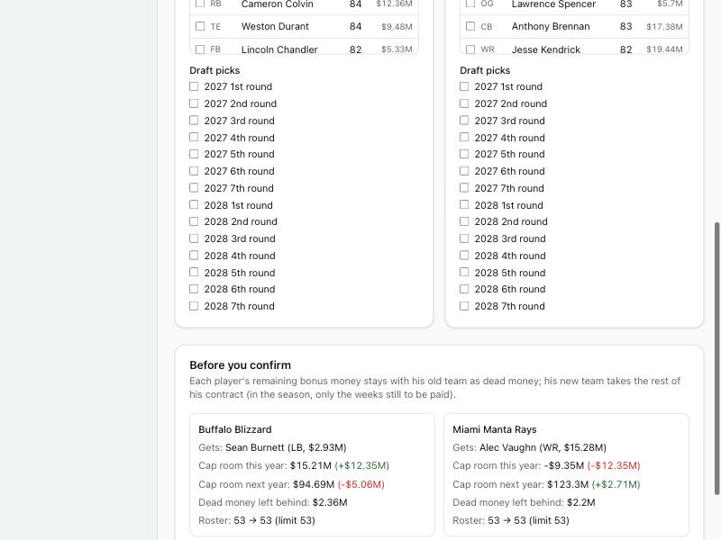
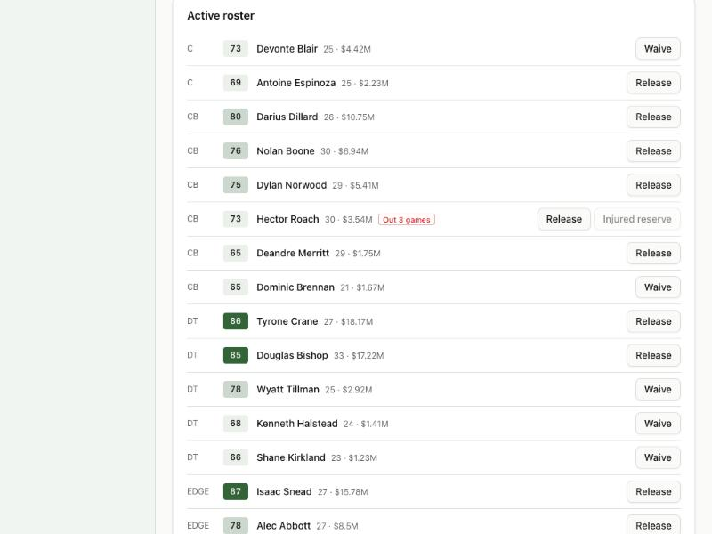

# Devlog 8b: Trades and the roster screens

_Phase 8b, October 2026_

You can now see and steer everything Phase 8a built. Five new screens:

- **Trade builder:** any two teams, any players and draft picks, with both teams' cap room and roster before and after, checked against the rules before you confirm.
- **Manage roster** (on each team's page): the active roster, practice squad and reserve lists, each player with the moves allowed right now, and free agents to sign.
- **Transactions log:** every signing, cut, claim, trade, injured-reserve move and contract change, newest first, each with its reason. One page for the whole league, and a tab on each team's page.
- **Calendar:** the League Year's dates and deadlines, where the league is, whether trading is open, and what the sim buttons will do.
- **Training camp:** the preseason standouts, who improved, whether each made the 53, and the waiver claims at final cuts.

Until GM Mode (Phase 14), the league office can make these moves for any team. AI teams don't propose or judge trades yet; that's Phase 13.

## What was built

- **Trades:**
  - **What a trade can include:** any number of players and draft picks between two teams. Picks can be future years' (as far ahead as teams hold them), and this year's until the draft.
  - **The money:** each player's remaining bonus money stays with his old team as dead money (all of it before June 1; this year's share after, the rest next year). The new team takes the rest of the contract, and in the season only the weeks still to be paid.
  - **The preview** shows each team's cap room this year and next, before and after, the dead money left behind, the roster count against its limit, and what each team gets. A test checks the preview is exactly what the trade then does.
  - **Refused** (with the reason) when:
    - it's outside the trading period (from the new League Year in March to the deadline, Nov 10 in 2026);
    - either team would be over the cap or the roster limit;
    - a player isn't the team's to trade, or is on the practice squad.
  - **Recorded** as one transaction listing everything that moved.
- **Roster moves**, each with a button that explains itself (hover for what it does, or why not):
  - **Waive or release:** waive if he has fewer than four seasons (claims happen in order), release if he's a vested veteran. Shows the dead money if he clears.
  - **Injured reserve:** only if he's out four or more games.
  - **Activate:** from injured reserve or the PUP list once he's healthy and past the minimum, using one of the season's eight returns.
  - **Promote:** a practice-squad player to the 53 (a minimum deal for the weeks left).
  - **Elevate:** a practice-squad player for this week's game. Two a week, three times a season.
  - **Sign a free agent:** to the 53 or the practice squad (within the six-veteran limit), best available first, filtered by position.

  Every move is first tried on a copy of the league. One that would break a roster or cap rule is refused with the reason and changes nothing.

- **Unique jersey numbers.** A player who joins a team keeps his number if it's free, otherwise he takes the first free one in his position's range. The longest-serving player keeps a contested number.
- **Tests (334 in all; 12 run only on this computer):**
  - **Trades:** a player for a player and a pick (dead money, the new team's cap hit, the pick's new owner, the preview equal to the result); refused past the deadline, over the cap, over the roster limit, and for a practice-squad player; previews never change the league.
  - **Roster moves:** a refused move changes nothing; waive-then-sign keeps 53, with reasons and unique numbers; an elevation counts for the week.

## Checked in the browser

- **The trade builder** caught a real problem. Buffalo's best receiver for a Miami linebacker would have put Miami $9.35M over the cap, and the button stayed off with that reason. A linebacker-for-a-4th-round-pick deal was refused because Buffalo would be at 54 players and $65K over.
- **Manage roster** shows 53 of 53, a full practice squad, and six injured-reserve returns left (two were used naming players at final cuts). A corner out three games can't go on injured reserve ("needs 4 or more").
- **The calendar** lists every 2026 date, with Week 1 next and trading open. **The camp report** lists the top grades, who improved, and who made the 53.

## What surprised us

- **Who carries what.** The preview's "gets" line first showed a traded player's cap number on his new team (salary only, since his bonus stays behind), next to his old team's room change, which counts the bonus. Both were right, but side by side they read like an error. The line now says "on their cap this year".
- **Copies have to be deep enough.** The light league copy the previews use (from Phase 7b) shared a few lists that roster moves change in place, such as the season's injured-reserve returns. A refused move could have used up a return. The copy now copies everything a move can touch.

## Not done yet

- AI teams don't trade with each other or judge offers (Phase 13, with the anti-exploit tests).
- The CBA's three-week pay guarantee for a player signed off another team's practice squad isn't modeled.
- The non-football injury list waits for non-football injuries (Phase 9).

---

[← 8a: The League Year and the roster rules](0008a-league-year.md) · [Index](README.md) · [9a: Players grow, age and retire →](0009a-development-aging-retirement.md)
