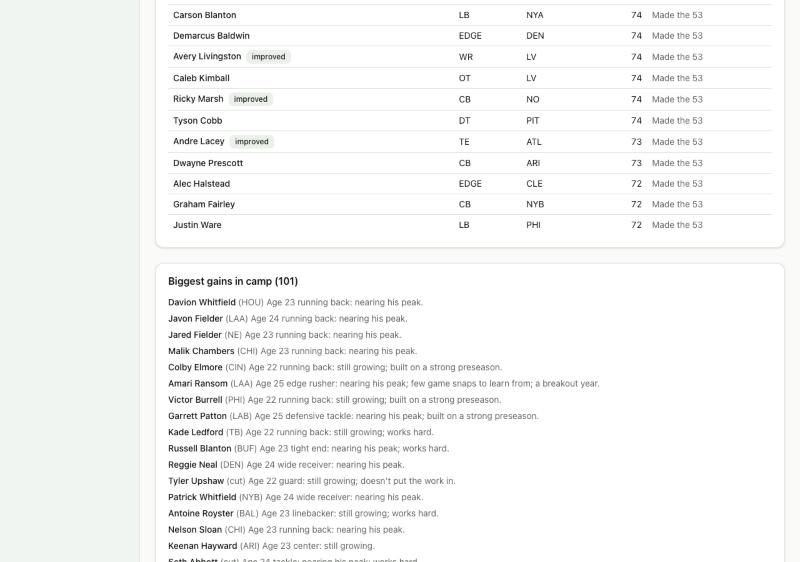

# Devlog 9a: Players grow, age and retire

_Phase 9a, October 2026_

Until now a player's ratings never changed: a 22-year-old rookie was the same player at 35. Now careers have arcs:

- young players grow toward their hidden potential;
- veterans decline on their position's real curve (running backs early, quarterbacks late);
- players retire for real reasons, each recorded.

Thirty simulated seasons in a row keep the league's age mix and talent level steady, and careers by position mostly look like the NFL's.

## Real data first

`npm run pipeline -- lifecycle` builds `calibration/lifecycle.json` from nflverse (no names kept):

- **How players age, by position.** For every player who played two seasons in a row (2013–2025), we measured the change in his share of his team's snaps, by age. Quarterbacks use efficiency instead (expected points per play), since a starting quarterback plays every snap whether he's improving or not. This gives each position's growth years, peak and decline. Peak ages: running backs and tight ends 25; receivers, linemen, corners, safeties, linebackers and defensive tackles 26; edge rushers and fullbacks 27; quarterbacks 28.
- **Career lengths:** every player who entered the league from 2000 to 2012 (careers now finished), first season to last, by position.
- **Retirement ages:** the age in each of those players' last season.
- **The age mix:** everyone who played in 2025 (mean 26.35).

## What was built

- **Development, twice a year.**
  - **When:** most of a year's change comes at the new League Year in March, before contracts and free agency, so teams decide on who players are now. The rest comes in training camp, after the preseason.
  - **Growth:** before his position's peak, a player closes part of the gap to his hidden potential each year. The share each year follows the real curve's timing (fast early, slowing toward the peak). Good work ethic and real playing time last season speed it up.
  - **Decline:** past the peak, players lose ground along their position's real curve, faster if their body is wearing down (low durability). After 30, speed, acceleration and the other physical traits take most of the loss; skills hold up longer.
  - **Luck:** every player has good and bad years. For young players some of that luck shows up in their potential too, so breakouts and busts are real. After the peak, potential fades toward what the player is.
  - **Reasons:** every change of 3 points or more is recorded, for example "Age 31 running back: lost a step; his body is wearing down."
  - **During the season:** small and rare weekly changes. A young player getting a starter's snaps sometimes gains a point; a veteran past his peak who isn't playing sometimes loses one. They happen after the whole week's games, so "Play and watch" still gives the same week as simming it.
- **Training camp and close position battles** (your call: close battles only).
  - A strong preseason adds a little to a player's camp development if he has room to grow and good work habits. This replaces Phase 8's separate preseason boost.
  - When two players at a spot are within a couple of points, the preseason grade can decide who starts: worth up to 1.25 points either way, so a 3-point gap always holds. The depth chart marks the winner with a "camp" tag ("Won the job in camp (preseason grade 84)").
- **Retirement, replacing the placeholder.** Each offseason every player weighs it:
  - **Age**, against his position's real late retirement age (most of the effect): a 24-year-old corner almost never walks away, a 35-year-old almost always does, and a quarterback lasts longer than a running back of the same age.
  - **How far he's fallen** from his best season.
  - **A championship**, at or past the usual age: some go out on top.
  - **An expiring contract.**
  - **A fringe role** at 29 or older.
  - **A long injury** at 28 or older.
  - **Free agents** nobody played all season retire (after one idle season at 27 or older, two when younger).

  Each retirement records its main reasons ("Retired at 34: late in a career at his position, 9 points off his best.").

- **Rating history:** each player keeps a line per season (overall, age, team, position). The chart on the player page comes in 9b.
- **The draft feeds the balance.** The placeholder draft (until Phase 11) now gives prospects a little more room to grow, and kickers, punters and long snappers arrive closer to ready (teams still don't spend early picks on them).
- **The long run:** `npm run sim -- --lifecycle 30` prints, season by season, the age mix, starters' average overall, players rated 80+ and 90+, the free-agent pool and retirements, then career lengths by position next to the real ones. `--out` saves the final league, and `--calibrate --league <file>` can now run the scorecard on it.
- **Saves:** format 9. Older saves load with an empty rating history.
- **Tests (359 in all; 12 run only on this computer):**
  - age curves: running backs peak and decline before quarterbacks; growth stops at the peak; decline keeps steepening past the measured ages;
  - growth toward potential, faster with work ethic and snaps, none at potential; the average over many draws matches the expectation;
  - veterans lose speed faster than skills; potential fades;
  - the same seed gives the same development, and every notable change has a reason;
  - retirement odds by age and position; idle free agents retire;
  - a strong camp wins a job from a player a point better, but not from one three points better;
  - the 10-season legality test now also checks the age mix, starter quality, stars and that long careers peak in a player's prime.

## Thirty seasons

`npm run sim -- --lifecycle 30 --seed 42` (a generated league), every fifth season:

| Season | Mean age | Ages (10th/25th/50th/75th/90th) | Starters' avg overall | Rated 90+ | Rated 80+ |
| ------ | -------- | ------------------------------- | --------------------- | --------- | --------- |
| 2026   | 26.4     | 22/24/26/29/31                  | 76.4                  | 33        | 281       |
| 2030   | 26.5     | 23/25/26/28/30                  | 76.8                  | 54        | 327       |
| 2035   | 26.7     | 23/25/27/29/31                  | 77.1                  | 56        | 334       |
| 2040   | 26.6     | 23/24/26/29/30                  | 76.7                  | 39        | 319       |
| 2045   | 26.5     | 23/24/26/29/30                  | 76.4                  | 46        | 312       |
| 2050   | 26.6     | 23/24/26/28/30                  | 76.4                  | 41        | 298       |
| 2055   | 26.7     | 23/24/26/29/30                  | 76.7                  | 55        | 323       |

- **Age:** the real league's 2025 mix is mean 26.35, percentiles 23/24/26/28/31. The sim stays within a few tenths of a year; its oldest tenth retires about a year early.
- **Talent:** starters hold at 76–77 the whole way. By position, every group's starters end within about 2 points of where they began (the five line spots, which come from one pool, spread that much among themselves too).
- **Stars:** the league settles at about 40–55 players rated 90+, up from 33 at the start. The real league starts with only 14 and settles at about 40–50 too: the real ratings (Madden-based) have fewer stars than our scale produces over time.
- **The real league** (`--league`, seed 3): starters 76.0 at the start and 76.7 thirty years on; mean age 26.5–26.9.

Career lengths (players who entered 2027–2044; seasons from first to last, real classes 2000–2012):

| Group | Sim  | Real | Last-season age, sim / real |
| ----- | ---- | ---- | --------------------------- |
| CB    | 4.3  | 4.1  | 26.1 / 25.9                 |
| DT    | 4.5  | 4.7  | 26.4 / 26.7                 |
| EDGE  | 6.6  | 5.6  | 29.2 / 27.4                 |
| LB    | 4.3  | 4.2  | 26.2 / 26.1                 |
| OL    | 6.0  | 4.8  | 28.4 / 26.8                 |
| QB    | 5.3  | 6.0  | 27.1 / 28.2                 |
| RB    | 4.6  | 4.1  | 26.4 / 25.9                 |
| S     | 6.7  | 6.6  | 29.4 / 28.1                 |
| TE    | 4.7  | 4.5  | 26.5 / 26.5                 |
| WR    | 4.3  | 4.0  | 26.1 / 25.9                 |
| FB    | 7.4  | 5.6  | 29.8 / 27.6                 |
| K     | 12.0 | 6.7  | 34.2 / 29.4                 |
| P     | 11.9 | 5.9  | 34.1 / 28.8                 |
| LS    | 12.9 | 10.0 | 35.1 / 32.5                 |

Running backs and receivers have the shortest careers and quarterbacks among the longest, as in the real league. Most groups are within half a season.

## Scorecard

Seasons 1 and 2 (four leagues, two seasons each), and a league 30 seasons on:

| Run                                   | League stats in range | Player level |
| ------------------------------------- | --------------------- | ------------ |
| Generated, seed 42                    | 62 of 63              | 36 of 48     |
| Generated, seed 7                     | 62 of 63              | 32 of 48     |
| Real league, seed 42                  | 60 of 63              | 31 of 48     |
| Real league, seed 7                   | 62 of 63              | 36 of 48     |
| Generated, 30 seasons on (`--league`) | 59 of 63              | 32 of 48     |

- **Seasons 1–2** look as they did in Phase 8. The remaining misses are the long-standing success-rate gap, plus one-off edge cases (own-territory 4th-down go rate on seed 7; sack rate and the spread of team scoring on real seed 42, both just outside and back in range on seed 7).
- **Thirty seasons on**, the engine's numbers mostly hold. Yards per attempt is just under its range (6.82 vs. 6.84 minimum), net punting is a little long, and the own-territory go rate is a hair high.

## What surprised us / what broke

- **The real curves understate growth.** Share of snaps can't show a full-time starter getting better: he already plays every snap. Sizing growth from the curve made the league lose about a point of starter quality a year. Growth is now sized by each player's potential (the curve sets only its timing), and decline by the curve.
- **Positions drifted apart.** Starter quality held overall, but after 30 seasons running backs and receivers were 3–4 points worse and edge rushers 3 better, and passing fell well below the real range (6.50 yards per attempt). Positions that wear out sooner spend less of a career at their peak. Their prospects now get a little more room to grow, sized from that drift, while the real decline curves stay as measured.
- **Kickers faded over decades.** Drafted kickers started as weak as other late-round picks but have little growth ahead, so after 30 seasons the average starting kicker was 6 points worse. Specialists now arrive closer to ready.
- **A team cut its own draft pick to make room for its next one.** Different ratings after development made a team at 90 players waive the tight end it had just taken in the 6th round to fit its 7th-rounder. Teams no longer cut this year's draft picks to make room on draft day.

## Not done yet

- **Careers that run long:** edge rushers (6.6 seasons vs. real 5.6), offensive linemen (6.0 vs. 4.8), and especially kickers and punters (12 vs. 6–7). Once a specialist has a job, nobody competes for it; that's AI roster judgment (Phase 13).
- **The injury model, the injury report, the rating-history chart and the development report** are Phase 9b.
- **Coaching** doesn't affect development yet (a hook for Phase 10).

---

[← 8b: Trades and the roster screens](0008b-trades-and-roster-screens.md) · [Index](README.md) · [9b: Injuries, the injury report, and seeing careers →](0009b-injuries-and-screens.md)
