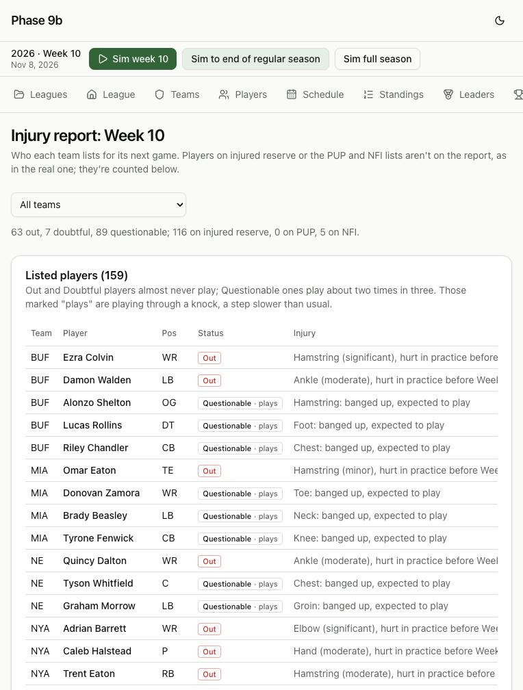

# Devlog 9b: Injuries, the injury report, and seeing careers

_Phase 9b, October 2026_

Injuries used to be a single number: hurt for so many games, everyone healed in the offseason. Now each one has:

- a body part and a severity;
- a recovery time from real injury reports;
- a status on a weekly injury report.

Injuries also:

- come back: a recent return makes the same body part more likely to go again;
- can leave a lasting mark: a severe leg injury costs speed;
- can carry over the offseason.

Players get hurt in practice and training camp as well as in games, so teams lose players at the real rate. Three new screens show it all: the injury report, the development report, and each player's career arc and injury history.

## Real data first

`npm run pipeline -- injuries` builds `calibration/injuries.json` from nflverse's weekly injury reports, weekly rosters and snap counts (2016–2025, leaving out 2020's COVID lists; no names kept).

- **An injury "episode"** starts when a player is listed Out, Doubtful or Questionable with a body part. It lasts while he stays listed with that part or sits on injured reserve.
- **Games missed** are his team's games he didn't play in.
- **Per team-season:** 45.7 episodes, 30.8 of which cost at least one game.
- **Severity of those that cost games:** 40% one game, 20% two, 12% three, 11% four or five, 5% six to eight, 12% nine or more.
- **Body parts:** knee, ankle and hamstring lead at every severity; knee injuries are 29% of the longest ones. Players moved straight to injured reserve never appear on a report, so their body part is unknown (46% of the longest injuries). Each severity's mix comes from the episodes where it is known.
- **Reinjury:** in the eight weeks after a return, the same body part is 2.1 times as likely to be the next injury as chance alone would say.
- **The weekly report, per team:** 1.9 Out, 0.3 Doubtful, 2.5 Questionable. Questionable players play 67% of the time; Doubtful and Out almost never.
- **Reserve lists, per team-season:** 3.2 on injured reserve at Week 1 and 6.2 more placed during the season; 0.5 on PUP and 0.2 on NFI at Week 1.

## What was built

- **Injuries with types.**
  - **In games:** the engine still decides who gets hurt and whether he returns, at the real per-snap rates. One who doesn't come back misses the real distribution of games; one who does is "banged up" (see knocks below).
  - **In practice:** each week brings the injuries the real reports show beyond the in-game ones. Their severity mix is whatever the real total needs once the in-game injuries are counted. Positions are hurt in proportion to their real injury rates, so kickers, punters and snappers rarely are.
  - **Body part:** drawn from the real mix for the injury's length, with reinjury: a player back from a hamstring injury within eight weeks is more likely to hurt it again.
  - **Severity words:** minor (one game), moderate (two or three), significant (four to eight), severe (nine or more), as in "Hamstring (significant), hurt in practice before Week 7".
  - **Lasting damage:** a severe injury to the legs (knee, ankle, foot, Achilles, hamstring, calf, hip) costs 2 points of speed, acceleration and agility, plus half a point a year past 28. This is a judgment call, not measured.
  - **Medical staff:** a hook (recovery time × 1 for now; Phase 10's staffs set it).
- **The weekly injury report.**
  - A player who will miss the game is listed Out. On the last game of an absence he's sometimes listed Doubtful or Questionable instead.
  - A player with a knock (hurt but able to play) is listed Questionable and plays, a step slower: 2 points off his speed, acceleration and agility for the game.
  - Players on injured reserve and the PUP and NFI lists aren't on the report, as in the real one.
- **Training camp and the offseason.**
  - Camp has its own injuries, half when camp opens and the rest over the preseason weeks, so some are still out at final cuts and go on injured reserve.
  - Non-football injuries put players on the NFI list; still out at cuts, they go to Reserve/NFI, like PUP.
  - The offseason heals six games' worth of a long injury; anything longer carries into camp, and the player starts on the PUP list.
  - Free agents heal week by week too.
- **Injured reserve:** AI teams put a player on it when he's out six or more games. The rule allows four, but real teams keep shorter injuries on the 53. When a position runs short of healthy players, anyone out four or more goes, and the team signs a replacement at that position.
- **Retirement** now also weighs a severe injury in the season just ended (at 30 or older) and an injury carried into the new season.
- **Development fix:** a young player closes at most 60% of his remaining room to grow in one year. Before, the year before a position's peak handed over all of it at once: a 24-year-old tight end jumped 14 points in one March.
- **Screens:**
  - **Injury report** (`/injuries`): every team's listed players, or one team's, with status, body part, how it happened and games still to miss, plus the reserve-list counts.
  - **Development report** (`/development`): this season's biggest risers and fallers at the League Year, in camp and over the season, each with its reason.
  - **Player page:**
    - a career-arc chart: overall at the end of each season as your staff sees it, with this season so far as an open dot (hover or use the arrow keys for age, team and position; a season-by-season table underneath);
    - this season's development notes;
    - his injury history;
    - his health line with his report status.
- **The runner:** `npm run sim -- --injuries N` prints, season by season and on average, injuries costing games, reserve lists and the weekly report next to the real numbers.
- **Saves:** format 10. Older saves load; a current injury gets an unknown body part and a severity from its length.
- **Tests (372 in all; 12 run only on this computer):**
  - severities, and practice injuries filling the real total;
  - reinjury raising the same body part's odds, and not long after a return;
  - a knock: listed Questionable, he plays, slower;
  - an injury: body part, severity, Out, history, he sits;
  - lasting damage, worse at 32 than at 24;
  - offseason carryover;
  - a full season's injuries, reserve lists and weekly report in bands around the real numbers, with the screens' sorting;
  - a format-9 save upgrading.

## How it compares

`npm run sim -- --injuries 3 --seed 42`, per team-season (three seasons averaged):

| Measure                                 | Sim        | Real                       |
| --------------------------------------- | ---------- | -------------------------- |
| Injuries costing games                  | 31.0       | 30.8                       |
| … of which in games / in practice       | 8.3 / 22.7 | (not split in the reports) |
| Injured reserve at Week 1               | 3.0        | 3.2                        |
| Placed on injured reserve in the season | 7.5        | 6.2                        |
| PUP at Week 1                           | 0.39       | 0.48                       |
| NFI at Week 1                           | 0.14       | 0.19                       |
| Listed Out, per team-week               | 1.6        | 1.9                        |
| Listed Doubtful                         | 0.30       | 0.30                       |
| Listed Questionable                     | 2.5        | 2.5                        |
| … of whom play                          | 68%        | 67%                        |

- **Severity:** one game 40% (real 40%), two 19% (20%), three 12% (12%), four or five 9% (11%), six to eight 6% (6%), nine or more 14% (12%).
- **Body parts:** knee 18% (real 18%), ankle 16% (14%), hamstring 11% (13%), shoulder 6% (7%), concussion 6% (7%), groin 5% (5%), foot 4% (4%).
- **Slightly off:** a little too much injured reserve in the season and a few too few players listed Out. Teams send short-handed positions' 4-game injuries to injured reserve rather than listing them Out week after week.

## Scorecard

Four leagues, two seasons each:

| Run                                   | League stats in range | Player level |
| ------------------------------------- | --------------------- | ------------ |
| Generated, seed 42                    | 61 of 63              | 33 of 48     |
| Generated, seed 7                     | 60 of 63              | 33 of 48     |
| Real league, seed 42                  | 59 of 63              | 31 of 48     |
| Real league, seed 7                   | 61 of 63              | 30 of 48     |
| Generated, 10 seasons on (`--league`) | 58 of 63              | 28 of 48     |

- **Misses in seasons 1–2:** the long-standing success-rate gap, plus lines a hair past their edges that come and go by seed. Net punting is 41.8–41.9 vs. a 41.82 maximum; interceptions, long field goals, and yards per attempt on real seed 42 sit exactly at 6.84.
- **Ten seasons on:** two new misses.
  - **Third-down conversions** run a little high.
  - **Team strength spreads too little** (2.9 points a game between teams vs. a 3.4 minimum). With every team run by the same simple roster AI, good and bad teams drift toward the middle over the years. Real GMs who build (and tear down) teams arrive in Phase 13.
- **Thirty seasons** (`--lifecycle 30`) stay stable with real injury rates: starters 75.9–76.7, mean age 26.2–26.5, the free-agent pool 100–190.

## What surprised us / what broke

- **Three-quarters of real injuries never show up in a play.** The play-by-play flags about 8 injuries per team-season that cost games; the real injury reports show 31. The rest happen in practice, or a player finishes the game and misses the next week. With only the in-game ones, our starters stayed far healthier than real starters.
- **Realistic injuries cost the passing game.** With backups playing as often as they really do, yards per attempt fell to about 6.8 and the receiving leaders lost 15%. The engine had been tuned on healthier teams. Two engine settings moved: the completion nudge from 0.09 to 0.11 (0.14 restored passing but pushed scoring to the top of its range), and the sack-rate scale from 0.76 to 0.72 (backup linemen and quarterbacks took the real league's sack rate to 0.076, over its 0.074 edge).
- **Kickers kept getting hurt.** At first practice injuries hit every position alike. Backup kickers then missed field goals and coaches went for it more on fourth down. Positions are now hurt in proportion to their real injury rates.
- **A team ran out of defensive backs.** Keeping 4–5-game injuries on the 53 meant a team with several hurt corners and safeties had no open spot to sign replacements. On one long run the engine found no defensive back or linebacker to make the tackle, and the game stopped. Teams now use injured reserve sooner at a short position, and the engine falls back to any defender.
- **Bye weeks ended injuries.** In the data step, a bye week (no roster row) closed every open injury, which cut injured-reserve stints in half and hid most long injuries. Bye weeks now change nothing.
- **The free-agent pool ran dry.** With real injury rates, teams sign more replacements, and after 30 seasons only about 30 free agents were left. Two fixes: the placeholder draft's undrafted pool grew from 200 to 320, and a bug was fixed where a never-signed prospect always counted as idle for exactly one season.

## Not done yet

- **Injury reports by position:** body parts don't depend on position (a quarterback's throwing shoulder isn't special yet).
- **The medical staff** affects nothing until Phase 10.
- **Career lengths** for edge rushers, safeties, kickers and punters still run long (Phase 13's roster AI).

---

[← 9a: Players grow, age and retire](0009a-development-aging-retirement.md) · [Index](README.md) · [10a: Coaches call the plays →](0010a-coaches-call-the-plays.md)
