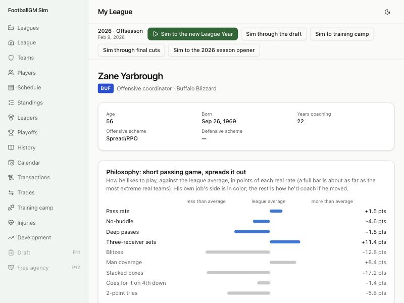

# Devlog 10a: Coaches call the plays

_Phase 10a, October 2026_

Until now every team called plays from the same league-average tables, made the same 4th-down calls and blitzed at the same rate; coaches were names with placeholder ratings that nothing read. Now each team has a twelve-person staff, and who's on it decides how the team plays:

- its offensive coordinator decides how often it passes, how fast it plays, how often it throws deep and how often it goes three-wide;
- its defensive coordinator decides how often it blitzes, plays man coverage and stacks the box;
- its head coach decides how aggressive it is on 4th down and 2-point tries, and how disciplined.

How much teams differ now matches how much real teams differ. Position coaches speed up or slow down their players' development, the strength coach and head trainer move injuries, and every player has a fit in his team's schemes.

## Real data first

`npm run pipeline -- coaching` builds `calibration/coaching.json` from nflverse play-by-play and participation, 2016–2025 (320 team-seasons; no names kept). For each team-season:

- **Offense:** pass rate over expected in neutral situations (nflverse's expected pass rate), no-huddle share, share of passes thrown 20+ yards, 11-personnel share (2016–22), shotgun share;
- **Defense:** blitz rate (5+ rushers), man-coverage share (2018–25), 8+ in the box on early-down runs;
- **Head coach:** 4th-down go rate over expected (against the league's rate at the same distance and field zone), 2-point tries per touchdown.

For each tendency it stores how much teams differ, with one season's sampling noise taken out. It also stores how stable the tendency is from one season to the next with the same head coach versus a new one, which shows what belongs to the coach:

| Tendency                | Same coach next year | New coach |
| ----------------------- | -------------------- | --------- |
| No-huddle               | 0.74                 | 0.00      |
| 11 personnel            | 0.64                 | 0.17      |
| Man coverage            | 0.47                 | 0.00      |
| 4th-down aggressiveness | 0.63                 | 0.39      |
| Pass rate over expected | 0.44                 | 0.20      |
| 2-point tries           | 0.21                 | 0.35      |

2-point tries don't follow the coach (they follow the scoreboard), so that style stays small. Real head-coach changes average 7.3 per offseason; 10b's carousel will aim for that.

## What was built

- **The staff:**
  - **Twelve per team:** head coach, offensive and defensive coordinators, special teams, a quarterbacks-and-skill-positions coach, offensive line coach, defensive front coach, defensive backs coach, strength and conditioning coach, head athletic trainer, two scouts.
  - **Skills (0–100):** offensive and defensive play calling, development, leadership (also discipline), game management, scouting, and health for the strength coach and trainer.
  - **A style:** how he leans on each tendency, in the real units.
  - **Generated coaches** draw their style from the real spread between teams.
  - **Real coaches** (private build): 94 of the 96 head coaches and coordinators get their real tendencies. A coordinator gets his team's 2025 season; a head coach gets his 4th-down and 2-point habits over every season he was a head coach. Each is pulled toward the average in proportion to how noisy its sample is.
- **The engine plays each staff's style.** A coordinator's style shifts the real tables the engine already uses: pass rate, pass depth, personnel groups, the share of 5+ rushers, man coverage, stacked boxes. More no-huddle snaps mean a faster pace. The head coach's style sets the 4th-down and 2-point aggressiveness that Phase 5 built (its range doubled so real coaches' differences show up).
- **A small skill edge:** a better play caller gains a little on every snap against the other side's play caller. It's zero-sum across the league, so league totals don't move.
- **Discipline:** the head coach's leadership moves pre-snap penalties by up to about 10%.
- **Scheme fit:**
  - **What each scheme prizes,** by position. Air Raid receivers: route running, release, speed. Power Run linemen: run blocking, strength. Man Pressure corners: man coverage, speed. 3-4 vs. 4-3 fronts: strength vs. speed.
  - **Fit** (−1 to +1) compares how much a player's prized skills stand out from the rest of his game with an average starter's, so a typical player is neutral in every scheme.
  - **What it does:** a full fit or misfit is worth up to 3 overall points on game day and on the depth chart, and up to 5% faster or slower development.
  - **Changing coordinators changes fits:** some players get better and some worse.
- **Staff effects** (Phase 9's hooks; each 1.0 for a typical staff):
  - **Development:** position coaches move their group's by up to about ±10%; the head coach moves everyone's by ±3%.
  - **Injuries:** the strength coach moves injury risk by up to ±10%; the head trainer moves recovery time by up to ±10%.
  - **Neutral on average:** across a league, development averages 1.000.
- **Screens:**
  - **Staff tab:** each coach's job, main skill, scheme and style in a few words ("short passing game, spreads it out"), or what his job does ("Development for EDGE, DT, LB +8%").
  - **Coach profile:** a philosophy chart, each tendency against the league average in points. His own side is in color; the rest (how he'd coach if he moved) is muted. Plus what he does in his job, and his skills.
  - **Fit tags:** on the roster (a sortable Fit column) and depth chart, and a fit line on the player page ("Good fit in his team's Air Raid").
- **The runner:** `npm run sim -- --coaching N` prints how much teams differ in each tendency, sim vs. real.
- **Saves:** format 11. Older saves load: coaches get a style, and every team's staff fills out to twelve.
- **Tests (385 in all; 12 run only on this computer):** opposite staffs on identical rosters; coordinator changes moving fits; fit profiles; neutral staff effects; full staffs; format-10 saves upgrading.

## How much teams differ

`npm run sim -- --coaching 2`: the spread of each tendency across teams in one season (standard deviation), sim vs. real.

| Tendency                       | Generated league | Real league | Real NFL |
| ------------------------------ | ---------------- | ----------- | -------- |
| Pass rate over expected        | 0.037            | 0.032       | 0.044    |
| Deep-pass share                | 0.019            | 0.018       | 0.022    |
| 11-personnel share             | 0.108            | 0.105       | 0.127    |
| Blitz rate                     | 0.066            | 0.060       | 0.069    |
| Man coverage                   | 0.094            | 0.071       | 0.109    |
| 4th-down go rate over expected | 0.056            | 0.044       | 0.046    |

Generated leagues land within about 15% of the real spreads. The real league runs a little narrower, because each real coach's numbers are pulled toward average by how noisy his sample is: one season for a coordinator. Real teams also differ for reasons beyond the coach (their quarterbacks, their opponents), which the sim doesn't add.

## Scorecard

Four leagues, two seasons each:

| Run                                   | League stats in range | Player level |
| ------------------------------------- | --------------------- | ------------ |
| Generated, seed 42                    | 61 of 63              | 31 of 48     |
| Generated, seed 7                     | 61 of 63              | 33 of 48     |
| Real league, seed 42                  | 61 of 63              | 33 of 48     |
| Real league, seed 7                   | 61 of 63              | 32 of 48     |
| Generated, 30 seasons on (`--league`) | 59 of 63              | 31 of 48     |

- **Misses:** the long-standing success-rate gap, and net punting a hair over its edge (41.9 vs. 41.82).
- **Thirty seasons on:** team strength still spreads too little (Phase 13), and third downs convert a little often.
- **The 30-season balance holds** with staffs shaping development: starters 76.0–76.1, mean age 26.4–26.5.
- **Injuries** stay near real with strength coaches and trainers: 30 costing games per team-season (real 31).

## What surprised us / what broke

- **The 4th-down knob was too weak.** Teams looked as varied as real ones on 4th down, but most of that was sampling noise. A test with two opposite head coaches showed their go rates barely differed. The engine's aggressiveness range doubled (neutral for a typical coach), and now an aggressive coach goes for it as much more often as real ones do.
- **The blitz knob added instead of shifting.** Phase 5's blitz hook added weight to the 5+-rusher outcomes, which changed less than intended. All styles now tilt the real tables by an exact share, and the blitz spread went from 0.042 to 0.068 (real 0.069).
- **Lean on the right scale.** A coordinator's pass lean was first added flat to every down's pass rate. On 3rd and long (already 92% passes), run-leaning coaches pulled the rate down while pass-leaning ones hit the ceiling, so the league's 3rd-and-long pass rate fell below the real range. The lean now moves the log-odds: full size in neutral situations, where it was measured, and little where everyone passes.
- **More varied coaches go for it more on average.** The chance of going for it is a curve, so a league of differently aggressive coaches goes for it slightly more than a league of typical ones. The engine's baseline lean moved down a little (4th downs and 2-point tries) to keep the league's rates real.
- **Faster offenses broke saves.** A coordinator's faster tempo made the time between snaps a fraction of a second, and saved box scores need whole seconds. Tempo is rounded.
- **Scheme fit leaned by position.** At first guards and running backs fit their schemes worse on average and safeties better, because generated players' skill profiles differ by position. Fit is now measured against an average starter at the same position.
- **The special-teams coach was judged on the wrong skill.** He develops the kickers, but his main skill was game management, so specialists would have developed a little slower everywhere.

## Not done yet (10b)

- The coaching carousel: firings, interviews and hiring, staffs following head coaches, coaching trees, coach careers and reputations.
- Scouts are on staff with a scouting skill; the draft uses them in Phase 11.

---

[← 9b: Injuries, the injury report, and seeing careers](0009b-injuries-and-screens.md) · [Index](README.md) · [10b: The coaching carousel →](0010b-coaching-carousel.md)
