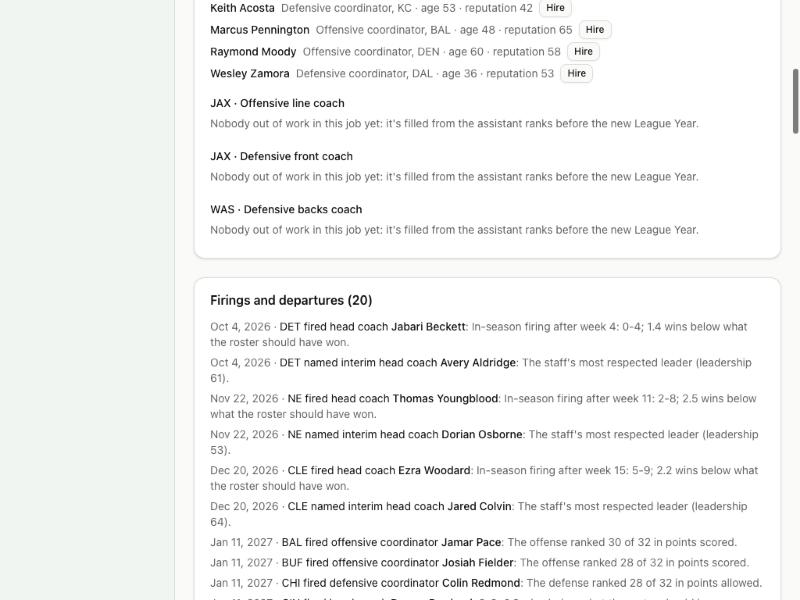

# Devlog 10b: The coaching carousel

_Phase 10b, October 2026_

Coaches now have careers, and the league hires and fires them like the real one:

- **Firings:** head coaches whose teams fall short of what their rosters should win are fired on Black Monday, and now and then during the season; coordinators whose units rank near the bottom sometimes go too.
- **Interviews:** teams interview other clubs' coordinators and position coaches, coaches out of work and new faces, under the league's interview rules.
- **Hiring:** a coach can't sign until his own season is over, so some teams wait for a coordinator still in the playoffs.
- **Staffs:** a new head coach keeps or replaces his coordinators, and promotions open jobs further down.
- **Careers:** every coach builds a record season by season, with the head coach he worked under, so coaching trees grow. Real head coaches start with their real careers.

Over 20 simulated seasons, head-coach changes average 7.2 a year (real: 7.2) and in-season firings 1.6 (real: 1.65).

## The real targets

From nflverse's schedules, which name every game's head coaches since 2000 (`npm run pipeline -- coaching`):

- **Head-coach changes between seasons:** 7.2 a year on average (3 to 11). A change means a team's main head coach differs from the season before.
- **During seasons:** 1.65 a year, counting only teams whose opening-day head coach was gone for good before the season ended.

## The interview rules

`rules/2026.json` `staff`, from the league's anti-tampering policy as reported for the 2023-24 and 2025 hiring cycles (the 2026 text wasn't found):

- another club's assistants may be interviewed starting three days after their team's last game, virtually while their team is still in the playoffs;
- in person after the divisional round;
- no coach signs or agrees to a contract until his own season is over;
- since 2020, clubs can't block their assistants from interviewing for coordinator jobs.

## What was built

- **Careers:**
  - **A line per season:** each coach records his team, his job, and the head coach he worked under. Head coaches also get the team's record.
  - **Also kept:** a contract end, a reputation (results, playoffs, titles, promotions; a firing costs some), and, for scouts, a position-group specialty for Phase 11.
  - **Aging:** coaches improve at their main skill until about 50 and slip after 64.
  - **Retirement:** coaches retire around 70, or after two seasons out of work.
- **Firings:**
  - **During the season,** after Weeks 4–15, rarely: a coach far below what his roster should win can go. The coordinator with the most leadership becomes interim head coach, and his side's best position coach calls the plays.
  - **On Black Monday,** the odds rise with how far the team fell short of its roster's expected wins and with losing seasons in a row. They fall in a coach's first two seasons and after a playoff season, and rise when his contract is up.
  - **Interim coaches** are kept one time in five.
  - **Coordinators** whose units ranked in the bottom half are sometimes let go.
  - Each firing says why, for example "5-12; 3.2 wins below what the roster should have won; 2 losing seasons in a row."
- **Hiring:**
  - **Interviews:** each head-coach and coordinator search interviews its top five candidates, dated by the rules (in person, or virtually while the candidate's team is still playing).
  - **When hires happen:** in rounds as each playoff round ends. A team takes its best candidate who's free to sign, unless a clearly better one is still in the playoffs (then it waits). Two teams after one coach: he picks the stronger program.
  - **Who's considered:**
    - head-coach searches look at other teams' coordinators, former head coaches and coordinators, and the team's own coordinators;
    - coordinator searches look at position coaches on that side (a promotion) and coaches out of work;
    - other jobs go to coaches out of work in that job.
  - **New faces** join a search only when its field is thin.
- **After a new head coach:** he keeps each coordinator about a third of the time, less often on his own side of the ball.
- **Before the new League Year,** every job left is filled.
- **Screens:**
  - **Coaching carousel page** (`/coaching`): firings and departures with reasons, each search with its interviews and hire, every hire and promotion, retirements, and the jobs still open with their best candidates. The league office can hire anyone free to sign, until GM Mode.
  - **Coach profile:** career table (season, team, job, record, the head coach he worked under), reputation and contract, "worked under" and his coaching tree, and a league-office Fire button.
- **The runner:** `npm run sim -- --carousel N` counts head-coach changes between and during seasons the way the real numbers were counted, plus coordinator departures, retirements, coaches out of work, and head coaches' average tenure.
- **Saves:** format 12. Older saves start every coach's career now.
- **Tests (393 in all; 12 run only on this computer):**
  - after a season, every team has a full staff and nobody is on two teams;
  - firings and hires carry reasons, and nobody signs before his team's last game;
  - careers record the head coach above each assistant;
  - the league office can fire and hire, and is refused for jobs that aren't open;
  - the same seed gives the same carousel;
  - format-11 saves upgrade;
  - the 10-season test checks head-coach turnover stays in a band.

## How it compares

`npm run sim -- --carousel 20 --seed 42` (a generated league) and `--carousel 10` on the real league:

| Measure                            | Generated (20 seasons) | Real league (10 seasons) | Real NFL |
| ---------------------------------- | ---------------------- | ------------------------ | -------- |
| Head-coach changes between seasons | 7.21                   | 6.67                     | 7.2      |
| Head-coach changes during seasons  | 1.58                   | 1.78                     | 1.65     |

- **The range:** single seasons run from 4 to 11 changes on the generated league; the real league ran from 3 to 11 since 2000.
- **Other turnover:** about 10–20 coordinators leave a year, about 15–25 coaches retire, and about 15–25 coaches are out of work at any time.
- **Tenure:** head coaches' average time with their current team settles around 4 years.
- **Real careers:** 26 of the 32 real head coaches start with their careers since 2000. The other six were new in 2025.

## Scorecard

Four leagues, two seasons each, with the carousel running:

| Run                  | League stats in range | Player level |
| -------------------- | --------------------- | ------------ |
| Generated, seed 42   | 60 of 63              | 32 of 48     |
| Generated, seed 7    | 61 of 63              | 34 of 48     |
| Real league, seed 42 | 62 of 63              | 33 of 48     |
| Real league, seed 7  | 61 of 63              | 33 of 48     |

- **Misses:** the long-standing success-rate gap, plus lines a hair past their edges on one seed or another (net punting, 2-point tries, long field goals, the real league's expected points per play at 0.028 on seed 42).
- **How much teams differ** in style still matches reality: blitz rate 0.077 vs. real 0.069, 4th-down aggressiveness 0.051 vs. 0.046.
- **Thirty seasons** with coaches coming and going stay stable: starters 75.9–76.2, mean age 26.3–26.5.

## What surprised us / what broke

- **Staff effects need the league's own average.** In 10a every effect was measured against a fixed "typical coach". A league whose strength coaches or defensive coordinators happened to come out a few points below that level gave every team the same nudge in one direction. The real league's scoring efficiency rose past its range when the generated assistants were reshuffled. Every effect (play-calling edge, development, injuries, discipline) is now measured against the average coach holding that job in the same league, so it balances exactly.
- **Dates out of order.** At first, Black Monday's hires were dated the Sunday before (the league's date hadn't moved), ahead of the firings and the interviews. All of Black Monday's moves are now dated the Monday, and a hire comes a few days after that candidate's interview.
- **The pool of coaches out of work kept growing.** Every search added two new faces whether or not it needed them, and after ten seasons 126 coaches were waiting. New faces now join only thin fields; the pool holds around 20.

## Not done yet

- **Coordinator turnover** isn't calibrated (nflverse doesn't record coordinators). About 10–20 coordinators leave each year, which looks right but isn't measured.
- **Owners** don't drive firings yet (Phase 13), and the user's own staff decisions wait for GM Mode (Phase 14).
- **Scouts'** accuracy and specialties come into play with Phase 11's draft.

---

[← 10a: Coaches call the plays](0010a-coaches-call-the-plays.md) · [Index](README.md) · [11a: Scouting and draft classes →](0011a-scouting-and-classes.md)
