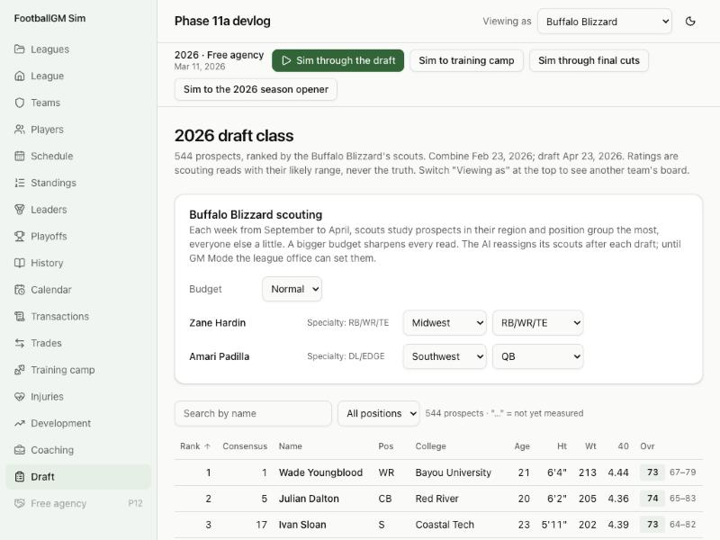

# Devlog 11a: Scouting and draft classes

_Phase 11a, October 2026_

Nobody sees true ratings any more. Every screen now shows what a staff believes: the truth plus an error that shrinks as the staff learns more. At the top of the screen, "Viewing as" picks whose eyes you look through:

- **The league office** (the default): a consensus, like an average scouting department.
- **Any team**: exactly what its scouts and coaches believe.

Draft classes are real objects now: prospects with combine results, scouted all year, drafted by each team from its own board.

## What was built

- **Ratings come with a range.** Every overall shows the staff's read and a likely range, for example "71, likely 66–76", with a confidence. Potential shows only as a range ("likely 78–86"), never the hidden number.
- **What sharpens a read:**
  - **NFL tape:** veterans are clear, rookies much less so.
  - **Being on the team:** a team sees its own players about twice as clearly.
  - **The scouts:** two per team. Their scouting skill counts, measured against the league's typical scout, as does the team's budget (low, normal or high).
  - **Study (prospects only):** each week from September to April, a scout studies prospects in his assigned region and position group the most, everyone else a little. A scout whose specialty covers a prospect's position learns more.
  - **Measuring:** the combine (about 337 invitees, as in real years) and pro days (everyone else, spread from March to April). After that, speed, strength and jumping are known almost exactly; skills and potential always stay a scouting read.
- **The error has two parts.**
  - **The league-wide read:** most of it is shared by everyone (all teams watch the same tape and hear the same buzz). A prospect's shared read starts at what prospects of his rank usually become, and moves toward the truth as he's studied.
  - **Each team's own read:** a smaller part, which is why boards differ.
  - The league office sees only the shared part. This is why first-round picks mostly follow the consensus while busts and gems still happen.
- **No dice are rolled on screens.** The error is fixed per viewer and player by a hash, so looking at a page never changes the future and the same page always shows the same read.
- **Draft classes:**
  - **When:** a class appears right after each draft, so the next year's is scouted all season. A new league starts with its 2026 class already scouted since September.
  - **Size:** one prospect per pick plus a pool of 320 who go undrafted.
  - **Positions and ages:** follow real drafts round by round.
  - **Drills:** every prospect has a 40, bench, vertical, broad jump, cone and shuttle, drawn from his true physical ratings on the real distribution for his position. Some skip drills at real rates. Drafted players keep their measured 40.
- **The real 2026 class (real league):**
  - **Who:** the 319 real combine invitees and every real 2026 draftee (345 in all), with real positions, sizes, ages and combine results, fictional names and schools.
  - **Ranking:** each is ranked by where he was really drafted. His true talent is drawn around that rank's level, so the real order is the consensus, not the truth.
  - **Physical ratings** come from his real drills.
  - **Every new game** redraws who turns out to be a bust or a gem. The rest of the pool is generated.
- **Draft day:** each team takes the top of its own board (its scouts' read of overall plus room to grow, nudged toward thin positions), and the undrafted rush follows the same boards. The clock, trades and compensatory picks are 11b.
- **Screens:**
  - **Draft page** (`/draft`): the class sortable by your board or the consensus, with ranges, potential, confidence and 40 times. When viewing as a team, its scouting budget and each scout's region and position group can be set.
  - **Prospect page:**
    - a scouting report in words (best traits, needs work, ceiling, how sure the scouts are, how his 40 ranked);
    - drills with percentiles against real prospects at his position;
    - every rating with a "±" band.
  - **Player page:** the overall's likely range and potential range, and the 40 marked "estimated from tape" unless he ran it.
- **The runner:** `npm run sim -- --draft 20` compares how picks turned out with real drafts (classes 1994–2020): started 3+ seasons, never started, seasons started. It reports by round and by overall pick.
- **Saves:** format 13. Older saves get scouting departments and their class on the first step.
- **Tests (430 in all):**
  - classes, drills and the reverse from real drills;
  - the combine and pro days;
  - assignments, and a better department giving tighter ranges;
  - "Viewing as";
  - draft day;
  - the real class and its redraw;
  - the format-12 upgrade.

## How it compares

`npm run sim -- --draft 20`, classes 2026–2039 (6+ seasons since the draft), share who started 3+ seasons:

| Picks   | Seed 42 | Seed 7 | Real NFL |
| ------- | ------- | ------ | -------- |
| 1–10    | 85%     | 84%    | 86%      |
| 11–32   | 76%     | 79%    | 73%      |
| 33–64   | 60%     | 54%    | 57%      |
| 65–100  | 40%     | 41%    | 37%      |
| 101–150 | 26%     | 29%    | 23%      |
| 151–200 | 21%     | 20%    | 15%      |
| 201–224 | 15%     | 17%    | 9%\*     |

\* The real group runs to pick 262 (compensatory picks and older drafts). Ours stops at 224, the better end of that group.

- **Busts and gems:** never started: picks 1–10 6% (real 3%), 201–224 71% (real 78%). About 6% of first-rounders never start, and a fifth of starting seasons go to undrafted players.
- **A "started" season** is 530+ snaps on one side (half a season), or 9+ games for kickers and punters. Teams average 21 players over that line a season; real teams about 23.
- **The real league's first draft** follows the real order closely at the top. In two games, 25–28 of the real top 32 went in round 1, and first-round picks landed about 7 slots from their real slot on average (12 in round 2, about 30 later).
- **Combine numbers** match the real ones: invitees' 40 times average 4.52 s at receiver (real 4.50), spread 0.10 s (real 0.10); 5.21 at tackle (real 5.20).

- **The long run holds:** in 30 seasons with the new classes (`--lifecycle 30`), starters average 75.3–76.9 and the mean age is 26.3–26.7 (real 26.35). Stars rated 90+ settle around 50–58, at the top of Phase 9's 40–55. Late-round and undrafted gems are a little more common now.
- **Scorecard** (four leagues, two seasons): 59 of 63 league stats in range, the same near-misses as before (success rate, net punting, 2-point tries, long field goals), and 34 of 48 player-level stats.

## What surprised us / what broke

- **The noise wasn't random enough.** Each read uses a hash of the viewer, the player and the rating, and the hash gave related numbers for keys that differ only in the last character. The four draws that make one bell-curve number were correlated, which made combine results 40% too spread out. A standard final mixing step fixed it, and hashing each key once made the screens three times faster.
- **Teams drafted too well.** At first the league's shared read learned 40% of each prospect's hidden difference before the draft, so few good players went undrafted. Undrafted players held 11% of starting seasons against about a quarter in reality, and mid and late picks started too often. Now the league learns little before the draft, and most of what a prospect becomes is found out on the field.
- **By round was the wrong comparison.** Real rounds 3–7 held 35–44 picks a year in 1994–2020; ours hold 32. The report now also compares by overall pick.
- **The scoring test was on the edge.** The CI guard measured only the first season of two new leagues, and a fresh league's first season scores about 0.7 points a game more than its second. The pair averaged 23.70 before this phase, against a top of 23.77, and the new draft tipped one league over. The guard now measures two seasons per league, as the scorecard does (23.61).
- **Teams cut their own new picks for waiver claims.** Fixed: before camp, a team doesn't cut a player it just drafted to make room.

## Not done yet

- **Draft day itself:** the pick clock, trades, compensatory picks, big boards with needs and philosophy, retro grades, mock drafts and draft history (11b).
- **Other AI decisions** (cuts, trades, free agency) still use true ratings; veterans' reads are close to the truth anyway. Phase 13's GMs move them onto their own staff's view.
- **Late picks still start a little more often** than real ones (151–224: about 6 points high).
