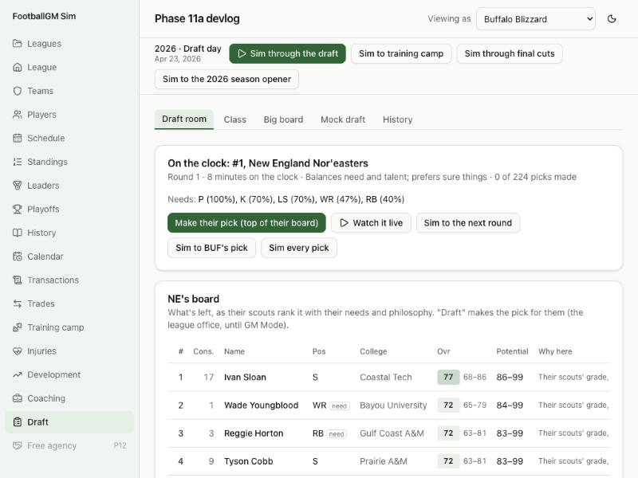

# Devlog 11b: Draft day

_Phase 11b, October 2026_

The draft is an event now, not a single step. On draft day the calendar stops with the first pick on the clock, and the draft room shows:

- the team on the clock, its needs, its philosophy and its board;
- the trade offers coming in for the pick;
- the picks coming up;
- a log of every pick and trade, with the reason.

You can make the pick yourself (as the league office, until GM Mode), let the AI pick one at a time, watch it live, sim to a team's pick or the next round, or sim the rest. Teams trade up and down at real prices, compensatory picks follow the CBA's formula, and every class is graded as its players' careers unfold.

## The real targets and rules

- **Draft-day trades** (nflverse/nfldata trades, 2011–2025):
  - **How many:** 31.7 trades a draft move a pick in that year's draft.
  - **What they cost:** in trades of only that year's picks, the team moving up gave a median 1.42 times the career value it got (middle half 1.30–1.56). Teams overpay to move up, as research on real drafts has long found.
- **Pick values:** the career value of each overall pick (weighted approximate value, classes since 1994), from 11a.
- **The pick clock:** 8 minutes in round 1 (shortened from 10 for 2026), 7 in round 2, 5 in rounds 3–6 and compensatory picks, 4 in round 7.
- **Compensatory picks**, from the CBA (Article 6 §2(a) and §10, Appendix V) and the 2017 owners' vote that made them tradable:
  - **Who counts:** unrestricted free agents (4+ accrued seasons) who signed with a new club, not on veteran-minimum or cheap one-year deals, ranked in the top 35% by the formula's points.
  - **The points:** average yearly pay (ranked), snaps (1 point per percentage point, from 25%), kicks and punts, and honors.
  - **Netting out:** losses cancel against signings in an equal or higher bracket.
  - **Where the picks go:** after rounds 3–7 by the lost player's bracket; at most 4 a club.
  - **Equal losses:** one pick when a club lost 300+ more points than it gained.
  - **Veterans:** a non-quarterback veteran with 10+ seasons brings no pick before round 5.
  - **Filling to one per club:** supplemental picks at the end of round 7, by draft order.

## What was built

- **A "draft day" stage** in the calendar, with a "Sim to draft day" button. "Sim through the draft" still runs the whole thing in one go.
- **Big boards:**
  - **Grades and needs:** each team ranks the class by its own scouts' grades, plus its needs (weak or aging starters, thin depth, read by its own staff) and its philosophy.
  - **Philosophy:** how much it drafts for need, and whether it likes upside or sure things. It's fixed per team until Phase 13's general managers.
  - **Boards by hand:** a board can be set by hand (Big board tab: move players up and down), and that team drafts from it.
- **Trades up and down:**
  - **When:** a team further down moves up for the top of its board when he's likely gone before its own pick and it gains clearly more by moving up than the team on the clock loses by moving down. Every board falls as picks go by, so a trade needs one team that loves a player and another that can live without him.
  - **The price:** it pays the cheapest set of its picks worth about the real price. Future picks count as a round later.
  - **In the draft room:** the room lists every offer for the pick on the clock. The AI takes the best one that clears its bar, and the league office can accept any.
- **Compensatory picks:**
  - **The record:** the free-agent market now records every unrestricted free agent who changes teams.
  - **The award:** the formula runs at the next League Year, and each pick comes with its reason (for example "Net loss of free agents in 2027 (lost 3, signed 1); for …").
  - **The real league:** its 2026 draft uses the real final order, including the real 33 compensatory picks and draft-day ownership.
- **Mock drafts:** the league office's consensus mock, or any team's (switch "Viewing as"). Every team takes the best player for it as those scouts see the class.
- **Draft history:** each class looked back on: every pick's seasons started against what real picks at that slot started in as many seasons, his peak (as your staff reads it), and a label (steal, hit, fair, miss, bust). Each team gets a grade for the class. A generated league lists only drafts it actually held; the real league also lists its players' real drafts.
- **The runner:** `npm run sim -- --draft 20` now also prints each draft's picks, compensatory picks, trades and median price.
- **Saves:** format 14. Older saves start with regular, unused picks.
- **Tests:**
  - a worked compensatory example (cancellation, brackets, the one-year exclusion, the veteran rule, the 4-pick cap, supplemental picks, numbering);
  - draft day pick by pick (office picks, AI picks, trading used vs. unused picks, sim to a team's pick);
  - a board set by hand being followed;
  - trade prices inside the band;
  - the draft room, offers, mock and history;
  - the format-13 upgrade.

## How it compares

`npm run sim -- --draft 20`, two seeds:

| Measure                           | Seed 42   | Seed 7    | Real NFL  |
| --------------------------------- | --------- | --------- | --------- |
| Draft-day trades a draft          | 34.9      | 33.3      | 31.7      |
| Price paid to move up (median)    | 1.41      | 1.42      | 1.42      |
| Price, middle half                | 1.34–1.48 | 1.35–1.48 | 1.30–1.56 |
| Picks 1–10 who started 3+ seasons | 85%       | 78%       | 86%       |
| Picks 11–32                       | 70%       | 72%       | 73%       |
| Picks 33–64                       | 59%       | 56%       | 57%       |
| Picks 65–100                      | 40%       | 44%       | 37%       |
| Picks 101–150                     | 29%       | 28%       | 23%       |
| Picks 151–200                     | 22%       | 23%       | 15%       |
| Picks 201–256                     | 16%       | 15%       | 9%        |

- **By round,** rounds 1–3 land within about 4 points of real drafts. Rounds 4–7 start 1–11 points more often than real ones (round 6 most): the late rounds hold many supplemental picks (see below), and late picks still win jobs a little more easily than real ones.
- **Busts and gems:** about 10% of first-rounders never start (real 7%); late-round gems (rounds 5–7, 3+ seasons started) are a little more common than in reality.
- **The real league's first draft:** in a test game, 27 trades, and first-round picks landed within about 5 slots of their real slot on average.
- **The long run** (`--lifecycle 30`):
  - starters average 75.8–77.0 and the mean age stays 26.2–26.7 (real 26.35);
  - stars rated 90+ drift up to about 55–70 late in the run, above Phase 9's 40–55, because draft classes now carry more hidden spread. To revisit with Phase 13's long-run tuning.
- **Scorecard** (four leagues, two seasons): 60 of 63 league stats in range (success rate, net punting and 2-point tries a hair outside, as before).

## What surprised us / what broke

- **Nobody traded at first.** The first rule asked the team on the clock whether it would lose little by waiting. Every team's board falls about 5 points over 20–40 picks, so the answer was almost always no: 1–4 trades a draft. Comparing the two teams' stakes (the team moving up must gain clearly more than the other loses) brought real numbers. Scaling the bar to the picks' worth spread trades into the later rounds.
- **Offers overpaid.** Adding picks one at a time to cover the price overshot it (2.0× for a seventh-round swap). Offers now use the cheapest combination of up to three extra picks that covers the price.
- **Kickers looked like every team's biggest need.** Every team carries one kicker, punter and long snapper, which read as "thin", and kickers play into their late 30s. Specialists' needs now count half, and they count as old only from 36.
- **The real 2026 draft order.** The league's own 2025 standings gave the right order but not the real draft-day ownership or the 33 compensatory picks. The real league now takes the real list.
- **A coaching gap found by the longer runs.** A coordinator's season line written right after his head coach was fired had no head coach above him. It now records the head coach who ran the team that season.

## Not done yet

- **Compensatory picks lean on supplemental ones.** The placeholder free-agent market moves few qualifying players, so about half of each year's 32 are supplemental (real: a few at most). Phase 12's free agency fixes the cause.
- **Honors** don't count toward compensatory points until the league names All-Pros (Phase 15), and punters score per punt only (no inside-the-20 stat yet).
- **Trades are picks only.** Players don't move on draft day yet, and the AI doesn't trade future picks for current ones on its own (Phase 13).
- **Late rounds still start a little often:** rounds 4–7 start 2–9 points more often than real ones.

---

[← 11a: Scouting and draft classes](0011a-scouting-and-classes.md) · [Index](README.md) · [12a: Free agency and negotiation →](0012a-free-agency.md)
