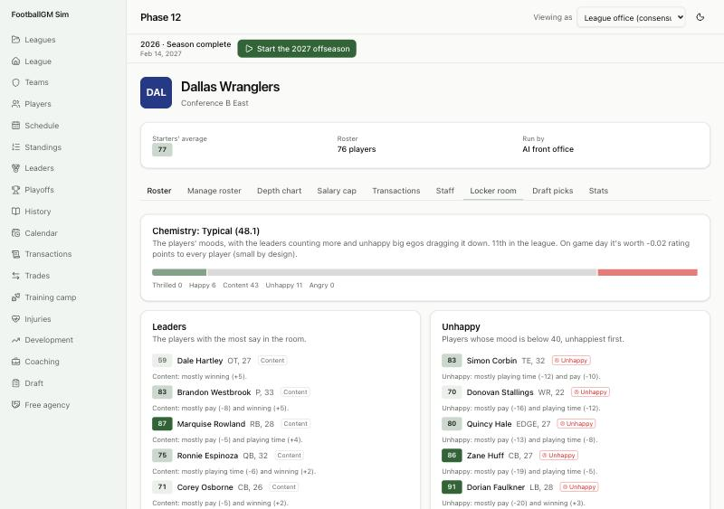

# Devlog 12b: Moods, the locker room and holdouts

_Phase 12b, October 2026_

Players have feelings now. Every player on a team has a mood from 0 to 100 (50 is content), with the reasons behind it. Moods add up to a locker room. Each summer a few underpaid stars hold out of camp, hold in, or ask to be traded, and their teams answer.

## What moves a mood

Each week a player's mood moves about a third of the way toward where these put it. One bad game doesn't change much.

- **Winning:** how his team is doing, weighed by how much winning matters to him.
- **Playing time:** whether he plays as much as he thinks he should. He compares himself with his teammates at his position, and a big ego makes him think he's better than he is.
- **Pay:** what his deal pays against his market value (Phase 12a), weighed by how much money matters to him. Players on their first rookie deal mostly accept being underpaid.
- **Scheme fit:** how well he fits his coaches' scheme (Phase 10).
- **Leaders:** the veterans in his locker room.
- **Loyalty:** loyal players are content more easily.
- **A contract dispute:** a holdout or trade request sours him.

Volatile players (low temperament) feel everything more.

## What moods do

The effects are small on purpose, as you chose: at most about one rating point.

- **Development:** a happy player develops up to 6% faster, an unhappy one up to 6% slower.
- **Game day:** a player's mood moves his game-day ratings by up to 0.6 points, and his locker room's chemistry by up to 0.4 more.
- **Contract talks:** an unhappy player asks his own team for up to 6% more and loses his loyalty discount. He's also more likely to test the market. A happy one gives his team a little break.

## The locker room

A team's **chemistry** is its players' moods, with leaders counting more and unhappy big egos dragging it down (two points each). The new **Locker room** tab on the team page shows:

- the chemistry and the team's rank in the league;
- what chemistry is worth on game day;
- how moods spread across the roster;
- the leaders, the unhappy and the disruptive, each with the reason;
- the team's holdouts, hold-ins and trade requests.

## Holdouts, hold-ins and trade requests

- **At camp:** a few unhappy stars hold out, hold in, or ask to be traded. A star here means a market value of 5%+ of the cap, paid under 65% of it, with at most two years left on his deal.
  - **A holdout** stays away and is fined $60,000 a day (CBA Article 42; $45,000 on a rookie deal; teams often waive the fines). He misses the preseason games and half of camp's development.
  - **A hold-in** reports but doesn't practice. He loses a quarter of camp's development.
- **In season:** before the trade deadline, a very unhappy player who matters may ask out.
- **The team answers, with a reason:**
  - **Extend him:** through the normal contract talks, for a core player. At camp the team starts at its usual limit and goes a little higher each preseason week.
  - **Trade him for picks:** to the team that would start him and values him most. He fetches the cheapest one or two early picks worth his value, at a discount because he's unhappy. His new team usually extends him.
  - **Wait him out:** holdouts report by cutdown day rather than lose game checks. A trade request lapses at the next League Year if his mood has recovered.
- **Real counts:** about three to eight stars hold out or hold in each summer, and one to five players ask to be traded. These are judgment ranges from 2024 and 2025 camp coverage; only counts were kept, no names.

## Screens

- **Player page:** a Mood card with the score, the reason, a bar for each factor, and his disputes.
- **Rosters:** a Mood column, and tags for players holding out, holding in or wanting a trade.
- **Team page:** the Locker room tab.
- **League page:** a Holdouts and trade requests card (under way, this year and last).
- **Contract talks:** "Unhappy where he is: it'll cost more to keep him" when it applies.
- **The runner:** `npm run sim -- --market N` now adds each year's disputes and how they ended.

## How it compares

`npm run sim -- --market 6` (a year on average over six League Years):

| Measure                                   | Seed 42 | Seed 7 | Real NFL            |
| ----------------------------------------- | ------- | ------ | ------------------- |
| Holdouts and hold-ins at camp             | 5.0     | 3.8    | about 3-8           |
| Trade requests                            | 1.3     | 3.5    | about 1-5           |
| Free agents to new teams, paid 1%+ of cap | 124     | 124    | 140                 |
| Re-signed, paid 1%+                       | 84      | 86     | 105                 |
| Extensions                                | 35      | 32     | 26 (5%+ of the cap) |

- **How disputes end:** most with an extension. A few end in a trade, and some holdouts report without a deal and pay fines of $1–4M.
- **Moods:** average about 47.7 every year, with no drift. About 1% of players are angry (below 25) at any time.
- **Market numbers held:** they're about where 12a left them. Unhappy players test the market more now, so the base chance of testing it went from 60% to 55% to keep re-signings level.
- **Scorecard** (four leagues, two seasons):
  - 61 of 63 league stats in range. The two misses are hairline: long field goals at 74.6% against a 74.5% ceiling, and the 4th-down go rate in opponent territory at 33.8% against 33.4%.
  - With the game-day mood effect switched off, 62 of 63, with a different miss (the long-standing success-rate gap). Mood isn't moving the scorecard; these are seed-level wobbles.
  - Player-level: 35 of 48 with moods, 33 without.
- **The long run** (`--lifecycle 30`):
  - mean age 26.2–26.6 (real 26.35);
  - starters 75.5–76.8;
  - stars rated 90+ settle around 45–68;
  - career lengths as before.

## What surprised us / what broke

- **Everyone was in a dispute.** The first version had about 35 a year. Many good players are "underpaid" against today's market, and most just wait for their extension. Disputes now need an unhappy star near the end of his deal, and only a small share of those act.
- **Disputes ended the day they started.** Teams first offered 10% over their usual limit, so every core player was extended on camp's first day. Now teams start at their usual limit and go up each week, so some disputes run into the preseason.
- **An extended player still sulked.** Moods refresh weekly, so a player extended to end his holdout still said "mostly pay (−11)" until the next week. His mood now refreshes as soon as a dispute ends.
- **Nearly everyone read "Content".** "Happy" started at 60, which almost nobody reaches. The words now start at 56 (Happy) and 70 (Thrilled).

## Not done yet

- **GM Mode** (Phase 14): until then, you can't answer a holdout yourself; the league office watches the AI do it.
- **AI general managers** (Phase 13): will weigh trades of unhappy players against their whole plan.

---

[← 12a: Free agency and negotiation](0012a-free-agency.md) · [Index](README.md) · [13a: Front offices and the trade market →](0013a-front-offices.md)
