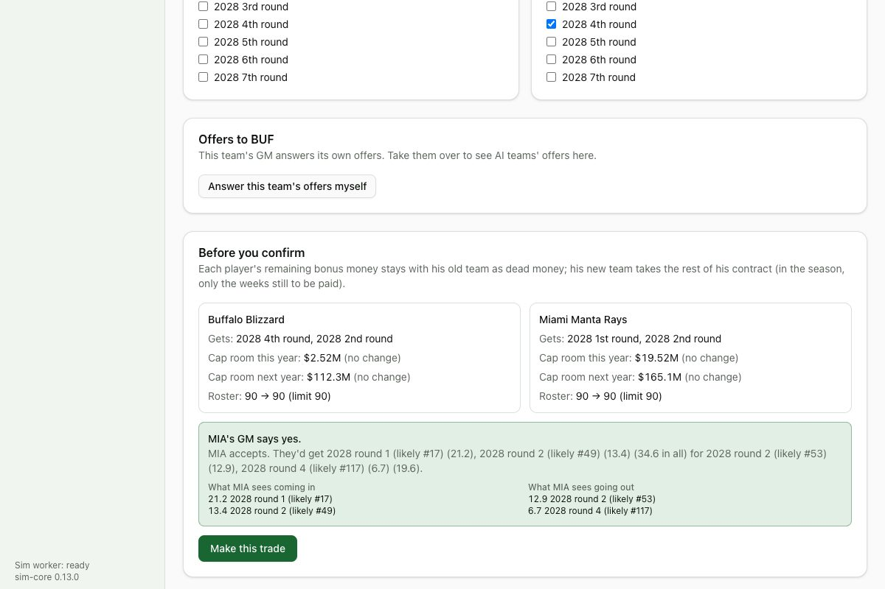

# Devlog 13a: Front offices and the trade market

_Phase 13a, October 2026_

Every team has a front office now: a general manager with a philosophy, and an owner. The GM reads where his team stands and runs the offseason his way. He also trades like a real GM, with other GMs and with you. AI teams agree to a trade only when they think they win it. Each answer gives its reasons and what it would want instead.

## The real data

`npm run pipeline -- frontoffice` → `calibration/frontoffice.json` (counts and shapes only):

- **Trades 2015-25** (nflverse/nfldata):
  - 82 trades a year: 32 picks only, 26 players for picks, 21 mixed, 3 players for players;
  - 35 around the draft, 18.5 at camp and cuts, 13 in the season, 12 between the League Year and the draft;
  - 58 players a year move, median age 26.
  - **Price mix:** only about 5% of deals for players include a 1st-round pick, 8% a 2nd. Two-thirds involve nothing better than 5th-to-7th-rounders: most trades are small.
- **Parity 2002-25** (nflverse schedules):
  - a team's win share carries over from one year to the next at r = 0.33;
  - 52% of playoff teams return the next year;
  - 25% of the worst teams make the playoffs the next year;
  - 7.5 different champions a decade;
  - five-year playoff runs and four-year losing runs are both regular events.
  - These are the 13b balance check's targets.
- **GM turnover:** about 4.5 new GMs a year, judged from news coverage of recent hiring cycles.
- **Dead money in 2026:** median 3% of the cap; 2 teams above 15% (our "cap hell" line).

## What was built

- **GMs and owners:**
  - **GMs:** each has six leanings, each from one extreme to the other: win now or build for later, trust the numbers or the scouts, pay later or keep the books clean, deal often or rarely, loyal or not, take risks or not. He's labeled by the nearest of six types: analytics-driven, win-now, draft-and-develop, cap-aggressive, trade-happy, conservative.
  - **Owners:** have patience, a budget, a meddling streak and ambitions (they start hiring and firing in 13b).
  - **The real league:** GMs take their teams' measured habits under them (trades a year, trading up or down in drafts, dead money), and owners' patience comes from how fast the franchise has changed coaches. Renamed and private.
- **Where a team stands:**
  - **What the GM reads:** his roster through his own staff's eyes, now and two years out (the real age curves), last season's record, the quarterback and the cap.
  - **His call:** contend, retool or rebuild, with the reasons.
  - **When:** at the League Year, camp, and the week before the deadline. Win-now GMs call "contend" sooner; patient ones start over sooner.
- **The offseason, by philosophy:**
  - **Free agency:** contenders pay more for veterans, rebuilders for youth. Analytics GMs pay by position value (less for running backs). Loyal GMs pay more to keep their own.
  - **Spending:** cap-aggressive GMs and big-spending owners spend more.
  - **The cap:** cap-aggressive GMs restructure with void years to spend now and pay later.
  - **Extensions:** patient and loyal GMs extend their young core a year early.
  - **The draft:** boards weigh need against talent by the GM.
- **The trade AI:**
  - **What players are worth:**
    - the value they'd add over the years the team controls them, by its own read and the age curve, plus or minus how good their contract is;
    - all in the same units as draft picks (career value; the #1 pick is about 62);
    - adjusted for injuries (long ones run into next season), whether he'd start, the team's needs and window, and the GM's leanings.
  - **Picks:** valued at the slot they'll likely land in, with future ones discounted.
  - **Saying yes:** a team says yes only when it gets more than it gives, by a margin. It names the biggest pieces and why, and a no comes with a counter.
- **Fleeceable, but not farmable** (your call: realistic, with the occasional overpay):
  - **Where mistakes come from:** the AI values players through its own scouts (who can be wrong), its GM's biases, and a gut feeling.
  - **Why they can't be farmed:** the gut feeling is fixed per team, player and season, so asking again never changes the answer. A team that has traded with you twice lately wants no more for now.
- **The trade market:**
  - **When:** from the League Year to the deadline, GMs look for deals.
  - **What they look for:** contenders and retooling teams buy at their biggest need, rebuilders sell veterans, and at camp teams move depth they can't keep.
  - **How often:** follows the real count in each stretch of the year, scaled by each GM's appetite. Most searches are for small deals, as in the real market.
  - **Teams run by a person:** they get offers to answer instead.
  - **Unhappy players (12b):** a team that shops one now uses the same market.
- **Screens:**
  - **Trade builder:** the other GM's answer, both sides' values, an "Add what they asked for" button, and an offers inbox. A switch lets you answer a team's offers yourself (until GM Mode).
  - **Team page:** a new **Front office** tab with the GM's leanings, the owner, where the team stands and why, the cap outlook for three years, the biggest needs, and recent trades with what the GM gave and got in his eyes.
- **The runner:** `npm run sim -- --trades N` compares a year's trades with the real ones.
- **Saves:** format 17. Older saves get generated GMs and owners.

## How it compares

RESULTS

## What surprised us / what broke

- **Every trade was a blockbuster.** The first market traded starters for first-round picks all spring. Real trades are mostly small: two-thirds involve only late-round picks. Each search now decides how big a deal it's after, and most stay small.
- **Camp was quiet.** Each team could look only once a week, and depth-for-a-7th deals failed on the fixed minimum gain. Teams can now look more than once, and the minimum gain shrinks with the deal.
- **Injured stars were a bargain.** An ACL tear cost only the current season. Long injuries now run into the next, and severe ones cost a little of later years.
- **Trade-happy GMs traded less than win-now ones.** Their appetite for risk sent them chasing blockbusters that rarely happen. Big swings now come from win-now contenders; trade-happy GMs deal often at the margins.
- **Speed:** the market's checks made a season about a third slower. Reading players once per day instead of once per trade, and checking only the two teams in a deal, brought most of it back.

## Not done yet (13b)

- **Owners hire and fire** GMs and coaches.
- **In-season replacements, and the deadline:** contenders buying, sellers dumping.
- **Balance check:** parity against real, and which philosophies win.
- **Simulation Mode screens:** sim many seasons, power rankings, GM and owner pages.
- **The 100-season run.**
