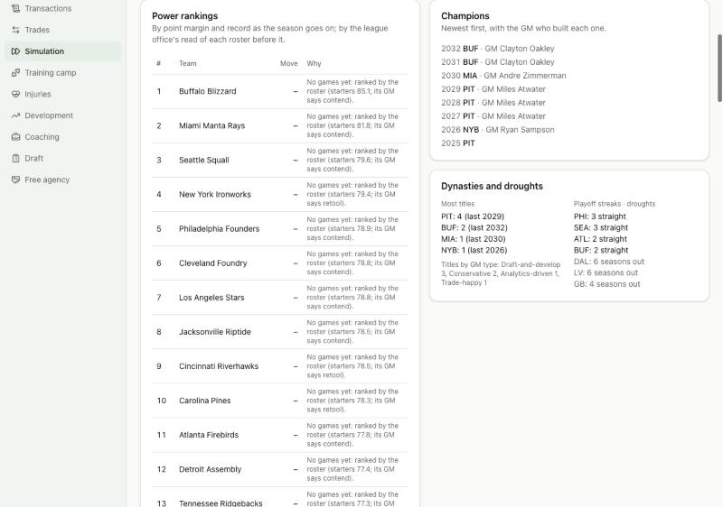

# Devlog 13b: Owners, the balance check and Simulation Mode

_Phase 13b, October 2026_

Owners now hire and fire. Each judges his GM and head coach every season and writes down why. Simulation Mode has its own page: sim as many seasons as you like and watch dynasties rise and fall. A new balance check compares the league's parity and each GM type's results with the real NFL. It found the league reshuffling too much from year to year; much of that is fixed, not all.

## Owners

- **Head coaches:** the carousel's firing odds (Phase 10b) now move with the owner. Patient owners fire less, ambitious ones more, and meddlers act on a whim (fixed per season).
- **GMs, judged on Black Monday:**
  - results against what the roster should have won;
  - playoff droughts and losing runs;
  - cap hell (more than 15% of the cap in dead money);
  - a contract running out, and a new GM's grace;
  - the owner's patience and ambition.
- **Hiring a GM:** the owner chooses from out-of-work GMs and newcomers from the personnel ranks, by skill, reputation and how they suit him. Ambitious owners like win-now GMs; patient ones like builders. A new GM may bring in his own head coach.
- **In season:** an owner who fires his head coach sometimes cleans house and lets the GM go too.
- **Careers:** GMs build careers and reputations, renew contracts and retire. Every move is on the new Simulation page and the GM's own page.

## Simulation Mode

- **`/simulation`:**
  - **Sim many seasons:** one at a time, saved as each finishes, with a stop button.
  - **Power rankings:** by point margin and record as the season goes on; by the league office's read of each roster before it.
  - **Champions:** with the GM who built each one.
  - **Dynasties and droughts:** titles by team and by GM type, playoff streaks, droughts.
  - **Every GM:** with his philosophy and his stance (contending, retooling, rebuilding).
  - **Front-office moves:** with their reasons.
- **`/executive/:id`:** a GM's or owner's page with his philosophy chart, career record, hirings and firings, and every trade he made with what he gave and got in his own eyes.

## The balance check

`npm run sim -- --frontoffices N` records every team's season with its GM's type, and measures the league's parity the way the real numbers were measured (2002-25, nflverse).

`npm run sim -- --frontoffices 25` with the final code, seeds 42 and 7:

| Parity                                     | Seed 42   | Seed 7    | Real 2002-25 |
| ------------------------------------------ | --------- | --------- | ------------ |
| Win share spread in a season (sd)          | 0.187     | 0.189     | 0.192        |
| Win share carrying over to next season (r) | 0.21      | 0.20      | 0.33         |
| Playoff teams back the next year           | about 50% | about 50% | 52%          |
| Worst teams in the playoffs next year      | 34%       | 30%       | 25%          |
| Different champions a decade               | 7.4       | 7.2       | 7.5 (6-9)    |
| Five-year playoff runs, per team-decade    | 0.11      | 0.10      | 0.17         |
| Longest playoff run / losing run           | 11 / 15   | 7 / 12    | 11 / 12      |

- **Dynasties and rebuilds both happen.** Five-year playoff runs come along about two-thirds as often as in the real league, and the longest runs reach 7-11 seasons. Seasons still carry over less than real: a good year predicts the next one about two-thirds as well.
  - **Before the fixes below:** carryover was r = 0.14-0.20, the worst teams reached the playoffs 31-37% of the time, and the longest runs were 5-7 seasons.
- **GM types build visibly different teams** (three seeds, 25 seasons each):

  | GM type        | Cap hell | Free-agent spending | Trades a season | Restructures |
  | -------------- | -------- | ------------------- | --------------- | ------------ |
  | Conservative   | 1-4%     | 6-7% of the cap     | 2.1-2.5         | 1.0          |
  | Cap-aggressive | 7-10%    | about 13%           | 3.0-3.3         | 3.2-3.9      |
  | Win-now        | 4-10%    | 10-13%              | 3.1-3.3         | 2.1-3.0      |
  | Trade-happy    | 3-10%    | 9-13%               | 3.8-4.2         | 1.4-1.8      |
  - **Draft-and-develop:** keeps the youngest rosters.
  - **No philosophy dominates:** win shares range 0.45-0.57 by type and seed. Titles swing with whichever team builds a dynasty: a conservative GM's team won about half the titles in two seeds, an analytics or trade-happy one in the third.

- **Turnover:**
  - 4.2-4.8 GM changes a year (real about 4.5), 0.36 of them during the season (real 0.4);
  - head-coach changes 7.8 between seasons and 1.4 during them (real 7.2 and 1.65).
- **The long runs:** STABILITY

## What surprised us / what broke

- **The league reshuffled too much.** Seasons barely carried over (r = 0.15 against a real 0.33), and the worst teams bounced into the playoffs a third of the time (real: a quarter). We traced it step by step through the offseason.
  - **Not development:** it hardly moves a team.
  - **The real cause:** good teams lost too many starters when their deals ran out, and weak teams gained most in free agency.
  - **What changed:**
    - a winning team's players now test the market less;
    - starting quarterbacks rarely leave, and the tag reaches any of the top 16 QBs;
    - rebuilding teams keep money back and don't pay for players past 29;
    - contenders pay more for veterans;
    - a GM's skill now sharpens his staff's reads.
- **More teams said "contend" than could.** After a season, half the league called itself a contender. The contend line moved up.
- **Re-signings were short.** Teams re-signed about 80 well-paid players a year against a real 105. Players now test the market less often (45% at heart, less on winners), and teams extend about 67 a year at 1%+ of the cap, as real teams do.

- **The 100-season run caught two bugs no shorter run could.**
  - **A trade broke the cap.** In season 24, a team made roster room for a trade by waiving a player whose release added $53.8M of dead money, putting it $20.8M over the cap. The legality check stopped the run. A roster-room waiver must now fit under the cap; the bug also lurked in Phase 12's free agency.
  - **The league ran out of names.** Generated people draw from 200 first names and 260 last names, 52,000 combinations. Each draft class avoided every name ever used, including long-retired players. Near season 88 the pool ran dry, and the search for an unused name never ended: the run sat at 100% CPU for 14 hours before we caught it. Names now free up five seasons after a player retires, and the search gives up and allows a repeat, as real leagues have.

## Not done yet

- **Dynasties are still rarer than real:** five-year playoff runs happen about half as often, and seasons carry over less.
- **Release v0.3:** waits until the repo goes public, like v0.1 and v0.2.
