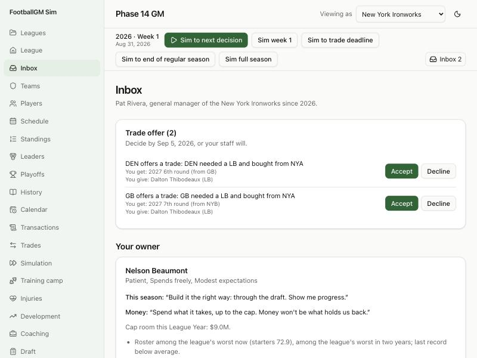

# Devlog 14a: GM Mode: your team, your decisions

_Phase 14a, October 2026_

You can now run one team. Pick it, meet the owner, and the team's decisions come to you. They arrive in an inbox with deadlines; "Sim to next decision" runs the calendar until something needs you. Areas you hand to your staff, they run the way an AI front office would, and the log says what they did. Sim past a deadline on purpose and your staff decide that one too, with a note.

## What was built

- **Starting a career:**
  - **New League:** asks "GM Mode or Simulation Mode". GM Mode goes to the team list: last season's record, where its front office thinks it stands, its owner's character, and its cap room.
  - **Taking the job:** the team's AI GM steps aside (other owners may hire him). You become its GM in the league's records.
  - **The owner meeting:** his traits, what he expects this season (from his ambition and the team's stance), how he feels about spending, and what the front office saw in the roster.
  - **Your staff's eyes:** "Viewing as" switches to your team, so every screen shows your scouts' reads.
- **Who decides (delegation):**
  - **Thirteen areas**, each "You" or "Staff":
    - **Yours by default:** the draft; re-signing, tags and tenders; free agency; trades; extensions; holdouts and trade requests; coaching hires.
    - **Staff by default:** final cuts; the depth chart; injured reserve and the practice squad; waiver claims; game-day elevations; cap compliance.
  - **Under the hood:** every AI routine that acts for a team now asks one question first: does this team's staff decide this? AI teams' staffs decide everything.
  - **The safety net:** cap compliance and roster limits always run, so the league stays legal even if you ignore everything.
  - **Handing over:** switching an area to "Staff" also hands them its open items. Handing the draft over while on the clock makes the pick at once.
- **The inbox:**
  - **The re-signing window:** each expiring player worth keeping. Negotiate, tag, tender, or let him go. The League Year waits one step for you.
  - **The draft:** your pick on the clock. The draft stops there.
  - **Final cuts:** if you keep them.
  - **Extension windows:** starters in their deal's last year, due at the trade deadline.
  - **Holdouts and trade requests.**
  - **Coaching vacancies:** you get 14 days, then your staff hire.
  - **Trade offers:** with what you'd get and give.
- **Deadlines:** every item has one.
  - **Before each step:** whatever you settled on a screen closes (a signing, a pick, cuts to 53).
  - **When a step passes a deadline:** your staff decide, using the AI's own logic.
  - **An item that opens and expires within one step** (a summer trade offer while the calendar jumps to camp) waits for the next step, so you still see it.
- **Sim to next decision:**
  - **What it does:** runs until something new comes in, something comes due, or the season ends.
  - **The other buttons:** still run straight through, with your staff deciding at deadlines.
  - **The header:** shows your inbox count and how many items are due.
- **No more league office:**
  - **Your team only:** in GM Mode the screens act for your team only (negotiation, roster moves, cap moves, coaching, trades, the draft board, scouting).
  - **The draft room's sim buttons:** stop at your picks.
  - **The log's wording:** your moves read "Your decision".

## How to see it

- **Start:** create a league with GM Mode (any seed), then pick a team.
- **The inbox:** press "Sim to next decision". In a new league, the first stop is your first-round pick on draft day.
- **The log:** at the bottom of the inbox page. Try "Staff" on the draft switch while on the clock and watch your scouts' pick appear there.
- **The tests:** `career/career.test.ts`:
  - **Three seasons as one team**, through the same functions the screens call: re-signing, a free-agent signing, every draft pick, cutting to 53 by hand, accepting and declining trade offers, extension windows. The legality audit runs after every move, and nothing is ever left past its deadline.
  - **A fully delegated team** plays two seasons like an AI team and is never asked anything.

## What surprised us

- **A bug in the sim buttons:** single-step buttons ("Sim week 1", "Sim free agency day 2") silently did nothing when no progress listener was attached. JavaScript skips a call's arguments when the function is missing. The screens always attach one, so nobody saw it. The headless playthrough did.
- **The draft pause and the cap:** rookie deals can push a tight team over the cap in the middle of the draft. Before, nobody looked until the end of the draft. Now teams fix it at each pause, so the legality audit holds.
- **A brand-new fictional league has no expiring contracts** in its first spring, so GM Mode's first decision is the draft. With the real league, the re-signing window comes first.

## What's next (14b)

- **The owner's side:** a job-security meter, his reactions to your big moves, and his budget.
- **Getting fired,** and job offers from other teams.
- **A career page.**
- **Saves:** save slots and season backups.
- **Help:** first-season tips and a glossary.
