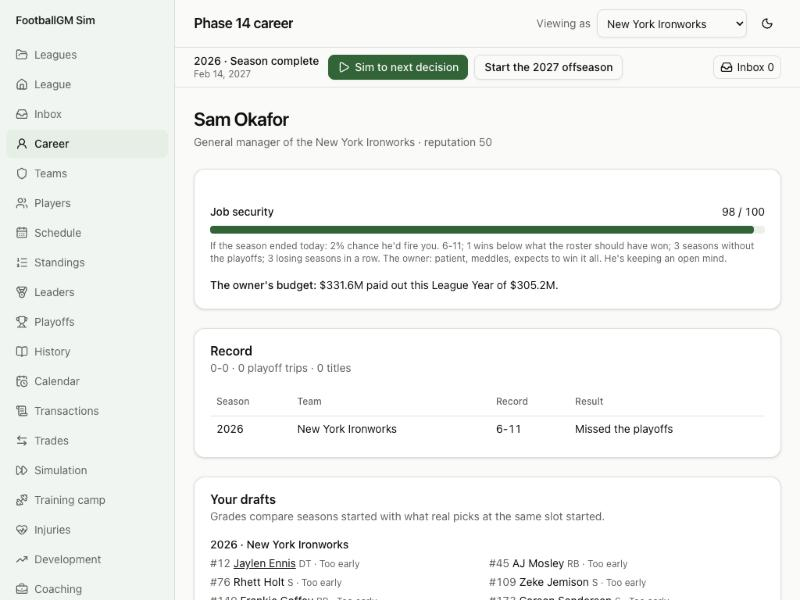

# Devlog 14b: The job

_Phase 14b, October 2026_

GM Mode now has stakes. Your owner judges you exactly like the AI GMs, by the same formula and the same dice. He also has opinions about your moves, a budget, and, if he meddles, a veto. Miss his expectations and you're fired. Then the phone rings with other owners, and your career carries on somewhere else. There's also a career page, save copies and season backups, first-season tips, and a plain-English glossary.

## What was built

- **Job security:**
  - **The meter:** 0 to 100, live all season. It's 100 minus the chance the owner fires you if the season ended today.
  - **The formula:** the AI GMs' own odds: wins against what the roster should have won, playoff droughts, losing runs, more than 15% of the cap in dead money, an expiring contract, grace in your first two seasons, and the owner's patience and ambition.
  - **The owner's mood:** his reactions to your moves move those odds a little. Reactions fade by half each new season.
- **The owner talks:**
  - **Trading away a star:** an impatient owner hates it. A patient one shrugs if you're rebuilding.
  - **A big free-agent deal:** a spender loves it; a penny-pincher grumbles.
  - **Cap hell:** he complains.
  - **His budget:** what the league's typical team pays out, moved by how freely he spends. Your own signings that push past it cost you. The deals you inherited don't.
  - **The veto:** a meddling owner refuses a deal that would run far past his budget, and says why.
- **Getting fired:**
  - **When:** on Black Monday with the AI GMs, or rarely in season, if things are dire and he's impatient.
  - **What happens:** your team goes back to an AI GM, your inbox closes, and owners call.
  - **The offers:** first from teams that changed GMs this year, then from owners on the edge with their own GM. Ranked by your reputation and each owner's taste. Never from the team that fired you.
  - **Your choice:** take a job, wait a season (new calls after the next Black Monday), or retire and watch in Simulation Mode.
- **Your career page (`/career`):** job security with the reasons, the owner's budget and words, your record by season with playoff trips and titles, your drafts with retro grades, your trades, and every hire and firing.
- **Interview notices:** when another team interviews one of your coaches, you hear about it. The rules don't let you block it.
- **Saves:**
  - **"Save a copy":** on the league list, saves the open league under a new name.
  - **Season backups:** a backup is kept the first time each season is saved (the last three). "Restore as a copy" makes a new league and leaves the original alone.
  - **Export:** works as before.
- **Help:**
  - **First-season tips:** cards at the big moments (the inbox, the re-signing window, free agency, the draft, camp, final cuts, the deadline, Black Monday). "Got it" hides one; "No more tips" hides them all.
  - **The glossary (`/glossary`):** 28 cap and roster terms. Its numbers come from the league's rules file.

## How to see it

- **The career page:** start a GM Mode league and open "Career". Sim a season and come back: your record, your drafts and the owner's words fill in.
- **The firing test:** `career/job.test.ts` builds a doomed situation (six losing seasons, an impatient and ambitious owner, an expiring contract, an unhappy owner). Black Monday fires the GM. Offers come in, never from the old team, and taking one moves the career there.
- **The safe case:** a first-year GM with a patient owner keeps his job. Retiring hands the team back to an AI GM.
- **Backups:** "Backups" on any league in the list.

## What surprised us

- **The first budget was unfair.** Measured against the cap, the owner complained about the roster the previous GM built before you'd signed anyone. Teams routinely pay out more cash than the cap in bonus years. The budget is now the league's typical payout, and only money you commit counts against you.
- **"Once a year" needed the League Year.** The owner repeated his complaint in January, because the calendar year had changed while the League Year hadn't.

## Honest notes

- **Getting fired is verified by the test, not in the browser:** it takes a doomed team several seasons to get there. The career page and offers screen were checked with a live league in the browser, but not right after a real firing.
- **Owner-mood sizes are judgment.** No data measures an owner's mood. The firing odds themselves are the ones tuned to the real 4.5 GM changes a year in Phase 13.
- **One person-run team for now.** Your long-range multiplayer idea is in the roadmap's stretch goals. Decisions, delegation and the inbox are all keyed by team. A league's career is one person today, so a list of careers would be the main change.
- **Release v0.4 stays deferred** until the repo goes public, like v0.1 to v0.3.

---

[← 14a: GM Mode: your team, your decisions](0014a-gm-mode.md) · [Index](README.md) · [15a: The past, awards, records and the Hall of Fame →](0015a-the-past.md)
