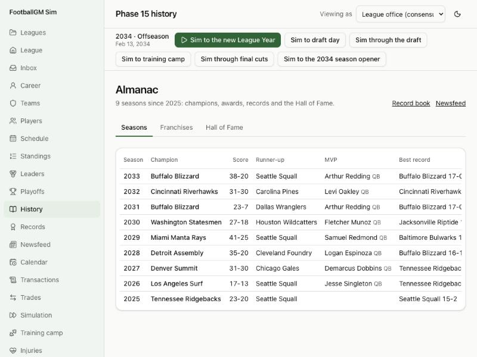

# Devlog 15a: The past, awards, records and the Hall of Fame

_Phase 15a, October 2026_

The league has a history now, and it makes more of it. A new real league opens with the real past behind it, renamed: every season since the first championship game in 1966, who won each award, the All-Pro teams, the Hall of Fame, retired numbers, and the record books. Then the league keeps going. After each championship the sim votes its own awards, checks every game for broken records, and each spring a committee elects a Hall of Fame class.

## What we agreed to import

- **The league's story from the first championship game on** (the 1966 season): champions and runners-up, standings from 1970 (the merger), award winners, All-Pro teams, the Hall of Fame.
- **Standing records at every level:** league and franchise; single game, single season and career. Whoever holds a record still standing is in, whatever year he set it. His other games aren't.
- **Full stats only from 1999:** what we already had for current players.
- **Fictional names throughout:** every real person gets a name from the same renamer as the players, from a hash of his id, so a star still playing keeps his name on the roster and in the record books. No fictional name can match any real person anywhere in the data (31 draws were redrawn).

## What the real league now carries

- **59 seasons, 1966-2024**, with each franchise's record, points and playoff trip, and the champion and score. A club that moved or renamed is one franchise (Baltimore's old club and Indianapolis's are one; so are Houston's old club and Tennessee's); the league's 1996 expansion team is its own.
- **3,660 award and All-Pro lines:** MVP, the two players of the year, the two rookie awards, Comeback Player and Coach of the Year since 1966, the AP's first and second All-Pro teams, and the last three Pro Bowls for players still active (their original-ballot selections set the 2023 first-round picks' fifth-year options this spring; nine of the 31 have one).
- **1,267 "legends":** history cards for retired people who won something or hold a record. They have a page with their honors and what's known of their career; the Hall's ballot skips them, since the real Hall settled their fate.
- **292 Hall of Famers** with induction years and what made their case, and **158 retired numbers.**
- **The record books:** 25 league lists (the top ten of each statistic's single-game, season and career marks; the other five pages have no archived copy) and franchise record holders for **10 of 32 clubs**. The other 22 clubs have no public records page I could read, so the sim keeps no franchise book for them rather than inventing all-time records from the modern era. Their pages say so.

## What the league does with it

- **Awards**, after the championship:
  - **How votes work:** a player's season against the others at his position (expected points for quarterbacks; yards and touchdowns for runners and receivers; sacks, takeaways and stops on defense), the team's record, and voters' habits by position, fitted to the real winners' mix since 1999.
  - **What's voted:** MVP, both players of the year, both rookie awards, Comeback, Coach of the Year (wins above what the roster should have won, and the turnaround), and an All-Pro and Pro Bowl roster per position.
  - **Reasons:** every winner has a reason line, with the vote count and the runners-up.
- **The record book:** checked after every game and every week.
  - **A record falls:** the book moves up, the old holder stays in the list, and the newsfeed says so.
  - **A tie:** doesn't take a record from its holder.
- **The Hall of Fame:** the Hall's own rules, taken from its pages.
  - **Eligibility and ballot:** five seasons after a player last played. Thirteen player finalists, a coach and a general manager.
  - **The vote:** a finalist needs 80%; three to seven new members a year.
  - **The case:** a career's honors (All-Pros, Pro Bowls, MVPs, titles, records still held, peak and years as a starter). The clearest cases go in at once; others wait a few years and gain support.
  - **Numbers:** inductees' teams sometimes retire their numbers, and the jersey sweep never hands them out again.
- **Pro Bowls in contracts:** a first-round pick with one Pro Bowl in his first three seasons gets the transition tender as his fifth-year option; two or more, the franchise tender (CBA Article 7). Until now only snaps decided it.
- **Owners remember ten years:** a real club's owner reads the last ten real seasons when judging a drought or a losing run, so a team that missed the playoffs for a decade starts with an impatient owner. Seasons before that count for nothing.

## How to see it

- **Almanac:** History in the sidebar: every season, franchises by titles, dynasties and droughts, the Hall of Fame by class.
- **Season recap:** click a season: awards with votes, standings, the playoffs, All-Pro first team, leaders, records broken.
- **Records:** the record book, league or one franchise.
- **Player pages:** show honors (awards, Hall of Fame, retired number).
- **The checks:** `npm run sim -- --history 20` compares the sim's awards by position, Hall classes and record pace with the real shapes.
- **The tests:** `history.test.ts`, and for the real league `tests/realLeague.test.ts`, which checks the real champions by franchise, an MVP for all 60 seasons, the 2026 Hall class of five, Chicago's fourteen retired numbers, no real name anywhere, and a quarterback passing a real single-season record, with the old holder kept and a story in the feed.

## What the check says

Two 20-season runs (seeds 7 and 11), against the real mix of winners since 1999. With 20 seasons each, a few points of noise is normal:

| Award                                                            | Sim                   | Real         |
| ---------------------------------------------------------------- | --------------------- | ------------ |
| MVP: quarterbacks                                                | 70-85%                | 86%          |
| Offensive Player of the Year: runners / quarterbacks / receivers | 40-45 / 35-45 / 15-20 | 52 / 33 / 15 |
| Defensive Player of the Year: linebackers / edge rushers         | 30-35 / 30            | 33 / 30      |
| Defensive Rookie of the Year: linebackers                        | 50-60%                | 56%          |
| Comeback Player: quarterbacks                                    | 68-74%                | 61%          |

The Hall of Fame, after 16 classes: 75-77 members, classes of three in the thin early years and seven once the pool fills (real classes: 4-11 players; the bylaws' three to seven in total now). All twenty of the strongest careers are in. About 56% go in on the first ballot and the average wait is a year (real: about a third on the first try, so the committee is a little too decisive).

## What surprised us

- **A wall of pages that wouldn't open.** The reference site throttled our fetching hard after about a hundred pages. The fetcher now waits patiently, backs off, and resumes where it stopped; the whole history takes hours but runs unattended.
- **Franchise records weren't uniform.** Each club's public records page has its own layout; ten parse cleanly. The rest are left out on purpose.
- **A new book's first games were "breaking records".** A franchise with no real book logged a "record broken" for every early touchdown. Books now keep quiet for their first seasons, and a real league keeps no book for a club without one.
- **The Hall's first classes were all first ballot.** With a pure threshold every inductee went in on his first try. A first-year discount and a bonus for each year waited make borderline careers wait, as they do.
- **Real trademarks sneaking into code.** Our franchise mapping needed real club names. They now live in a git-ignored private file, and a test checks that no committed code or data names a real club.

## Honest notes

- **Franchise records:** 10 of 32 clubs. The rest start with no book.
- **Calibration of voters** is judgment fitted to counts, not measured votes (the AP's vote shares aren't in what we fetched).
- **The vote strength of Hall candidates** (the bar and the first-ballot discount) is judgment tuned so classes look like real ones.
