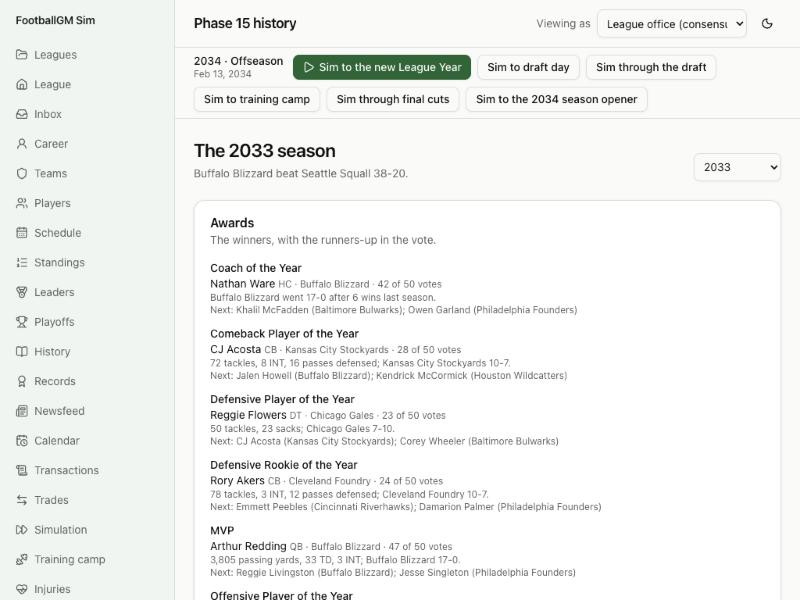
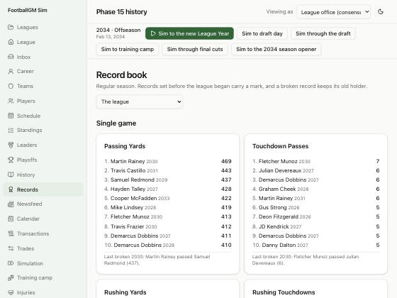
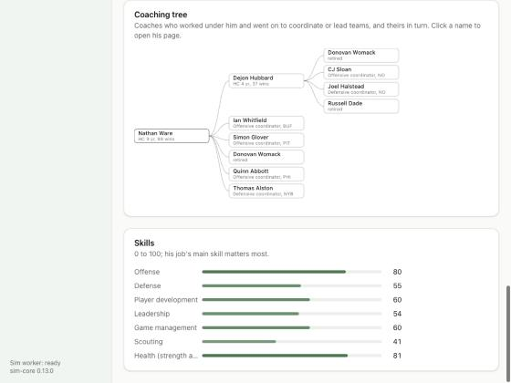

# Devlog 15b: The story told

_Phase 15b, October 2026_

A league that remembers needs a way to tell it. This half is the newsfeed and the pages that read like an almanac: season recaps with awards and records broken, a record book, each franchise's history, a drawn coaching tree on every coach's page, and honors on every player's page.

## The newsfeed

Stories come from what actually happened, never invented:

- **From the logs:** trades (both sides), big signings and extensions (5% of the cap a year or more), head-coach firings and hires, general-manager firings and hires.
- **From the record book:** a league record changes hands; a franchise's season or career record that has stood a while (single-game marks fall too often to be news); career milestones (a quarterback's 50,000th yard).
- **Weekly:** win and losing streaks of five or more, the MVP race at weeks 6, 10 and 14, a coach whose team is two wins below what its roster should have won (the hot seat), and starters lost for the season.
- **Yearly:** the awards, the Hall of Fame's class, and numbers retired.
- **GM Mode:** your owner's reactions are in the log on your career page.

The feed keeps two seasons. A twenty-season run makes about 190 stories a year, mostly signings, injuries and trades. Record stories run about fifteen a year in a generated league's first decades and about eight in a real league, whose books are hard to break.

## The screens

- **Almanac (`/history`):** every season with champion, score, MVP and best record; franchises by titles and finals; dynasties (three titles in four seasons) and the longest droughts; the Hall of Fame class by class.
- **Season recap (`/season/:year`):** awards with votes and runners-up, records broken, standings, playoff results, All-Pro first team, leaders, and the season's stories.
- **Record book (`/records`):** league or one franchise; single game, season and career; with the last time each changed hands.
- **A team's History tab:** every season with record, result and head coach; retired numbers; Hall of Famers; franchise records.
- **Coaching tree:** on each coach's page, the people who worked under him and went on to coordinate or lead, drawn as a family tree you can click through.
- **Player pages:** awards by kind and season, the Hall of Fame class, the retired number.
- **The League page:** the latest stories.

## What surprised us

- **Where the awards live.** They're announced the moment the championship is played, not when the calendar turns, or a season's recap would have no awards to show until the next step.
- **The feed's tone.** Franchise single-game records made twenty stories a season. They don't any more.
- **A new league's first records.** In a generated league every first-season game "sets a record" because the book is empty. Early marks aren't news, and the almanac says nothing of them.

## How we checked

- **Tests:** a record falls, ties don't count; awards follow a season (every award has a winner with a reason; the MVP is a quarterback or skill player; the rookie really is a rookie); a Hall class follows the bylaws (five-season wait, three to seven, the great ones in); retired numbers stay off the jersey sweep; the almanac, recap, history and tree views; the 19-to-20 save upgrade.
- **Same-seed check against Phase 14:** a generated league plays identically except where Pro Bowls now decide a fifth-year option.
- **In the browser:** a generated league through nine seasons: the almanac, a season recap, the record book, the newsfeed, a team's History tab and a coach's tree. And the real league's almanac (private, no screenshot committed).

## What's next

- **Phase 16:** the exact real start: the 2025-26 coaching carousel, the real schedule, picks owned, a validation report and the "where things stand" screen.
