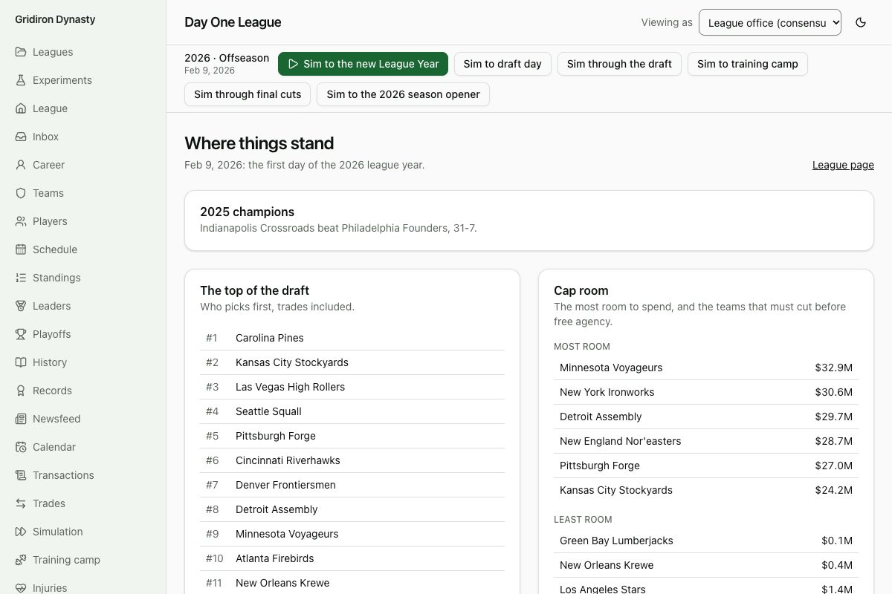

# Devlog 16: Day One

_Phase 16, October 2026_

A new real league now opens on a day that looks like the real one: the morning after the 2025 championship, with the real 2026 schedule, the real picks, and a coaching carousel that has already happened. The carousel is the sim's own. The real file stops at the end of the 2025 regular season, and each new game works out who got fired and hired on its own seed, so no two real-league saves start with the same coaching staffs.

## What changed

- **The real 2025 season stays in the file.** Its 285 games (regular season and playoffs) are kept, not played again. A new game borrows them for the carousel and drops them.
- **The starting carousel** (`coaches/startCarousel.ts`): Black Monday, the owners' reviews of their general managers, every hiring round and the offseason's last hires, run as if the 2025 season had just ended. It uses the new game's seed, so each save is different. It lends the league its 2025 calendar and gives it back, so nothing else moves.
- **The real 2026 schedule:** all 272 games, each with its week, opponent and home side, replacing the generated one.
- **2027 picks traded before Feb 9, 2026** now belong to their new teams.
- **A Day One report** (`npm run pipeline -- league`): every team against the real facts, written to a private file and to the build report. Details below.
- **"Where things stand"** (`/start`): the screen a new real league opens on. It shows last season's champion and score, the top of the draft (with who traded up), the teams with the most and least cap room, the twelve biggest players whose deals ran out, and every coaching and front-office change the carousel made. Hover a change to see why it happened.
- **A rebuild guide** (`docs/rebuild-guide.md`) for starting a 2027 league: which private files to collect, which year constants to change, the order to run the pipeline, and how to read the report.

## What the report says (real league, built today)

- **25 of 32 teams pass every check.** The other seven differ only in cap space, each with its reason: the team's cap page was archived on a different day from the published Feb 10 figure, so moves in between (a release, a signing) show up. Miami's gap is $4.2M because seven players on its page aren't on our roster; Houston's is the biggest ($15.5M), because its page was archived two weeks after the published number.
- **Roster size:** within three players on all 32; players cut before a team's cap page start as free agents.
- **Picks:** every team's 2026 and 2027 picks match the real order, trades and compensatory picks included.
- **Contracts:** every player the real contracts file has under a deal into 2026 (signed before the league year) has one in ours, for all 32 teams.
- **Schedule:** all 17 games for all 32 teams match the real week, opponent and home side.
- **Head coaches:** match the staffs file (this check is close to automatic; its job is to catch an import that lost one).
- **League-wide:** the schedule follows the rules file, every roster and cap is legal.

## What the carousel does

Twelve starts from the real file (seeds 1-12):

|                          | Per start     | Real, per year |
| ------------------------ | ------------- | -------------- |
| Head coaches changed     | 9.5 (7 to 12) | 7.2            |
| General managers changed | 6.5           | 4.5            |

A start is busier than a typical year. My guess is that the real league's owners, who read the last ten real seasons, and the real coaches' own histories bring several long droughts due at once, but I haven't isolated the cause. I left it alone: the steady-state rates (`--carousel`, `--frontoffices`) were tuned in Phases 10 and 13 (the Phase 15 check had head coaches at 8.2 a year against 7.2), and one busy morning is believable. If it feels too busy in play, the knob is the owners' patience in `front-office/owners.ts`.

## What surprised us

- **A club rehired the manager it had just fired.** The first look at a real-league start showed three teams firing a general manager and, in the same step, hiring the same man back: he was out of work and the best candidate. It had been in the game since Phase 13 but a season-end firing was always followed by a long gap in play. A club now never takes back a general manager it fired this season or last. Generated leagues play differently from the first such firing on.
- **The real contracts file is newer than the league.** It includes March free-agent signings, so "who's under contract into 2026" first looked wrong for twenty players a team: they had already moved. The report now counts only deals signed before the league year.
- **Pending free agents have no independent real list.** Players with minimum or practice-squad deals aren't in the contracts file, so the report can check one direction only (a real deal into 2026 must exist in ours). The players whose deals ended, roughly 20 to 40 a team, come from the cap pages.

## How we checked

- **Tests:** a new game's carousel is the same for a seed and different across seeds; every team keeps exactly one head coach; the file's real games are kept and dropped as promised; the real schedule and later pick trades replace the generated ones; the 20-to-21 save upgrade; the first-day view. For the real league (skipped where the private files are missing): the schedule against the real games, the Day One report, 224 picks for 2027 with some teams not holding seven, and the carousel's effect on the first-day view.
- **In the browser:** a generated league's "Where things stand", and the real league's (private, no screenshot committed): Seattle over New England, 29-13; the top of the draft with the traded picks marked; sixteen head-coaching moves.

## What's next

- **Phase 17:** experiments and analytics.
- **Left over from Phase 15:** franchise record books for 17 more clubs, and five league leader pages the archive never saved.
