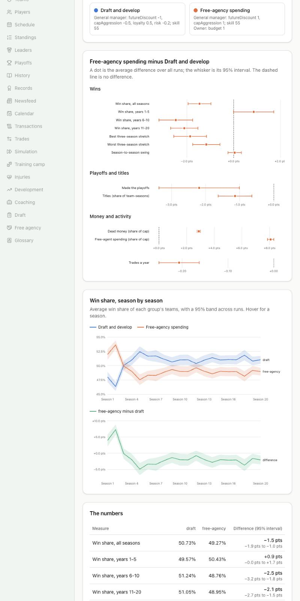

# Devlog 17a: Experiments you can rerun

_Phase 17a, October 2026_

The league is now a tool for answering questions. An experiment is a small JSON file; one command runs it across the machine's cores, gets means and 95% intervals, and the result shows up on a new Experiments page with a chart, the numbers, and the written conclusion.

## What was built

- **Experiment files** (`experiments/*.json`): which kind of experiment, which start (a league generated from each run's seed, or the real league started once and copied), how many runs and seasons, which changes to make to which teams, and what to measure. The file is checked on load and the result carries a copy, so a result says exactly how it was made.
- **Four kinds:**
  - _team groups:_ in each run the 32 teams of one league are split evenly into groups by the seed, each group gets its own changes (a kind of general manager, a coach style), and the groups are compared inside the same league;
  - _title odds:_ the same start played many times;
  - _playoff randomness:_ how often the strongest team wins a bracket replayed many times;
  - _swap study:_ one team, played as built and with a better staff or quarterback.
- **Changes ("levers") that hold.** A general manager's profile, an owner's traits, a coach's skills and style, a quarterback's attributes. The simulation carries no experiment code: the changes are written whole after every step, so when an owner fires a manager and hires another, the newcomer gets the same profile before he decides anything.
- **A runner for many cores** (`npm run sim -- --experiment <file> [--workers 6] [--runs N]`): one worker process per core, each loading the start once. Every finished run is written to a checkpoint file, so an interrupted batch resumes where it stopped, and the answer is the same with one worker or six. `--runs N` is a pilot.
- **Statistics** (`packages/foundation/src/stats.ts`): means, sample standard deviations, t intervals from a table, Wilson intervals for proportions, a seeded bootstrap, paired differences. Worked-example tests, plus a check that a 95% interval covers the truth about 95% of the time.
- **Exhibition games** (`exhibitionRig` in sim-core): any two teams, any seed, neutral field, the lineups and staffs they have, nothing in the league changed. Team strength is measured by round-robin with them.
- **Experiments pages** (`/experiments`, `/experiments/:id`): a dot-and-whisker chart for differences, a line with an interval band for seasons, bars for odds, and a table under each chart. Public results are committed; results from the private rating file stay on this machine.

## How long things take

| Experiment                                        | Runs                                                               | Roughly, on 6 workers |
| ------------------------------------------------- | ------------------------------------------------------------------ | --------------------- |
| Alternate histories (the 2026 season, real start) | 1,000 x 1 season                                                   | about 50 minutes      |
| Playoff randomness                                | 40 leagues, each with 9,920 strength games and 200 bracket replays | about 15 minutes      |
| Coach vs quarterback                              | 150 x 3 conditions                                                 | about 20 minutes      |
| Fourth-down coaches                               | 200 x 2 seasons                                                    | about 20 minutes      |
| Cap-aggressive GMs and Draft vs free agency       | 60 x 20 seasons each                                               | about 3.5 hours each  |

A 20-season run takes about 20 minutes on one core and about 300 MB of memory.

## What surprised us

- **Worker threads couldn't load our code.** The project imports modules without file extensions; `tsx` handles that for the main program but not inside worker threads. Worker processes (forked with `tsx` loaded) work, and also keep every run's module state to itself.
- **A resumed run read back differently from a fresh one.** A season band beyond the last simulated season came out as "not a number" in memory and `null` in the checkpoint file, so the same experiment gave different results depending on whether it had been interrupted. Rows now pass through JSON before they are summarized, and bands past the last season are skipped. A test runs the same tiny experiment in-process, on two workers, and interrupted and resumed, and requires identical results.

## How we checked

- **Tests:** statistics (known values, coverage); levers (a general manager's profile survives a firing and a new hire; the groups are equal and differ by seed); the spec files in the repository are all valid; one tiny experiment gives byte-identical results in-process, on two workers, and after an interruption; exhibition games repeat from a seed and change nothing.
- **Pilots** of each kind at one or two runs, to check the timing and the shape of the result, then the full runs.
- **In the browser:** every public result page, light and dark, and at phone width (the layout works; the chart text is small on a phone, which Phase 18's phone pass will look at).

## What's next

- **17b:** what the six experiments found.
