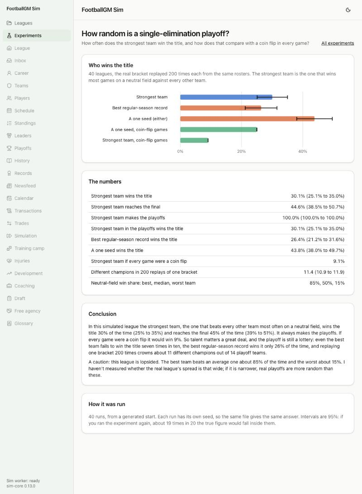

# How random is a single-elimination playoff?

**Question:** How often does the strongest team win the title, and how does that compare with a coin flip in every game?



## How it was run

- **File:** `experiments/playoff-randomness.json` (results in `experiments/results/playoff-randomness.json`; the page is `/experiments/playoff-randomness`).
- **40 generated leagues** (seeds 6000 to 6039), each played to the start of the playoffs.
- **Strength** of every team is measured by playing it against each of the other 31 teams 20 times on a neutral field (9,920 games a league), with the lineups and staffs it has when the playoffs start. The strongest team is the one that wins most of those.
- **The real bracket is then replayed 200 times** from the same rosters, each time with a new seed, so the only thing that changes is how the games bounce.
- Intervals are 95% t intervals over the 40 leagues.

## What it found

|                                                   | Chance               |
| ------------------------------------------------- | -------------------- |
| Strongest team wins the title                     | **30%** (25% to 35%) |
| Strongest team reaches the final                  | 45% (39% to 51%)     |
| Best regular-season record wins the title         | 26% (21% to 32%)     |
| Either one seed wins the title                    | 44% (38% to 50%)     |
| Strongest team, if every game were a coin flip    | 9%                   |
| Different champions in 200 replays of one bracket | 11.4 of 14           |

The strongest team always made the playoffs in these 40 leagues.

**Conclusion.** Talent matters a great deal (30% against 9%), and the playoff is still a lottery: even the best team fails to win the title seven times in ten, and one bracket replayed 200 times crowns about 11 different champions out of 14 playoff teams. The best regular-season record does about as well (26%, inside the margin of the strongest team's 30%).

## Caveats

- This league is lopsided: the best team beats an average one about 85% of the time and the worst about 15%. I haven't measured whether the real league's spread is that wide. If it is narrower, real playoffs are more random than these.
- Strength is measured on neutral fields, so home-field advantage (which favors one seeds in real playoffs) isn't in the strength, only in the bracket replays.

## Run it again

```
npm run sim -- --experiment experiments/playoff-randomness.json --workers 6
```
