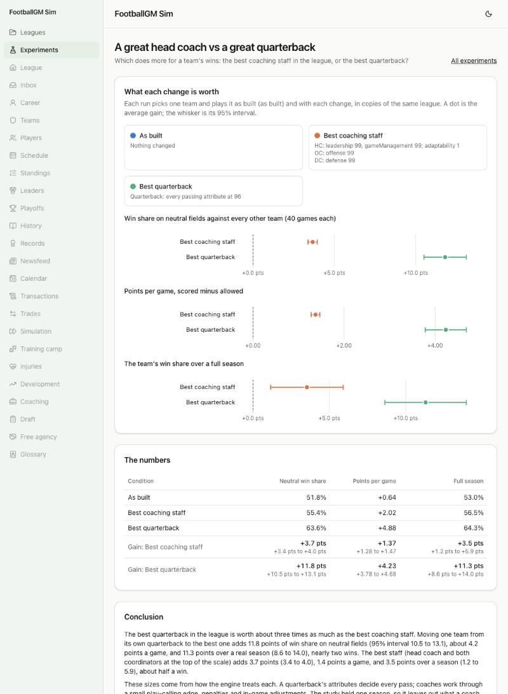

# A great head coach vs a great quarterback

**Question:** Which does more for a team's wins: the best coaching staff in the league, or the best quarterback?



## How it was run

- **File:** `experiments/coach-vs-quarterback.json` (page: `/experiments/coach-vs-quarterback`).
- **150 generated leagues** (seeds 4000 to 4149). In each, one team is picked by the seed and played in three copies of the same league at the start of Week 1: as built, with the **best staff** (head coach leadership, game management and adaptability at the top of the scale; the offensive coordinator's offense and the defensive coordinator's defense at 99), and with the **best quarterback** (every attribute that counts toward a quarterback's overall set to 96).
- **Two measures.** (A) the team plays every other team 40 times on a neutral field with the lineups it has; (B) the copy plays a full season. Staffs and quarterbacks are put back after any firing or retirement.
- Gains are the same team and league with and without the change, averaged over the 150 runs, with 95% intervals.

## What it found

| Gain over the team as built | Neutral-field win share      | Points per game       | Over a full season          |
| --------------------------- | ---------------------------- | --------------------- | --------------------------- |
| Best staff                  | +3.7 pts (3.4 to 4.0)        | +1.4 (1.3 to 1.5)     | +3.5 pts (1.2 to 5.9)       |
| Best quarterback            | **+11.8 pts** (10.5 to 13.1) | **+4.2** (3.8 to 4.7) | **+11.3 pts** (8.6 to 14.0) |

**Conclusion.** The best quarterback is worth about three times as much as the best staff: nearly two extra wins a season, against about half a win.

## Caveats

- The sizes come from how the engine treats each. A quarterback's attributes decide every pass; coaches work through a small play-calling edge, penalties and in-game adjustments (the best staff is worth about a point a game, by design). So this is the answer inside the model, not evidence about the real league.
- One season only: what a coach does over years (developing players, hiring) isn't measured.
- The quarterback gain depends on whom he replaces. The typical starter here is well below the best.

## Run it again

```
npm run sim -- --experiment experiments/coach-vs-quarterback.json --workers 6
```
