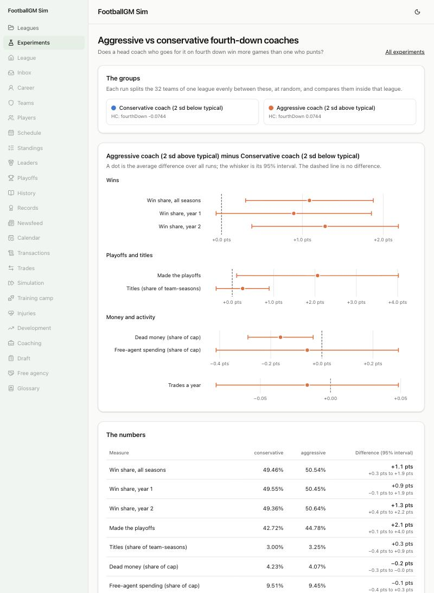

# Aggressive vs conservative fourth-down coaches

**Question:** Does a head coach who goes for it on fourth down win more games than one who punts?



## How it was run

- **File:** `experiments/fourth-down-coaches.json` (page: `/experiments/fourth-down-coaches`).
- **200 generated leagues** (seeds 3000 to 3199), two seasons each. In each, 16 teams (chosen by the seed) get a head coach two standard deviations more aggressive on fourth down than typical, and the other 16 one two deviations more conservative (the real spread between teams from `calibration/coaching.json`). Everything else about the two groups is the same, and a replaced head coach is given the same style again.
- Differences are between the two groups inside the same league, averaged over the 200 runs, with 95% intervals.

## What it found

| Aggressive minus conservative | Difference (95% interval)                          |
| ----------------------------- | -------------------------------------------------- |
| Win share                     | **+1.1 pts** (0.3 to 1.9), about 0.2 wins a season |
| Made the playoffs             | +2.1 pts (0.1 to 4.0)                              |
| Won the title                 | +0.3 pts (-0.4 to 0.9): within noise               |

**Conclusion.** Going for it more is worth a little: about a fifth of a win a season at a gap of four standard deviations between the two coaches.

## Caveats

- That is the gap between two extremes, wider than most real pairs of coaches; the difference between ordinary coaches is smaller still.
- The simulated coaches decide from a win-probability model tilted by their style, so this says the model's close calls favor going for it slightly. That agrees with the analytics view, but the agreement was built in when the model was calibrated.

## Run it again

```
npm run sim -- --experiment experiments/fourth-down-coaches.json --workers 6
```
