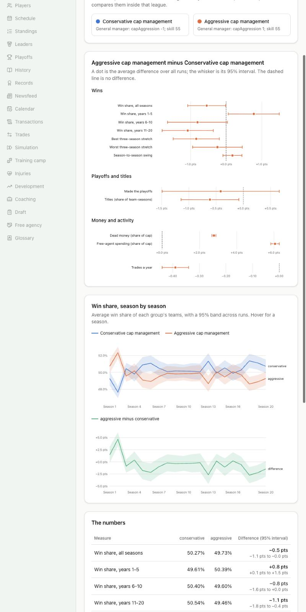

# Cap-aggressive vs conservative general managers

**Question:** Do general managers who run the cap hard win more titles, or do they rise sooner and collapse harder than conservative ones?



## How it was run

- **File:** `experiments/cap-aggressive-gms.json` (page: `/experiments/cap-aggressive-gms`).
- **60 generated leagues** (seeds 1000 to 1059), **twenty seasons each**. In each, 16 teams (chosen by the seed) get a general manager whose cap aggression is at the top of the scale (+1), the other 16 one at the bottom (-1). Every other trait of the manager is zero, his skill is 55 for everyone, and every owner is typical.
- **Held for twenty years:** when an owner fires or loses a manager and hires another, the newcomer is given the group's profile again before he decides anything.
- The groups are compared inside the same league, then averaged over the 60 leagues with 95% intervals.

## What it found

| Aggressive minus conservative             | Difference (95% interval)                      |
| ----------------------------------------- | ---------------------------------------------- |
| Win share, years 1-5                      | **+0.8 pts** (0.1 to 1.5)                      |
| Win share, years 6-10                     | -0.8 pts (-1.6 to 0.0)                         |
| Win share, years 11-20                    | **-1.1 pts** (-1.8 to -0.4)                    |
| Win share, all twenty years               | -0.6 pts (-1.1 to 0.0)                         |
| Titles (share of team-seasons)            | **-0.6 pts** (-1.2 to -0.1): 2.8% against 3.4% |
| Best three-season stretch                 | -0.8 pts (-1.5 to -0.2)                        |
| Worst three-season stretch                | -0.3 pts (-0.9 to 0.5): no clear difference    |
| Season-to-season swing                    | +0.2 pts (-0.1 to 0.4): no clear difference    |
| Dead money (share of cap)                 | +2.8 pts: 7.9% against 5.1%                    |
| Free-agent spending (share of cap a year) | +6.1 pts                                       |
| Trades a year                             | -0.4                                           |

**Conclusion.** Running the cap hard buys a short early edge and a slightly worse twenty years. There is no sign of a harder collapse (the worst stretch is no worse and the swings are no bigger); what aggressive teams lose is the top end, with a lower best stretch and fewer titles.

## Caveats

- The effects are small: a point of win share is about a sixth of a win a season.
- The groups play each other, so one group's gain is the other's loss.
- Only the cap knob differs between the groups. Real managers' habits come in bundles (see the next finding for a bundle).

## Run it again

```
npm run sim -- --experiment experiments/cap-aggressive-gms.json --workers 6
```

About 3.5 hours on six cores; interrupted runs resume where they stopped.
