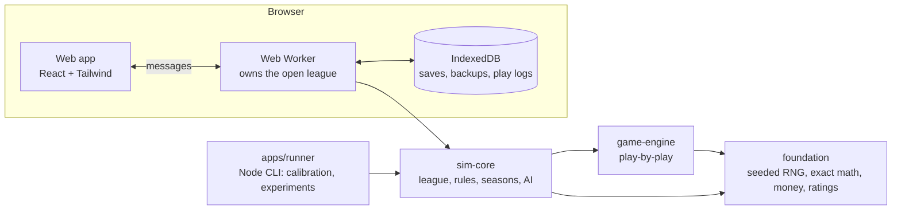

# Gridiron Dynasty: GM Simulator on one page

A pro football league simulator and general-manager game in the browser, with every name fictional. Planned and directed by its author (who does not write code) and built with Claude Code, one roadmap phase at a time.

## The idea

Football-management games usually trade fidelity for playability. This one tries to keep both: a play-by-play engine calibrated against real statistics, the real league's rulebook (cap, contracts, calendar, roster rules, tie-breakers) as data, and AI front offices that follow the same rules the player does. Because the same engine runs both modes, a person can step into any team's GM chair, or hand every team to the AI and watch a century go by. Because the engine is deterministic and fast, it is also a laboratory: a headless runner replays thousands of leagues to answer team-building questions with confidence intervals.

## What makes it different

- **Rules as data, with sources.** Every cap, contract, roster and calendar rule is a value in [`rules/2026.json`](../rules/2026.json) with a note saying where it came from, and every cap rule has a unit test with a worked example in whole dollars.
- **Everything has a reason.** Each AI decision (a trade, a firing, a contract demand, a fourth-down call) records why, and the screens show it. Nothing is a black box to the person playing.
- **Truth versus perception.** True ratings never reach a screen. Everything is read through what a team's staff believes, with an error that shrinks as scouts do their job. A test fails if the web app touches a true rating.
- **Deterministic everywhere.** The same seed and decisions give the same league in Chrome, Safari and Node. Simulation code avoids anything a browser may round differently, and a test enforces it.
- **Calibrated, and honest about misses.** The scorecard compares simulated seasons with real ranges. Run on generated leagues (4 leagues, 2 seasons, seed 42), 62 of 63 league-level stats and 34 of 48 player-level stats land inside the real range. The misses are in the passing and receiving leaderboards, a few percent low at the top; the devlog tracks each one.
- **Tested like a ledger.** More than 600 automated tests cover the cap math, the schedule formula, tie-breakers, determinism, calibration bands, anti-exploit checks on the trade and negotiation AI, and a legality audit that plays seasons with a check of every roster and cap after every transaction.

## Numbers

|                     |                                                                   |
| ------------------- | ----------------------------------------------------------------- |
| Phases              | 19 (0 to 18), 35 devlog entries                                   |
| Code                | about 66,000 lines of TypeScript, plus about 8,000 lines of tests |
| Tests               | 615                                                               |
| Games               | every one simulated snap by snap                                  |
| A full season       | about 4.5 s headless                                              |
| A 50-season save    | 34 MB raw, 4.7 MB gzipped (see [performance](performance.md))     |
| First page download | about 300 KB (96 KB gzipped)                                      |
| Accessibility       | no axe violations across 28 routes, light and dark                |
| Phone               | no sideways scrolling on 34 routes at 375 px                      |

## Architecture

Three packages hold the simulation and use no browser or Node APIs, so one codebase runs in the page's worker, in tests and in the command-line runner. A league is plain JSON checked by one schema and saved in a fixed key order, so a short fingerprint shows whether two copies are identical.

## Findings

Each finding can be rerun from its experiment file and seed range; the numbers are this simulation's, not claims about the real league.

| Question                                                                              | Answer                                                                                                                                                                          |
| ------------------------------------------------------------------------------------- | ------------------------------------------------------------------------------------------------------------------------------------------------------------------------------- |
| [How random is a single-elimination playoff?](findings/01-playoff-randomness.md)      | The strongest team wins the title 30% of the time; a coin flip would give 9%. About 11 different champions come out of 14 playoff teams when one bracket is replayed 200 times. |
| [A great head coach vs. a great quarterback](findings/02-coach-vs-quarterback.md)     | The best quarterback is worth nearly two extra wins a season; the best staff about half a win.                                                                                  |
| [Aggressive vs. conservative fourth-down coaches](findings/03-fourth-down-coaches.md) | Going for it more is worth about a fifth of a win a season.                                                                                                                     |
| [Cap-aggressive vs. conservative GMs](findings/04-cap-aggressive-gms.md)              | A short early edge, a slightly worse twenty years, no harder collapse.                                                                                                          |
| [Draft and develop vs. free-agency spending](findings/05-draft-vs-free-agency.md)     | The draft won over twenty years: about 1.5 points more win share and 44% more titles.                                                                                           |

## How it was built

The author wrote the specification, the rules and the roadmap, approved each phase's plan before any code, and judged each phase by its "Done when" checks. Claude Code wrote the code, tests and docs, and every phase's devlog records what surprised it and what broke. The working agreement is in [`CLAUDE.md`](../CLAUDE.md): small commits, tests green before every commit, plain-English explanations, and nothing pushed or published without a go-ahead.

## What I would do next

- A second human-controlled team, for friends.
- A simple 2D "watch the play" viewer for individual snaps.
- A second real-league start (2027) using the rebuild guide.

See also the [README](../README.md), the [devlog](devlog/README.md) and the [roadmap](roadmap.md).
